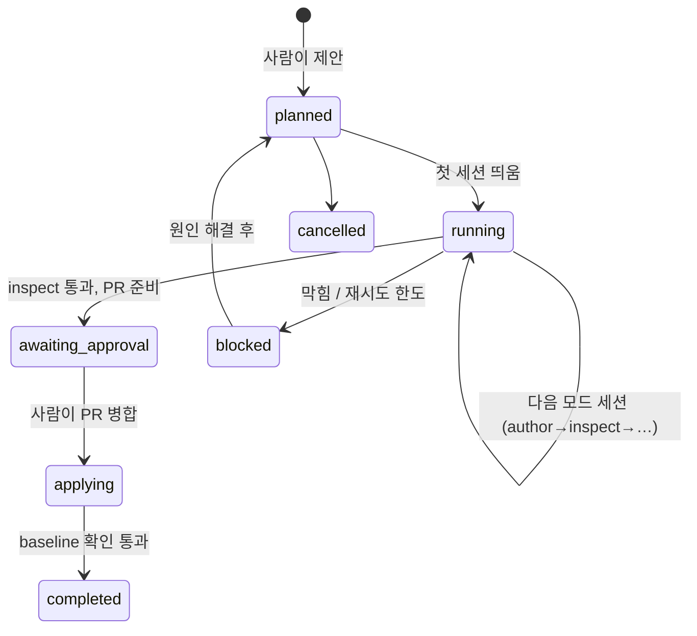
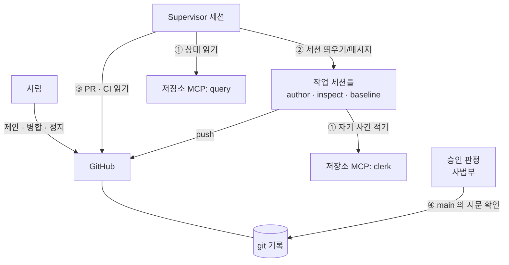

# 작업 조율(오케스트레이션) 쉽게 풀어 쓰기 — 컴퓨터 기초부터

> 2026-11-20 · develop 모드 · 사용자가 읽으려고 쓴 설명서다. 규격 문서가 아니다(규격은 PLAN-099 에서 만든다).
> 모듈별 흐름 · MCP 가 생기고 쓰이는 과정은 `docs/reports/2026-11-20-orchestration-modules-flow.md`.
> 함께 읽을 것: 결정 DEC-0064 · DEC-0065 (`node rebuild/read.mjs DEC-0064`) · 가상 실행 보고서 `docs/reports/2026-11-20-orchestration-tabletop.md`

이 문서는 다섯 부분이다.

1. 먼저 알아야 할 낱말 — 컴퓨터 기초
2. 지금 이 저장소는 어떻게 일하나
3. 우리가 만들려는 것 — 작업 조율
4. 한 바퀴 따라가 보기 — cAMP 예시
5. MCP 와의 관계, 그리고 남은 결정

---

## 1. 먼저 알아야 할 낱말

### 1.1 저장소 · 파일 · 커밋 · 브랜치

| 낱말 | 쉬운 뜻 | 비유 |
|---|---|---|
| **저장소 (repository)** | 이 프로젝트의 모든 파일과, 그 파일들이 바뀌어 온 기록 전부를 담은 상자. 우리 것은 GitHub 의 `make-bio-database` | 연구실의 실험 노트 전체 + 모든 판(版)의 사본 |
| **git** | 파일이 언제 · 누가 · 어떻게 바뀌었는지를 기록하는 프로그램 | 노트의 "고친 날짜와 고친 사람" 을 자동으로 적어 주는 비서 |
| **커밋 (commit)** | "지금 파일 상태를 한 장 사진으로 찍어 두기". 사진마다 설명 글과 고유 번호(예: `c8f61f5`)가 붙는다 | 노트 한 쪽을 다 쓰고 서명 · 날짜를 적는 것 |
| **브랜치 (branch)** | 원본을 건드리지 않고 따로 고쳐 보는 갈래 길. 원본 갈래 이름은 `main` | 원본 노트는 그대로 두고 복사본에 초안을 쓰는 것 |
| **main** | 공식 원본 갈래. **여기 들어간 것만 "진짜"** 로 친다 | 연구실의 공식 노트 |
| **push** | 내 컴퓨터(또는 클라우드 상자)에서 만든 커밋을 GitHub 로 올려 보내기 | 초안 복사본을 공용 책장에 꽂기 |
| **PR (pull request)** | "내 갈래에서 고친 것을 main 에 넣어 주세요" 라는 요청서. 무엇이 바뀌었는지 한 화면에 보여 준다 | 초안을 들고 가서 "공식 노트에 옮겨도 될까요?" 하고 묻는 결재 서류 |
| **병합 (merge)** | PR 을 받아들여 고친 내용을 main 에 실제로 넣는 것. **버튼은 사람이 누른다** | 책임자가 결재 도장을 찍고 공식 노트에 옮겨 적는 것 |
| **CI** | PR 이나 push 가 올 때마다 GitHub 가 자동으로 시험을 돌려 주는 것. 우리는 `.github/workflows/check.yml` | 결재 전에 서류 형식이 맞는지 자동으로 검사하는 창구 |

### 1.2 데이터를 담는 모양

| 낱말 | 쉬운 뜻 | 예 |
|---|---|---|
| **JSON** | 컴퓨터가 읽기 쉬운 글 모양. `{ "이름": 값 }` 처럼 칸 이름과 값을 짝지어 적는다 | `{"from":"author","to":"inspect"}` |
| **JSONL** | JSON 을 **한 줄에 하나씩** 이어 적은 파일. 새 일이 생기면 맨 아래에 한 줄 더 붙인다 | `workspace/transitions.jsonl` (전환 기록) |
| **장부 (ledger)** | 덧붙이기만 하고 지우거나 고치지 않는 기록. 지금 상태는 장부를 처음부터 차례로 읽어서 계산한다 | 은행 통장: 입출금 줄을 다 더하면 잔액이 나온다. 잔액을 따로 적지 않는다 |
| **생성물** | 사람이 손으로 쓰지 않고, 원본(장부)에서 프로그램이 만들어 내는 문서 | `docs/plan/ORDER.md` 는 계획 장부에서 만들어진다 |
| **지문 (해시 · digest · sha256)** | 파일 내용을 넣으면 나오는 긴 고유 번호. 내용이 한 글자만 바뀌어도 번호가 완전히 달라진다 | 서류의 지문. 지문이 같으면 같은 서류다 |

### 1.3 프로그램과 AI 쪽 낱말

| 낱말 | 쉬운 뜻 | 비유 |
|---|---|---|
| **세션 (session)** | AI(Claude)와 한 번 이어지는 대화 하나. 세션마다 자기만의 작업 상자(컨테이너)가 있다 | 연구원 한 명이 한 번 출근해서 일하는 하루 |
| **클라우드 세션** | 내 컴퓨터가 아니라 Anthropic 서버의 상자에서 돌아가는 세션. 지금 이 대화가 그것이다 | 원격 연구실 |
| **컨테이너** | 세션이 쓰는 임시 컴퓨터. 세션이 끝나면 사라지므로, 남길 것은 push 해야 한다 | 하루 빌려 쓰는 실험대 — 퇴근하면 치워짐 |
| **명령 (command)** | 프로그램에게 시키는 한 줄. 예: `node dbtool.mjs validate` | 실험 장비의 버튼 하나 |
| **시험 (test)** | 프로그램이 제대로 하는지 자동으로 확인하는 작은 검사들. 우리는 500 개쯤 | 장비 점검표 |
| **서버** | 늘 켜져 있으면서 요청이 오면 답하는 프로그램 | 창구 직원 |
| **도구 (tool)** | 서버가 AI 에게 내미는 "할 수 있는 일" 목록의 한 항목. AI 는 도구를 골라 부른다 | 창구에 붙은 업무 목록 하나 ("서류 발급", "조회") |
| **MCP** | AI 와 도구 서버가 대화하는 **약속된 말투**(규격). 이 말투를 지키면 어떤 AI 든 어떤 도구 서버든 붙일 수 있다 | 콘센트 규격. 규격이 같으면 아무 기계나 꽂힌다 |
| **환경 변수** | 프로그램을 켤 때 함께 건네주는 짧은 설정 값. 예: `BIODB_ROLE=collector` | 출근할 때 받는 이름표 |
| **역할 (role)** | 누가 무엇을 할 수 있는지의 구분. 우리 MCP 에는 collector(수집가) · integrator(통합가) · human(사람) | 연구원 · 책임 연구원 · 실장 |

---

## 2. 지금 이 저장소는 어떻게 일하나

### 2.1 세 권력 나누기 (삼권 분립)

이 저장소는 국가 권력처럼 일을 셋으로 나눠 서로 견제하게 만들어 두었다.

| 이름 | 하는 일 | 저장소의 자리 | 하지 않는 일 |
|---|---|---|---|
| **행정부** | 엔진이 시뮬레이션을 계산한다 | `core.js` · `engine/` | 파일을 쓰지 않고 판정하지 않는다 |
| **사법부** | 결과와 데이터가 규칙에 맞는지 판정한다 | `judicial/` | 실행하지 않고 쓰지 않는다 |
| **입법(서기)** | 판정을 통과한 것만 파일에 쓴다. **쓰는 문은 여기 하나** | `legislative/clerk.mjs` | 스스로 판단하지 않는다 |

`orchestrator.js`(조정자) 는 이 셋을 이어 주는 배선이다. **이 파일은 생물 시뮬레이션용이고, 이번에 만드는 "작업 조율" 과는 다른 것이다** — 그래서 새것은 이름을 `orch`(조율)로 구분한다.

### 2.2 모드 — 한 세션은 한 가지 일만

AI 세션은 시작할 때 모드 하나를 고른다 (`node rebuild/gate.mjs open <모드>`). **문지기**(`rebuild/gate.mjs`)가 그 모드가 쓸 수 있는 자리 밖의 쓰기를 막는다.

| 모드 | 하는 일 | 쓸 수 있는 곳 (요약) |
|---|---|---|
| author (정보 작성) | 문헌에서 출처를 찾아 데이터에 넣는다 | `data/` · 핸드오프 · 보고서 |
| inspect (점검) | 모은 것이 맞는지 판정하고 도장을 찍는다 | 도장(`attestations/`) · 보고서 |
| baseline (기초시험) | 시뮬레이션을 돌려 관찰과 맞는지 본다 | 시나리오 · 사전 등록 · 보고서 |
| develop (디벨롭) | 프로그램 코드를 고친다 (사용자가 요청할 때만) | 코드 대부분 (데이터 · 문지기는 빼고) |
| field (적분장) | 다음 엔진 시제품 | 엔진 · 시험 |

**모든 모드가 공통으로** 쓸 수 있는 곳도 있다: 계획 장부(`rebuild/state/`), 계획 문서(`docs/plan/`), 전환 기록(`workspace/transitions.jsonl`), 영수증(`workspace/receipts/`).

다른 모드가 필요하면 세션은 **전환 기록**을 한 줄 남기고 끝난다. 다음 세션은 그 한 줄만 받고 새 모드로 시작한다. 예: 기록 #8 은 "baseline 에서 cAMP 경로 출처가 0 인 걸 봤다 → author 가 출처를 달아라".

### 2.3 이미 있는 기록 넷

| 기록 | 무엇 | 비유 |
|---|---|---|
| `workspace/tasks/TASK-*.md` | 수집가에게 주는 일감 설명서 | 작업 지시서 |
| `workspace/handoff/` | 수집가가 모은 결과와 그 상태(collected → verified/rejected → applied) | 납품함 |
| `workspace/transitions.jsonl` | 모드 사이 넘김 기록 | 교대 근무 인수인계 장부 |
| `workspace/receipts/` | 세션이 부른 모든 도구 · 명령의 영수증 (문지기 훅이 자동으로 적음) | CCTV 기록 |

### 2.4 지금 무엇이 불편한가

지금은 **사람이** 세션을 하나씩 열고, 전환 기록을 읽고, 다음 모드를 고르고, 결과를 확인한다. 일 하나(예: cAMP 출처 달기)가 author → inspect → baseline 처럼 여러 세션을 거치면, "이 일이 지금 어디까지 왔나" 를 한눈에 볼 곳이 없다.

---

## 3. 우리가 만들려는 것 — 작업 조율

### 3.1 한 문장으로

**여러 모드 세션을 차례로 띄우고, 각자의 결과를 이어 붙이고, 지금 어디까지 왔는지 기록하는 상위 관리자** — 단, DB 를 진짜로 바꾸는 마지막 한 걸음은 사람이 한다.

### 3.2 고정 조건 (사용자 결정 DEC-0064)

| 조건 | 뜻 |
|---|---|
| 자동화 범위 Hybrid | 조사 · 분석 · 배정 · 결과 모으기는 자동, 승인은 사람 |
| DB 최종 반영은 사람 승인 | AI 가 혼자 공식 데이터를 바꿀 수 없다 |
| 기존 모드 권한 유지 | 문지기 규칙을 넓히지 않는다 |
| 기존 기록 재사용 | tasks · handoff · transitions · receipts 의 역할을 바꾸지 않는다 |

### 3.3 등장인물

| 이름 | 누구 | 할 수 있는 것 | 할 수 없는 것 |
|---|---|---|---|
| **사람 (사용자)** | 당신 | 일 제안 · PR 병합(= 승인) · 언제든 정지 | — |
| **Supervisor (감독)** | AI 세션 하나 | 다음에 무슨 모드 세션을 띄울지 정하고 띄운다. 상태를 읽는다 | **파일을 쓰지 않는다.** 승인 · 병합 못 함. develop · field 는 혼자 못 띄움 |
| **작업 세션** | author · inspect · baseline 세션 | 각자 자기 모드 일. 끝나면 자기 사건 한 줄을 장부에 적는다 | 모드를 바꾸지 않는다 (한 세션 = 한 모드) |

### 3.4 상위 작업(ORCH) 과 그 상태

일 하나를 **ORCH-0001** 처럼 번호로 부른다. 기존 TASK 를 대신하지 않고, 그 위에서 "여러 세션을 거치는 큰 일" 을 묶는다.

| 상태 | 쉬운 뜻 |
|---|---|
| planned | 할 일로 적혀 있음 |
| running | 어떤 모드 세션이 일하는 중 |
| awaiting_approval | 결과가 검증됐고, 사람의 병합을 기다림 |
| applying | 병합됐음, 마지막 확인 중 |
| completed | 끝 |
| blocked | 막힘 — 사람이 봐야 함 |
| cancelled | 취소 |

끝에도 종류가 있다: 맞게 끝남 · 관찰과 안 맞는 걸 발견하고 끝남(FINDING — 고치지 않고 기록) · 출처가 없어서 한계로 등록 · 사람의 develop 요청이 필요 · 취소.

### 3.5 왜 "승인 = 사람이 병합한 PR" 인가 (가장 중요한 부분)

장부에 `"승인한 사람": "사용자"` 라고 **글자로** 적는 방식은 쓰지 않는다. 그 파일을 쓰는 게 AI 이므로, AI 가 그 글자를 적을 수도 있기 때문이다. 이것은 "틈을 악용하지 않는다"(RULE-0461) 에 걸린다.

대신 이렇게 한다.

1. 바뀔 파일들의 **지문**을 만든다 (`judicial/approval.js` 가 이미 할 줄 안다).
2. 그 지문을 적은 **PR** 을 연다.
3. **사람이** GitHub 에서 병합 버튼을 누른다. AI 는 main 에 직접 넣을 수 없고, 병합 버튼도 누르지 않는다.
4. 프로그램이 "그 지문과 똑같은 내용이 main 에 들어갔나" 를 확인한다. 들어갔으면 승인된 것이다.
5. 승인 뒤에 누가 내용을 슬쩍 바꾸면 지문이 달라지므로 승인은 무효가 된다.

즉 **승인은 적는 것이 아니라, 사람만 만들 수 있는 흔적에서 계산하는 것**이다.

---

## 4. 한 바퀴 따라가 보기 — ORCH-0001 cAMP 출처 보강

배경: cAMP 신호 경로(D000050)의 단계 규칙 7 개와 분자 설명 15 개가 모두 "출처 없이 적힘(asserted)" 상태다 (전환 기록 #8).

| 차례 | 누가 | 무엇을 | 남는 흔적 |
|---|---|---|---|
| 0 | 사람 | "cAMP 출처 달기" 를 제안 | 조율 장부에 ORCH-0001 planned |
| 1 | Supervisor | author 세션을 새로 띄우고, 전환 기록 #8 을 그대로 일감으로 건넴 | 새 세션 · 그 세션의 브랜치 |
| 2 | author 세션 | 문지기로 author 모드를 열고, Europe PMC 에서 초록을 받아 출처를 대조해 데이터에 넣음. 시험 통과 후 자기 브랜치에 push | 커밋 · 영수증 · 장부 "start" 줄 |
| 3 | author 세션 | 끝: 전환 기록 author→inspect 한 줄 + Supervisor 에게 "끝났어요" 메시지 | 전환 기록 · 장부 "handoff" 줄 |
| 4 | Supervisor | inspect 세션을 **새로** 띄움 (author 브랜치에서 시작). 같은 AI 가 자기 결과를 판정하지 않게 | 새 세션 |
| 5 | inspect 세션 | 인용과 원문 대조 · 판정 · 도장. 실패면 author 로 되돌림 (재시도는 2 번까지) | 도장 · 전환 기록 |
| 6 | (F6 결정에 따라) | 지문을 적은 PR 을 엶 | PR |
| 7 | **사람** | 승인 화면을 보고 병합 | main 의 커밋 = 승인 증거 |
| 8 | Supervisor | baseline 세션을 main 에서 띄움 → 시뮬레이션이 관찰과 맞는지 | baseline 영수증 |
| 9 | — | 통과면 completed. 안 맞으면 FINDING 으로 기록 | 장부 끝 줄 |

### 4.1 가상으로 돌려 보고 찾은 문제 (쉬운 말로)

자세한 표는 `docs/reports/2026-11-20-orchestration-tabletop.md`. 여기서는 뜻만 적는다.

| 번호 | 문제 | 쉬운 설명 | 해결 방향 |
|---|---|---|---|
| F1 | 장부를 어디에 둘까 | 새 자리를 만들면 문지기 규칙을 고쳐야 하고, 그건 당신이 GitHub 에서 직접 해야 하는 일이다. 그런데 모든 모드가 이미 쓸 수 있는 `rebuild/state/` 가 있다 | 거기에 두면 문지기를 안 고쳐도 됨 — **당신의 결정 필요** |
| F2 | 감독은 무슨 모드? | 모드 다섯 중 감독은 없다 | 감독은 아무것도 쓰지 않는다. 쓰는 건 각 작업 세션이 자기 것만 |
| F3 | 세션 번호가 두 가지 | 클라우드 세션 번호와 영수증 번호가 다르다 | 세션이 시작할 때 자기 영수증 이름을 장부에 적는다 |
| F4 | 전환 기록에 ORCH 번호를 못 넣음 | 전환 기록 검사가 정해진 칸 7 개만 받는다 | 반대로 조율 장부가 전환 기록 번호를 가리킨다 |
| F5 | 세션이 끝났는지 모름 | 띄운 세션이 조용히 끝날 수 있다 | 끝날 때 메시지를 보내고, 감독은 20 분쯤 뒤에 다시 확인 |
| F6 | PR 을 누가 여나 | 규칙상 PR 은 **당신이 요청할 때만** AI 가 연다 (RULE-0257) | 당신이 열거나, "승인 PR 만은 감독이 열어도 된다" 는 상시 허락을 적는다 — **결정 필요** |
| F7 | 병합 방식이 여러 가지 | 병합 버튼에 세 가지 방식이 있어 커밋 모양이 다르다 | 모양 대신 "같은 내용이 main 에 들어갔나" 로 판정 |
| F8 | 장부 줄 번호가 겹침 | 두 갈래에서 동시에 장부에 줄을 붙이면 합칠 때 번호가 겹친다 | 한 번에 일 하나씩 + 줄 번호 대신 겹치지 않는 이름을 쓴다 |
| F9 | 결과 기록에 PR 이 또 필요 | baseline 보고서를 main 에 넣으려면 PR 이 또 생긴다 | 완료 판정은 영수증으로, 보고서는 다음 PR 에 묶어서 |
| F10 | 끝이 "완료" 하나뿐 | 실제로는 여러 끝이 있다 | 끝의 종류 다섯을 둔다 (3.4) |
| F11 | develop 은 자동 불가 | develop 은 당신이 요청할 때만 연다 | 자동으로는 author · inspect · baseline 만 띄운다 |
| F12 | 멈출 손잡이 | 자동이 폭주하면 막을 장치가 필요하다 | 정지 스위치 하나 · 세션 수 한도 · 재시도 2 번 · 시간 제한 |
| F13 | push 실패 | 11/3 에 예약 작업이 "성공" 이라 했는데 push 가 막혀 결과가 사라졌다 (PLAN-077) | 세션이 시작하자마자 push 가 되는지부터 확인 |

---

## 5. MCP 와의 관계, 그리고 남은 결정

### 5.1 이 저장소의 MCP 서버 넷

AI 가 저장소를 다룰 때 쓰라고 만들어 둔 창구들이다 (`mcp/`).

| 서버 | 하는 일 | 쓰기 |
|---|---|---|
| `query` | 데이터 조회 (요약 · 기전 · 한계 …) | 안 함 |
| `run` | 엔진 실행해서 예측 돌려주기 | 안 함 |
| `clerk` (서기) | **저장소를 바꾸는 유일한 문**. 부를 때마다 사법부 검사를 다시 돌린 뒤 쓴다 | 함 — 딱 하나 |
| `fetch` | 바깥 문헌(Europe PMC 등) 받아 오기 | 증거 구역만 |

### 5.2 조율이 붙어야 하는 네 층

조율은 MCP "하나" 가 아니라 네 층에 손을 뻗는다.

| 층 | 무엇 | 비유 |
|---|---|---|
| ① 데이터 · 장부 | 저장소 MCP (`query` 로 읽고, `clerk` 로 쓰고) | 서류 창구 |
| ② 세션 다루기 | 클라우드 세션 도구 (세션 띄우기 · 메시지 · 상태 보기) — 감독만 가짐 | 연구원 호출 버튼 |
| ③ 코드 호스트 | GitHub (PR · CI 상태 읽기) — 병합 버튼은 절대 안 누름 | 결재 시스템 |
| ④ 증거 | git 기록 자체 — 승인 판정이 직접 읽음 | 공식 노트 원본 |

### 5.3 지금 빠진 연결 두 가지

| 빠진 것 | 왜 문제인가 | 제안 |
|---|---|---|
| **모드와 MCP 역할이 따로 논다** | 모드는 문지기가, MCP 역할은 이름표(환경 변수)가 정한다. 이름표는 **켜는 쪽이 스스로 적는다** — AI 가 자기를 "human" 이라 적을 수도 있다. 그래서 MCP 역할은 승인 증거가 될 수 없다 (그래서 승인은 PR 병합으로) | 역할을 "지금 열린 모드" 에서 계산한다 (author 세션이면 author 도구만 보이게) |
| **`.mcp.json` 이 없다** | 이 파일이 MCP 서버를 세션에 꽂아 주는 설정인데 없다. 그래서 감독이 띄운 작업 세션들이 이 도구를 못 쓰고 명령으로 돌아간다 | 서버 넷을 등록하는 설정을 만든다 — 권한이 넓어지는 변경이라 당신의 승인을 거쳐서 |

### 5.4 계획 순서 (지금)

| 순서 | 작업 | 쉬운 뜻 |
|---|---|---|
| 1 | PLAN-099 조율 규격 | 위의 규칙을 정식 설계 문서로 |
| 2 | PLAN-100 조율 장부 + 명령 | 장부 파일과 그걸 쓰는 명령 · MCP 도구 |
| 3 | PLAN-102 승인 증거 판정 | "main 에 같은 지문이 들어갔나" 를 계산하는 프로그램 |
| 4 | PLAN-077 (이미 있던 일) | push 가 막혀 결과가 사라지는 문제 해결 |
| 5 | PLAN-101 승인 PR 권한 | F6 결정을 규칙으로 |
| (제안) | PLAN-105 MCP 연결 | 5.3 의 두 가지 — 아직 계획에 안 넣음 |
| 6 | PLAN-103 첫 바퀴 (손으로) | cAMP 로 실제 한 바퀴 |
| 7 | PLAN-104 자동 배정 | 첫 바퀴에서 깨진 곳만 고쳐서 자동으로 |

### 5.5 당신이 정해야 할 것 셋

| 질문 | 고르면 생기는 일 | 추천 |
|---|---|---|
| **F1** 장부를 `rebuild/state/` 에 둘까? | 예 → 문지기 안 고침, 바로 진행. 아니오 → 새 자리를 만들고, 문지기 수정을 당신이 GitHub 에서 직접 커밋 | 예 |
| **F6** 승인 PR 을 누가 열까? | 당신 → 매번 당신이 "PR 열어" 라고 하거나 직접 엶. 상시 허락 → 감독이 승인 PR 만 열 수 있고, 언제든 철회 가능. 병합은 어느 쪽이든 당신만 | 첫 바퀴는 당신, 그 뒤 상시 허락 검토 |
| **PLAN-105** MCP 연결을 계획에 넣을까? | 예 → 첫 바퀴 전에 작업 세션들이 MCP 도구를 쓰게 됨 | 예 |
