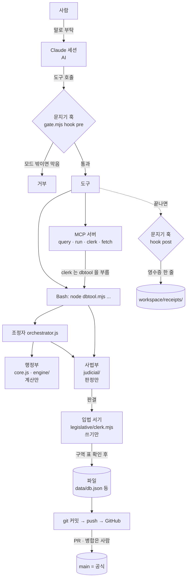
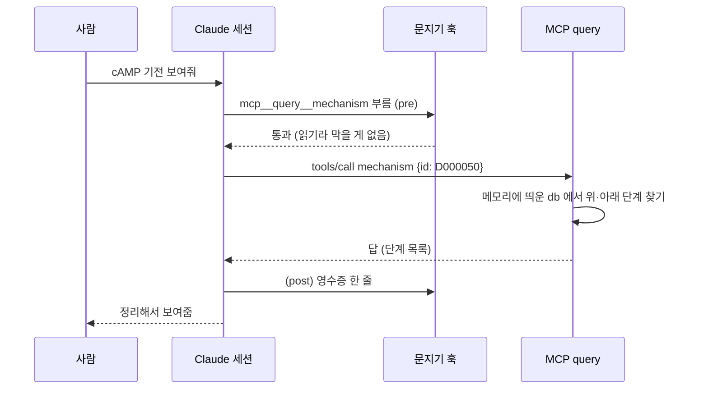
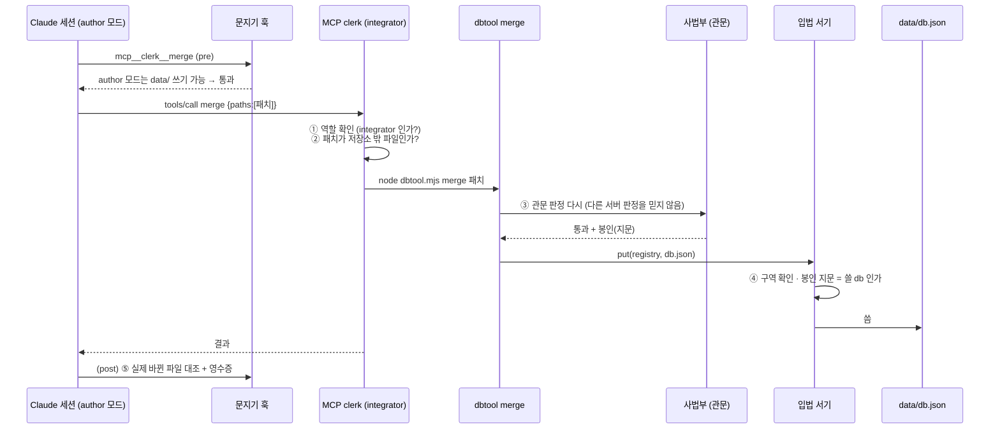
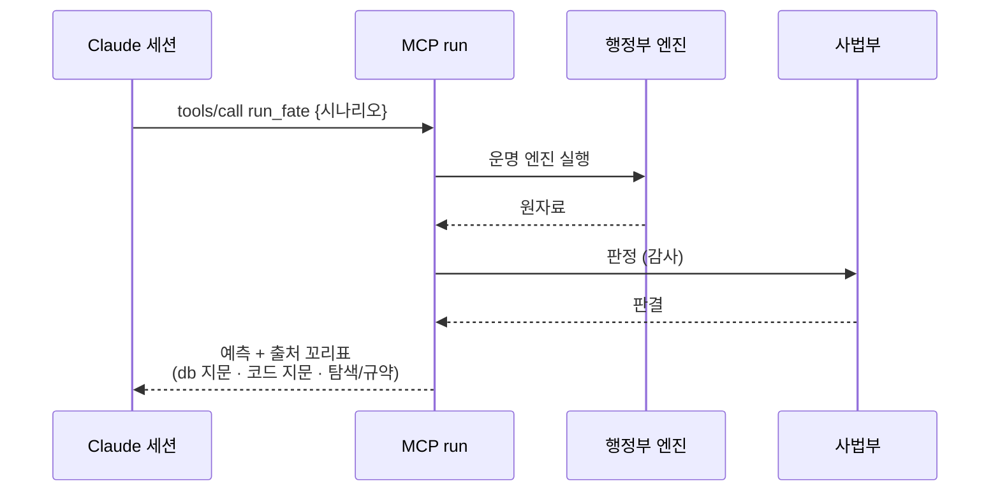
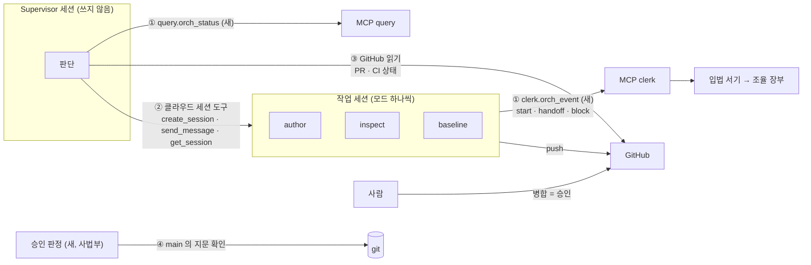

# 모듈과 흐름 — 요청 하나가 어디를 지나가나, MCP 는 어떻게 생기고 어떻게 쓰이나

> 2026-11-20 · develop 모드 · 사용자 읽기용 설명서. 낱말 풀이는 `docs/reports/2026-11-20-orchestration-explained.md` 1장.
> 이 문서는 코드를 읽고 쓴 것이다 — 근거 파일: `mcp/protocol.mjs` · `mcp/clerk.mjs` · `mcp/query.mjs` · `mcp/run.mjs` · `mcp/fetch.mjs` · `legislative/clerk.mjs` · `rebuild/gate.mjs` · `.claude/settings.json` · `dbtool.mjs` · `orchestrator.js`

읽는 순서:

1. 큰 그림 한 장
2. 모듈 하나씩 — 무엇을 받고, 무엇을 내고, 누구와 이어지나
3. 요청 세 개를 따라가 보기 — 조회 · 쓰기 · 엔진 실행
4. MCP 는 어떻게 생기나 — 켜짐부터 답까지
5. MCP 는 어떻게 쓰이나 — 지금, 그리고 작업 조율 뒤
6. 지키는 문 네 겹과 빈 곳

---

## 1. 큰 그림 한 장



한 줄로: **AI 가 부탁을 받으면 → 문지기를 지나 → 도구(명령 또는 MCP)를 부르고 → 계산(행정) · 판정(사법) · 쓰기(서기)가 차례로 일하고 → 영수증이 남고 → git 으로 올라가서 → 사람이 병합해야 공식이 된다.**

---

## 2. 모듈 하나씩

각 모듈을 "가게" 로 생각하면 쉽다. 가게마다 **받는 것 · 내는 것 · 앞집(누가 나를 부르나) · 뒷집(내가 누구를 부르나)** 이 있다.

### 2.1 Claude 세션 (AI)

| 항목 | 내용 |
|---|---|
| 하는 일 | 사람의 부탁을 듣고, 어떤 도구를 부를지 고른다 |
| 받는 것 | 사람의 말 · 도구가 돌려준 답 |
| 내는 것 | 도구 호출 (Bash 명령 · 파일 고치기 · MCP 도구) |
| 앞집 | 사람 |
| 뒷집 | 문지기 훅을 지나 도구들 |
| 중요한 점 | AI 는 스스로 파일을 "직접" 쓰는 게 아니라 **늘 도구를 통해서** 쓴다. 그래서 도구 앞에 문지기를 세우면 모든 쓰기를 잡을 수 있다 |

### 2.2 문지기 (`rebuild/gate.mjs`) + 훅

| 항목 | 내용 |
|---|---|
| 하는 일 | 세션이 연 모드를 기억하고, 그 모드가 쓸 수 없는 자리를 쓰려 하면 막는다. 모든 도구 호출을 영수증에 적는다 |
| 어떻게 끼어드나 | `.claude/settings.json` 의 **훅(hook)**. 훅은 "도구가 불리기 직전 · 직후 · 세션이 멈출 때 자동으로 돌아가는 작은 프로그램" 이다. 우리 설정은 `Bash · Edit · Write · MultiEdit · NotebookEdit · mcp__.*` 를 부를 때마다 `node rebuild/gate.mjs hook pre` (직전) 와 `hook post` (직후) 를 돌린다 |
| pre (직전) | "이 모드에서 이 자리에 써도 되나?" — 안 되면 도구 호출 자체를 거부 |
| post (직후) | 실제로 바뀐 파일을 대조하고(명령이 몰래 다른 자리를 썼는지) 영수증 한 줄을 덧붙인다 |
| stop | 세션이 멈출 때 마무리 기록 |
| 받는 것 | 도구 이름 · 인자 · 지금 모드 (`gate open` 때 기록됨) |
| 내는 것 | 통과/거부 · 영수증 (`workspace/receipts/<날짜>-<세션>.jsonl` 과 사람용 `.md`) |
| 규칙 원본 | `rebuild/rules/modes.json` 의 `gate` (모드별 쓰기 자리 목록) |
| finish | `gate finish <모드>` — 그 모드의 시험 묶음이 통과해야 커밋이 열린다 |

> **훅이 `mcp__.*` 도 잡는다** — 그래서 MCP 도구를 불러도 문지기와 영수증을 피할 수 없다.

### 2.3 dbtool (`dbtool.mjs`) — 명령 창구

| 항목 | 내용 |
|---|---|
| 하는 일 | 사람이나 AI 가 치는 명령 하나하나(`validate` · `merge` · `transition` · `attest` …)를 받아 맞는 모듈로 보낸다 |
| 받는 것 | 명령 줄 (예: `node dbtool.mjs merge 패치.json`) |
| 내는 것 | 화면 출력 · 종료 코드(0 = 성공) |
| 뒷집 | 조정자 · 사법부 · 입법 서기 |
| 앞집 | 사람 · AI(Bash) · **MCP clerk 서버** (clerk 는 dbtool 을 그대로 부른다 — 같은 일을 두 번 만들지 않으려고) |

### 2.4 조정자 (`orchestrator.js`) — 시뮬레이션 배선

| 항목 | 내용 |
|---|---|
| 하는 일 | 엔진(행정부)을 돌리고, 그 원자료를 사법부에 넘겨 판정받는다 |
| 하지 않는 일 | 쓰지도 판정하지도 않는다 |
| 주의 | 이름이 "오케스트레이터" 지만 **생물 시뮬레이션용**이다. 이번에 만드는 **작업 조율(`orch`)과 다른 것** |

### 2.5 행정부 (`core.js` · `engine/`)

| 항목 | 내용 |
|---|---|
| 하는 일 | 시뮬레이션 계산 (운명 엔진 · 속도 엔진 · 확률 앙상블) |
| 받는 것 | db · 시나리오 |
| 내는 것 | 원자료 (시간에 따른 분자 수 등) |
| 하지 않는 일 | 파일 쓰기 · 판정 |

### 2.6 사법부 (`judicial/`)

| 항목 | 내용 |
|---|---|
| 하는 일 | 규칙에 맞는지 판정한다. 패치 관문 · 전환 기록 검사 · 도장 확인 · 승인 묶음 지문(`approval.js`) … |
| 받는 것 | 값 (데이터 · 원자료 · 변경 목록) |
| 내는 것 | 판결 (통과/거부 + 이유 + 규칙 번호) · 봉인(판결에 붙는 지문) |
| 하지 않는 일 | 엔진 실행 · 파일 쓰기. **순수** — 같은 입력이면 늘 같은 답 |

### 2.7 입법 서기 (`legislative/clerk.mjs`) — 쓰는 문은 여기 하나

| 항목 | 내용 |
|---|---|
| 하는 일 | 판결이 붙은 것만, 정해진 **구역**에만 쓴다 |
| 구역 표 (`ZONES`) | registry(db · 패치 · 사전 · 가정 · 사전 등록) · attestation(도장) · evidence(받은 원문) · derived(파생 문서) · report(보고서) · handoff(수집 후보) · transition(전환 기록) · receipt(영수증) · ledger(규칙 장부) · rebuild(계획 · 상태) · draft(저장소 밖만) |
| 모든 쓰기 | `put(구역, 파일)` 하나를 지난다. 그 구역의 자리가 아니면 **거부** |
| 하지 않는 일 | 판단. 서기는 검사를 만들지 않는다 — 사법부가 준 판결만 본다 |
| 잠금 | MCP clerk 서버가 켜질 때 `writerLock` — **저장소 하나에 쓰는 프로그램은 하나만** |

### 2.8 MCP 틀 (`mcp/protocol.mjs`)

| 항목 | 내용 |
|---|---|
| 하는 일 | 네 서버가 같이 쓰는 "말투" 처리기. 요청을 읽고, 역할에 맞는 도구만 보여 주고, 부르면 실행하고, 답을 보낸다 |
| 받는 것 | 한 줄짜리 JSON 메시지 (표준 입력) |
| 내는 것 | 한 줄짜리 JSON 답 (표준 출력) |
| 역할 | `BIODB_ROLE` 환경 변수 — collector(기본, 가장 좁음) · integrator · human |
| 다루는 메시지 | initialize · ping · tools/list · tools/call — 이것만 |
| 순서 | 요청을 **한 번에 하나씩** 처리한다 — 답의 순서가 요청 순서와 같다 |

### 2.9 MCP 서버 넷 (`mcp/`)

| 서버 | 도구 (예) | 쓰기 | 누구 |
|---|---|---|---|
| `query` | summary · map · context · mechanism · limitations · origin · qualgraph · inbox · verify_collection … | 없음 | 모든 역할 |
| `run` | run_fate · run_ensemble · run_rate (결과에 출처 꼬리표: db 지문 · 코드 지문 · 탐색/규약 구분) | 없음 | 모든 역할 |
| `fetch` | 문헌 초록 · 공개 전문 받기 | 증거 구역만 (받기 기록 사슬) | 수집가 |
| `clerk` | put_handoff (모든 역할) · validate_patch · merge · augment_apply · register · assume_add · dictionary_add · accept · attest · write_derived (integrator · human 만) | **있음 — 유일한 문** | 역할별 |

### 2.10 장부들 (파일)

| 파일 | 무엇 | 누가 쓰나 |
|---|---|---|
| `data/db.json` | 생물 데이터 본체 | 서기 (관문 봉인 통과 시) |
| `attestations/registry.json` | 도장 | 서기 (도장 재확인 통과 시) |
| `workspace/handoff/` | 수집 후보 | 서기 (put_handoff) |
| `workspace/transitions.jsonl` | 모드 넘김 | 서기 (전환 검사 통과 시) |
| `workspace/receipts/` | 영수증 | 문지기 훅 |
| `rebuild/state/plans.jsonl` · `plan-log.jsonl` | 계획 | 서기 (`plan.mjs apply` 검사 통과 시) |

### 2.11 git · GitHub

| 항목 | 내용 |
|---|---|
| 하는 일 | 파일 변경을 커밋으로 묶고, 갈래(브랜치)로 올리고, PR 로 main 에 넣기를 요청 |
| 지키는 것 | AI 는 **자기 브랜치에만** push. main 병합은 사람 |
| CI | PR · push 때 GitHub 가 시험 전부를 다시 돌림 (`.github/workflows/check.yml`) |

---

## 3. 요청 세 개를 따라가 보기

### 3.1 조회 — "cAMP 경로의 기전 보여줘"



거친 모듈: AI → 훅 → query 서버 → (db 읽기) → AI → 훅(영수증). **파일은 하나도 안 바뀜.**

### 3.2 쓰기 — "검증된 출처 패치를 db 에 넣어"

가장 많은 모듈을 지나는 흐름이다.



그다음: `gate finish author` (시험 통과해야 커밋) → 커밋 → `finish --full` → 자기 브랜치에 push → (PR) → **사람이 병합** → main 에 들어감.

**문이 다섯 번 닫혀 있다**: ① 서버의 역할 확인 ② 파일 위치 확인 ③ 사법부 재판정 ④ 서기의 구역 · 봉인 확인 ⑤ 훅의 사후 대조. 그리고 마지막에 사람의 병합.

### 3.3 엔진 실행 — "LPS 시나리오 돌려 봐"



쓰기 없음. 꼬리표 덕분에 **"어느 데이터 · 어느 코드로 나온 숫자인지"** 를 나중에 되짚을 수 있다. 사전 등록이 없으면 `exploration`(탐색) 표시가 붙어 "맞다/틀리다" 결론을 낼 수 없다.

---

## 4. MCP 는 어떻게 생기나 — 켜짐부터 답까지

### 4.1 단계

| 단계 | 무엇이 일어나나 | 코드 |
|---|---|---|
| ① 등록 | Claude Code 의 설정 파일(`.mcp.json`)에 "이 서버를 이렇게 켜라" 를 적는다. 예: 명령 `node mcp/query.mjs`, 환경 변수 `BIODB_ROLE=integrator` | **지금 이 파일이 없다** (5.3) |
| ② 켜짐 | 세션이 시작되면 Claude Code 가 그 명령으로 서버 프로그램을 켠다. 서버는 꺼질 때까지 계속 떠 있다 | `serve({...})` |
| ③ 역할 정하기 | 서버가 켜질 때 환경 변수 `BIODB_ROLE` 를 읽어 역할을 정한다. 없으면 가장 좁은 `collector` | `roleOf()` |
| ④ 도구 거르기 | 서버의 도구 목록 중 그 역할이 쓸 수 있는 것만 남긴다 | `tools.filter(t => t.roles.includes(role))` |
| ⑤ 파이프 연결 | Claude Code 와 서버가 **표준 입출력**(프로그램끼리 글을 주고받는 통로 두 개: 들어오는 쪽 stdin, 나가는 쪽 stdout)으로 이어진다. 한 줄 = 메시지 하나 | `readline` |
| ⑥ 인사 | Claude Code 가 `initialize` 를 보내고, 서버가 이름 · 버전 · 말투 판 · 안내문을 답한다 | `method === 'initialize'` |
| ⑦ 목록 | Claude Code 가 `tools/list` 를 보내면 ④ 에서 남은 도구만 알려준다. **AI 는 이 목록에 있는 도구만 안다** | `tools/list` |
| ⑧ 부르기 | AI 가 도구를 고르면 `tools/call` 이 간다. 목록에 없는 도구면 **부르는 자리에서도 거부** (숨기기만 하지 않는다) | `tools/call` |
| ⑨ 답 | 도구가 돌려준 글(과 구조 자료)을 한 줄 JSON 으로 보낸다. 오류면 `isError: true` | `reply()` |

### 4.2 실제 메시지 모양 (예)

```text
→ {"jsonrpc":"2.0","id":1,"method":"initialize","params":{"protocolVersion":"2025-06-18"}}
← {"jsonrpc":"2.0","id":1,"result":{"protocolVersion":"2025-06-18","serverInfo":{"name":"biodb-clerk","version":"1"},"instructions":"입출력기 — ... (역할 collector)"}}

→ {"jsonrpc":"2.0","id":2,"method":"tools/list"}
← {"jsonrpc":"2.0","id":2,"result":{"tools":[{"name":"put_handoff", ...}]}}        ← collector 라 이것 하나만

→ {"jsonrpc":"2.0","id":3,"method":"tools/call","params":{"name":"merge","arguments":{"paths":["/tmp/p.json"]}}}
← {"jsonrpc":"2.0","id":3,"result":{"content":[{"type":"text","text":"도구 'merge' 은 역할 collector 에게 없음"}],"isError":true}}
```

`→` 는 Claude Code 가 보낸 것, `←` 는 서버의 답. `id` 로 질문과 답을 짝짓는다. 이 말투의 이름이 **JSON-RPC 2.0** 이고, MCP 는 그 위에 "initialize · tools/list · tools/call" 같은 약속을 얹은 것이다.

### 4.3 왜 서버를 넷으로 나눴나 (설계 `docs/design/outsourcing-and-mcp.md` §4)

| 기준 | 결과 |
|---|---|
| 쓰기는 순서가 하나여야 한다 (해시 사슬) | 쓰는 서버는 `clerk` **정확히 하나** + 잠금 |
| 읽기는 빠르게, 많이 | `query` 는 db 를 메모리에 띄워 두고 조회만. 파일이 바뀌면(크기 · 시각) 다음 호출에서 다시 읽음 |
| 엔진은 무겁고 쓰기가 없다 | `run` 따로 |
| 바깥과 말하는 것은 따로 기록 | `fetch` 따로 (받을 때마다 받기 기록) |
| 권한별로 서버를 또 나누지 않는다 (사용자 결정 2026-10-23) | 같은 서버가 **역할로** 보이는 도구를 거름 |

---

## 5. MCP 는 어떻게 쓰이나

### 5.1 지금 (설계상)

| 누가 | 역할 | 쓰는 서버 · 도구 | 못 하는 것 |
|---|---|---|---|
| 수집가 (싼 모델 세션) | collector | fetch(문헌 받기) · query(조회) · clerk.put_handoff(후보 붙이기) | db 병합 · 도장 |
| 통합가 (Claude 주 세션) | integrator | 위 전부 + clerk 의 merge · augment_apply · register · accept … | `allow_warnings` (사람만) |
| 사람 | human | 전부 | — |

### 5.2 작업 조율 뒤 — 무엇이 더 붙나



| 층 | 새로 붙는 것 | 어느 모듈에 | 왜 거기 |
|---|---|---|---|
| ① 저장소 MCP | `query.orch_status` · `orch_list` (읽기) / `clerk.orch_event` (쓰기 — start · handoff · block · cancel, **approve 없음**) | `mcp/query.mjs` · `mcp/clerk.mjs` → `dbtool orch` → 사법부 검사 → 서기 | 쓰기는 서기 하나라는 원칙 그대로. 명령과 MCP 도구가 **같은 함수 하나**를 부름 |
| ② 세션 다루기 | 클라우드 세션 띄우기 · 메시지 · 상태 보기 | Supervisor 세션만 | 저장소 MCP 는 로컬 프로그램이라 다른 세션을 띄울 수 없다 |
| ③ GitHub | PR · CI 상태 읽기 | Supervisor 세션 | 병합 도구는 절대 쓰지 않는다 |
| ④ 승인 판정 | "지문과 같은 내용이 main 에 들어갔나" | 새 사법부 모듈 (순수) + git 읽기는 조율 쪽 | MCP 역할은 스스로 적는 이름표라 증거가 못 된다 → git 기록으로 |

### 5.3 한 바퀴를 모듈 단위로 (ORCH-0001 cAMP)

| 차례 | 모듈 경로 | 남는 것 |
|---|---|---|
| 1 | 사람 → Supervisor → (② 세션 도구) → author 세션 시작 | 새 세션 |
| 2 | author 세션 → 훅(open author) → `clerk.orch_event start` → 서기 → 조율 장부 | 장부 줄 · 영수증 |
| 3 | author → `fetch` (Europe PMC 초록) → 서기(증거 구역) | 받은 원문 · 받기 기록 |
| 4 | author → `clerk.augment_apply` → dbtool → 사법부 관문 → 서기 → db.json | db 변경 · 영수증 |
| 5 | author → `gate finish` → 커밋 → push(자기 브랜치) → `dbtool transition`(author→inspect) → `clerk.orch_event handoff` | 커밋 · 전환 기록 · 장부 줄 |
| 6 | Supervisor → (② 세션 도구) → inspect 세션 (author 브랜치에서) | 새 세션 |
| 7 | inspect → `query.verify_collection` · 인용 대조 → `clerk.accept` → 서기 → 도장 | 도장 · 영수증 |
| 8 | (PR — F6 결정) → **사람 병합** | main 커밋 |
| 9 | Supervisor → ④ 승인 판정 (git 읽기 → 사법부) → "승인됨" 계산 | 장부에는 안 적음 — 계산값 |
| 10 | Supervisor → baseline 세션 → `run.run_fate` · 사전 등록 → 보고서 | 영수증 · 보고서 |

---

## 6. 지키는 문 네 겹과 빈 곳

### 6.1 네 겹

| 겹 | 누가 | 무엇을 보나 | 어디 |
|---|---|---|---|
| 1 | 문지기 훅 | **모드** — 이 모드가 이 자리를 써도 되나 | `rebuild/gate.mjs` + `.claude/settings.json` |
| 2 | MCP 서버 | **역할** — 이 역할이 이 도구를 볼 수 있나 | `mcp/protocol.mjs` |
| 3 | 사법부 | **내용** — 규칙에 맞나 (관문 · 봉인 · 도장) | `judicial/` |
| 4 | 입법 서기 | **자리** — 이 구역에 쓸 수 있나, 봉인 지문이 맞나 | `legislative/clerk.mjs` |
| + | 사람 | **공식** — main 병합 | GitHub |

### 6.2 빈 곳 (작업 조율 전에 메울 것 — 제안 PLAN-105)

| 빈 곳 | 쉬운 설명 | 위험 | 메우는 법 |
|---|---|---|---|
| 겹 1 과 겹 2 가 따로 논다 | 모드는 문지기가, 역할은 이름표(환경 변수)가 정한다. 둘을 맞춰 보는 곳이 없다 | author 세션이 integrator 이름표로 떠서 도장 도구를 볼 수 있다 (겹 1 이 attestations 쓰기를 막긴 하지만, author 모드는 `attestations/**` 쓰기가 허용돼 있다) | 역할을 **지금 열린 모드에서 계산**. 이름표는 더 좁히는 쪽으로만 |
| 이름표는 스스로 적는다 | 서버를 켜는 쪽이 `BIODB_ROLE=human` 이라고 적으면 그대로 믿는다 | 사람 역할 전용(`allow_warnings`)을 AI 가 쓸 수 있다 | 사람 역할은 이름표로 주지 않는다 — 사람 확인(설정 ask · PR 병합)으로만 |
| `.mcp.json` 없음 | 서버를 세션에 꽂아 주는 설정이 없다 | 작업 세션들이 MCP 를 못 쓰고 Bash 명령으로 돌아간다 (겹 2 를 건너뜀 — 겹 1 · 3 · 4 는 여전히 지킴) | 서버 넷을 등록 (역할은 위 방식으로). 권한이 넓어지는 변경이라 사람 승인 묶음으로 |
