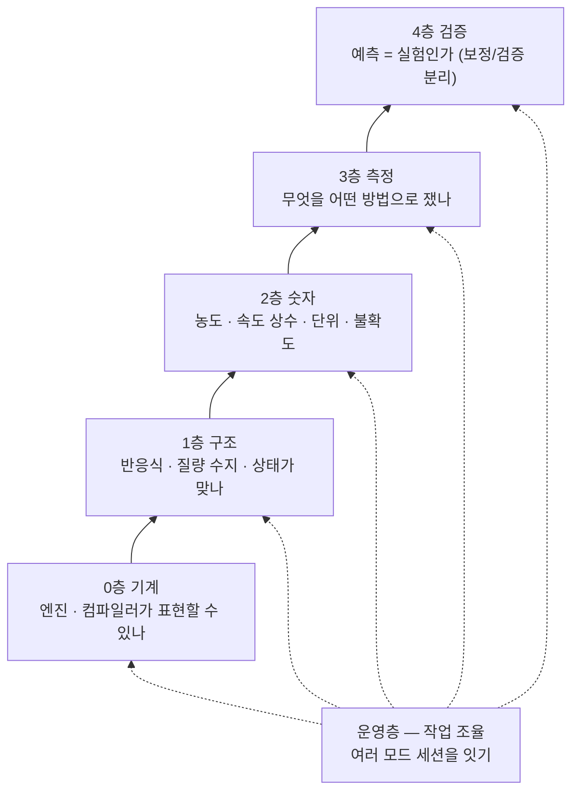

# 부족한 것 전체 지도와 가는 길 (2026-11-21)

> develop 모드 · 사용자 읽기용. 근거: `node dbtool.mjs status` · 교과서 부록 9.1(자동 생성) · D000051 해부 보고서(브랜치 `ccr-e6bcc1a4-tuedts`, `docs/reports/2026-11-21-D000051-dossier.md`) · 계획 순서 `docs/plan/ORDER.md` · 작업 조율 문서 3 개(2026-11-20).
> 숫자는 2026-11-21 의 저장소 값이다.

## 1. 한 줄 결론

부족한 것은 많지만 **엔진이 병목이 아니다.** 병목은 **숫자(속도 상수 · 농도)와 관찰(실험 데이터)** 이다 — 전이 규칙 57 개 중 속도 상수가 있는 것이 **4 개**, D000051 에 붙은 관찰은 **0 개**. 검증 기계(관찰 연산자 · 관찰 비교 · 보정/검증 분리)는 이미 있다.
그래서 **모든 경로를 한꺼번에 고치지 말고, 실험 하나를 골라 그 실험을 재현하는 데 필요한 것만 위에서 아래까지 한 줄로 뚫는다**(세로로 자르기). 한 번 뚫으면 그 길을 다른 경로에 다시 쓴다.

## 2. 지금 상태 — 숫자로

| 무엇 | 값 | 뜻 |
|---|---|---|
| 경로 | 9 개 (D000051 글리코겐 분해 11 단계 등) | 그림(기전)은 꽤 있다 |
| 전이 규칙 · 그중 속도 상수 있음 | 57 · **4** | 대부분 "즉시" 로 처리 → 시간 · 양이 Δt 에 따라 바뀜 (예측이 아님) |
| 근거 수준 (설명 · 규칙 · 관찰 424 개) | curated 146 · **asserted 150** · abstracted 84 · computed 44 | 1/3 이 출처 없이 적힘 |
| 관찰 기록 | 28 (추정용 22 · 검증용 6) | 맞대 볼 실험 데이터가 적다 |
| D000051 의 관찰 | **0** | 이 경로는 아직 "맞는지" 를 물을 수 없다 |
| 한계(열림) | Kinetic 27 · Structural 35 · Observation 16 · Concentration 14 · Regulatory 12 … | 모르는 것은 숨기지 않고 등록돼 있다 (좋은 점) |
| 검증 기계 | 관찰 연산자(`compiler/obs_operator.js`) · 관찰 비교(`judicial/obs_compare.js`) · 규약 · 보정/검증 분리(`judicial/protocol.js`) | **이미 있다** — 비어 있는 건 거기 넣을 데이터 |

## 3. 부족한 것 전체 — 다섯 층

아래 층이 막히면 위 층은 해도 소용이 없다. 그래서 층으로 나눈다.

### 0 층 — 기계 (develop)

| 번호 | 부족한 것 | 증상 (D000051) | 상태 |
|---|---|---|---|
| E1 | 1 분자 미만 행위자로도 즉시 단계가 발화 | PKA 촉매 소단위 ≈ 1e-29 인데 PhK 10/10 인산화 | 전환 기록 #11 — 다른 develop 세션이 맡는 중일 수 있음 |
| E2 | 부위의 리간드를 풀어 내보내는 효과 형식이 없음 | 수용체 해리 · PKA 재결합을 넣을 수 없음 | 전환 기록 #9 |
| E3 | "잔기 n → n−1 + 단량체" 일반 고분자 표현이 없음 | 글리코겐 1000 그대로, G1P 600 000 | 계획 없음 (형식 변경 — RULE-0261) |
| E4 | 막 반응의 부피 규약 | 막 단계가 상수가 있어도 즉시 | PLAN-080 · 056 · L000081 |
| E5 | 속도식 없는 단계에 조절자가 적용 안 됨 | 포도당 감지가 안 됨 | 2 층(상수)이 생기면 풀림 — 엔진 일 아님일 가능성 |

> 엔진은 분자 이름을 모른다(RULE-0009). E1–E4 는 모두 **일반 규칙**으로 고친다 — "글리코겐 전용 코드" 는 금지.

### 1 층 — 구조 (author)

| 부족한 것 | 증상 | 막는 것 |
|---|---|---|
| S000003 질량 수지 (Gs 가 두 번 세어짐) | AUDIT_MASS | 없음 — 데이터만 고치면 됨 |
| 끄는 단계 (수용체 해리 · AC 꺼짐 · PKA 재결합 · PhK 끄기) | 신호가 끊겨도 출력이 안 멈춤 | E2 |
| 글리코겐 잔기 · 가지 제거 효소 | 무한 생성 | E3 |
| 조절 고리 (PP1 ← 억제제-1 ← PKA, 포도당 → PP1, PhK 의 Ca²⁺) | 켜기 · 끄기가 같은 세기로 경쟁 | 2 층 상수 |
| G1P → G6P → 포도당 → 세포 밖 | 이름은 "혈당" 인데 G1P 에서 끝 | 없음 |
| 출처 (D000051 · D000050 의 asserted) | 근거 0 | 없음 — Europe PMC 접속 허용돼 있음 |

### 2 층 — 숫자 (author · assay)

| 부족한 것 | 지금 | 관련 계획 |
|---|---|---|
| 시작 농도 (ATP · GTP · PKA · Pi …) | 기본 10 분자 (= 4.15 pM) | L000016 · PLAN-078 |
| 속도 상수 | 57 중 4 | PLAN-078 (북극성 ① 의 병목) |
| 부피 · 단위 · 불확도 예산 | 부피는 가정(출처 기록 없음) | ASY-08 (진행 중) |
| 용액 조건 (pH · 온도 · Mg²⁺) | 없음 | ASY-08 |

### 3 층 — 측정 (author · assay)

| 부족한 것 | 예 | 관련 계획 |
|---|---|---|
| 단계마다 "무엇으로 재나" | cAMP = ELISA, GP 활성형 비율 = AMP 유무 활성 측정, 글리코겐 = 효소적 정량 | ASY-00 틀 · ASY-01 판독 · ASY-05 세포 수준 |
| 실험 조건 꼬리표 | 종(쥐/사람) · 자극(글루카곤/에피네프린) · 수용체(β/α₁) · 시간 | ASY-00 |
| 관찰 기록 | D000051 에 0 | — |

### 4 층 — 검증 (baseline · inspect)

| 부족한 것 | 지금 | 메울 것 |
|---|---|---|
| 기계 | 있음 (관찰 연산자 · 비교 · 규약 · 보정/검증 분리) | 없음 |
| 맞대 볼 실험 | 없음 | 3 층에서 옴 |
| Δt 의존 없는 예측 | 즉시 단계가 많아 불가 | 0 층 E4 + 2 층 상수 |

### 운영층 — 작업 조율

| 부족한 것 | 계획 |
|---|---|
| 여러 모드 세션을 잇는 장부 · 승인 증거 · MCP 연결 | PLAN-099 · 100 · 102 · (105 제안) · 103 · 104 |
| 여러 세션이 같은 장부에 동시에 붙이는 문제 | F8 — 실제로 지금도 일어날 수 있음 |

## 4. 가는 길 — 실험 하나로 세로로 뚫기

### 4.1 왜 이렇게

| 방법 | 장점 | 단점 |
|---|---|---|
| 가로로 (층마다 전부 다 고치기) | 빠짐이 없어 보임 | 끝이 안 보임. 0 층만 고치다 지침. "무엇이 맞나" 를 한 번도 못 물음 |
| **세로로 (실험 하나에 필요한 것만 위아래로)** | 몇 주 안에 처음으로 "예측 = 실험?" 을 물을 수 있음. 무엇이 진짜 필요한지가 실험에서 정해짐 | 다른 경로는 잠시 기다림 |

세로로 하면 **필요한 것이 줄어든다.** 예: 실험이 cAMP 와 활성형 GP 비율만 쟀다면, G6P → 포도당 단계(1 층)는 이번에 없어도 된다.

### 4.2 순서

| 단계 | 무엇 | 모드 | 끝나는 조건 |
|---|---|---|---|
| ① 실험 고르기 | 재현할 실험 **하나** — 종 · 세포 · 자극 · 측정 대상 · 시간 · 출처 | **사용자 결정** (후보는 author 가 Europe PMC 로 원문 확인) | 출처(PMID) · 측정표가 정해짐 |
| ② 거꾸로 짚기 | 그 실험의 측정값 → 필요한 단계 → 필요한 상수 → 필요한 엔진 기능. 위 표에서 **이 실험에 필요한 것만** 골라 냄 | inspect (읽기 · 판정) 또는 author | "이번에 할 것" 목록 — 아마 E1 · E2 · (E3) + 상수 몇 개 |
| ③ 기계 | 그 목록의 엔진 기능만 | develop | 시험 · 엔진 비트 동일 · CHANGES 한 행 |
| ④ 데이터 | 구조 고치기 · 출처 · 상수 · 관찰 기록 (보정용 / 검증용 나눠서) | author → inspect | 관문 통과 · 도장 |
| ⑤ 검증 | 사전 등록 → 실행 → 관찰과 비교 | baseline | 맞음 / 안 맞음(FINDING) — 어느 쪽이든 결과 |
| ⑥ 다시 쓰기 | 같은 길을 다른 경로(D000050 · TCA …)에 | — | 두 번째 경로에서 새로 만든 것이 적으면 성공 |

①→⑤ 가 그대로 **ORCH-0002**(작업 조율의 두 번째 순환)가 된다. 작업 조율이 먼저 다 만들어질 때까지 기다릴 필요는 없다 — 손으로 돌려도 되고, 돌리면서 조율의 빈 곳이 드러난다(RULE-0462).

### 4.3 지금 계획 순서와 맞추기

| 지금 순서 | 이 길에서의 자리 |
|---|---|
| ASY-08 계량 기초 (진행 중) | 2 층 — 그대로 계속 |
| PLAN-099 · 100 · 102 (작업 조율) | 운영층 — 그대로, 단 ①–⑤ 를 막지 않음 |
| PLAN-080 · 056 (엔진 하나로 · 경계) | 0 층 E4 |
| PLAN-078 실측 상수 | 2 층 — ② 에서 고른 상수부터 |
| ASY-00 · 01 · 05 | 3 층 — ① 의 실험을 첫 사례로 |

## 5. 정할 것 (사용자)

| 질문 | 왜 사용자인가 | 선택지 |
|---|---|---|
| 세로로 갈 것인가 | 순서를 바꾸는 결정 | 예 / 아니오(지금 순서대로) |
| 첫 실험의 조건 | 과학 판단 — 다른 조건의 데이터를 섞지 않으려면 하나로 | 쥐 간세포 + 글루카곤(간의 주 경로, 분석이 든 Studer 1984 류) / 에피네프린 + β(지금 D000051 그대로) / 다른 것 |
| E1 은 누가 | 다른 develop 세션과 겹침 | 그 세션 / 이 세션 |
