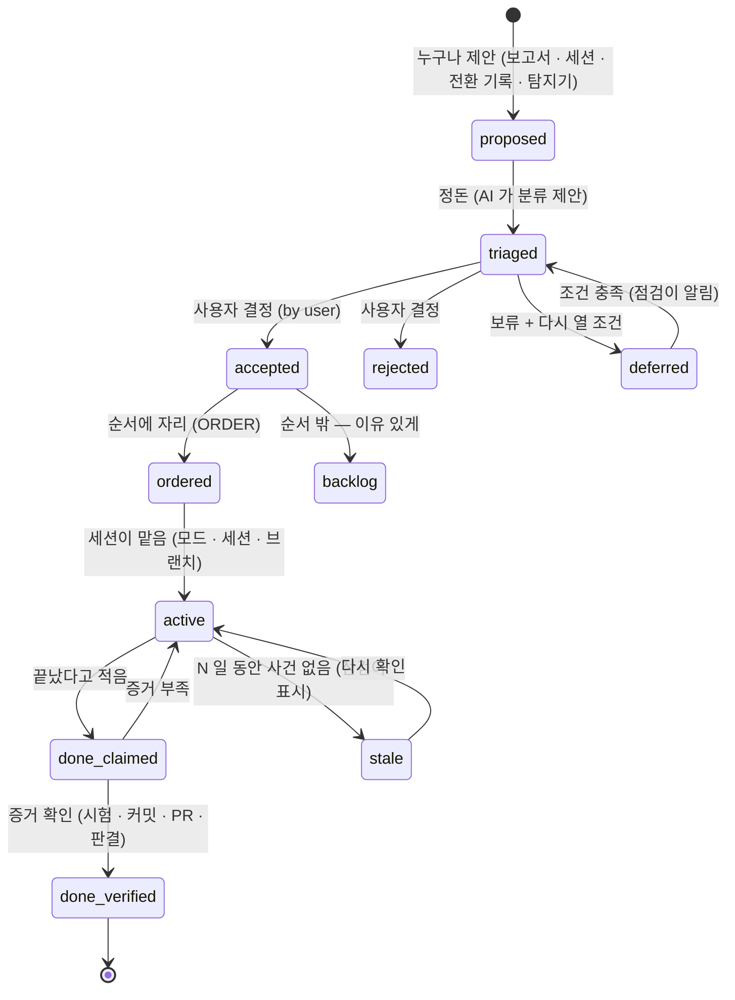
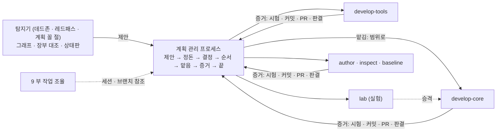

# 계획 관리 프로세스 · develop 나누기 · 모듈 연결의 데드존과 레드패스 (2026-11-21)

> develop 모드 · 설계 검토와 측정 — 기존 코드 · 장부 · 설정은 바꾸지 않았다.
> 입력: 앞선 조사 셋(`project-management-system-audit.md` · `project-roadmap-audit.md` · `project-plan-sources-inventory.md`) + 이번에 잰 모듈 그래프(읽기 전용 스크립트 — import/require 를 따라 진입점 34 곳에서 닿는 곳, 파일을 쓰는 자리, 프로세스를 띄우는 자리).
> 표기: **[사실]** 측정 · 코드 · 장부 · **[추론]** 분석자 판단 · **UNKNOWN**.

---

## 0. 결론

| 질문 | 답 [추론] | 근거 [사실] |
|---|---|---|
| 계획 관리 프로세스를 만들어야 하나 | **예.** 장부(저장 · 검사)는 이미 있으니 새로 만들 것은 **입구 · 흐름 · 주기 점검** 셋이다 | 장부 밖 할 일 34 · 장부와 안 이어진 문서 42 · 적용 안 된 정돈 제안 1 · 낡은 진행 표시 9 · 흩어진 결정 대기 약 40 |
| develop 을 나눠야 하나 | **예, 셋으로** — 코어(신뢰 코드) · 도구(관리 · 기반) · 실험(격리된 시제품). field 는 지금처럼 따로 | develop 쓰기 범위 = `**`(PERM-0017 ⚠, 장부 스스로 "다음 단계: L1 · L2 자리 목록으로") · 지금 develop 세션 둘이 서로 다른 일(이 세션 = 계획 · 문서, 다른 세션 = 엔진)을 같은 권한으로 함 |
| 데드존 · 레드패스가 있나 | **있다** — 데드존 9 · 레드패스 10 (4 장). 가장 무거운 것은 **승인 위조 가능(RP1)** 과 **동시 세션의 번호 · 갱신 충돌(RP2)** | 코드 대조 (`dbtool.mjs:647` · 서기에 `base_sha256` 없음 · `meta.next` 브랜치별 발급) |
| 셋의 관계 | 데드존 탐지가 계획 프로세스의 **입력** 이 되고, develop 나누기가 계획 작업의 **담당** 을 정한다 | 5 장 |

---

## 1. 계획 관리 프로세스

### 1.1 왜 계속 쌓이나 [사실 → 추론]

| 쌓이는 길 | 사실 | 까닭 |
|---|---|---|
| 보고서가 계획을 품음 | 보고서 45 개에 "다음 · 제안 · 순서 · 정할 것" 절, 그중 다수가 장부에 안 들어감 | 보고서를 쓰는 일과 장부에 올리는 일이 따로 — 올리는 단계를 강제하는 곳이 없음 |
| 제안이 적용되지 않음 | 계획 정돈 제안(11-02) 미적용 | "제안" 이 장부의 기록 종류가 아님 → 제안 상태를 추적 못 함 |
| 진행 표시가 늙음 | ◐ 가 10-16 · 10-22 · 10-29 부터 그대로 9 개 | 진행에 기한 · 마지막 확인 날짜가 없음 |
| 결정 대기가 흩어짐 | 장부 open 8 · 문서에만 약 40 | 결정 대기를 받는 한 자리가 없음 |
| 인계가 셋 | 전환 기록 · NEXT · WORKORDER | STG-11f 가 형식을 정했으나 셋의 관계는 글로만 |
| 동시 세션 | 장부 순번이 브랜치마다 붙음 | 병합 규칙 없음 |

### 1.2 원칙

1. **장부는 그대로, 입구를 하나로** — `plans.jsonl` · `plan-log.jsonl` · `plan.mjs` 를 바꾸지 않는 것부터 시작하고, 형식 변경은 증거가 생긴 곳만(RULE-0462).
2. **문서는 계획을 소유하지 않는다** — 보고서 · 설계 문서의 "다음" 은 장부 번호를 가리키거나 "기록만" 으로 표시한다.
3. **제안 → 결정 → 순서 는 사람의 결정** — AI 는 제안까지. 결정 기록에 by · src 가 이미 있다(결정 57 중 user 39).
4. **완료는 증거로** — DEC-0009("AI 자기 보고를 실행 증거로 인정하지 않음")를 계획 층에도.
5. **정기 점검이 쌓임을 드러낸다** — 생성물로, 상태를 바꾸지 않고 판정만.

### 1.3 흐름

| 단계 | 지금 장부에 있는 것 [사실] | 새로 필요한 것 [추론] |
|---|---|---|
| proposed | 없음 (작업은 add 로 바로 들어감) | **제안 기록** — 출처(문서 · 절 · 세션) · 한 줄 · 제안자 |
| triaged · accepted · rejected · deferred | 결정 · open 기록은 있으나 작업과 따로 | 제안에 정돈 결과 + 결정 번호 연결, 보류에 **다시 열 조건** 칸 |
| ordered · backlog | ORDER (49) · 순서 밖은 이유 없음 | 순서 밖에 **이유 칸** (정돈 제안 C · D 의 형태) |
| active | 상태 partial · 날짜 | 맡은 모드 · 세션 · 브랜치 (9 부 작업 조율과 같은 참조) · **마지막 확인 날짜** |
| done_claimed / done_verified | done 하나 | 증거 칸 + 검사 (결정의 `src.commit` 검사를 작업 결과에도) |
| stale | 없음 | 점검이 계산 (저장하지 않음) |

### 1.4 입구 규칙 — 다시 흩어지지 않게

| 규칙 | 어떻게 지키나 | 기존 장치 |
|---|---|---|
| G1 보고서 · 설계 문서에 계획 꼴의 절(다음 · 제안 · 순서 · 정할 것 · 남은 …)이 새로 생기면, 그 절은 장부 번호(PLAN · ASY · STG · DEC · open · 제안)를 하나 이상 가리키거나 "기록만" 표시 | 끝내기 검사에 탐지 하나 — **새로 바뀐 문서만** 본다 (옛 문서 98 은 정돈으로) | `rebuild/probe.mjs --check`(깨진 참조) · `status.mjs` 문서 분류 |
| G2 전환 기록의 열린 질문은 다음 세션이 "처리됨 · 넘김 · 제안으로" 중 하나로 닫음 | 전환 기록 형식은 그대로(칸 7) — 처리 사건은 계획 장부 쪽에 | `transition_audit.js` |
| G3 NEXT · WORKORDER 는 새로 만들지 않음 — 전환 기록 + 장부로 | 문서 분류에서 "옛 형식" 표시 | STG-11f |
| G4 진행 표시는 N 일(제안 14 일) 사건이 없으면 점검이 "낡음" | 상태판 · 로드맵 한 장 | `status.mjs` |
| G5 결정 대기는 open 한 곳에 | 대화에서 "정할 것" 이 나오면 open 기록으로 | open 기록 |

### 1.5 정기 점검 (주기)

| 점검 | 무엇 | 어디에 |
|---|---|---|
| 매 세션 끝 | G1 · G2 (바뀐 것만) | `gate finish` 묶음 |
| 매주 (또는 사용자가 부를 때) | 로드맵 한 장 생성 — 세 계획 · 순서 안/밖 · 낡은 진행 · 결정 대기 · 데드존 탐지 결과 · 진행 중인 세션 | 생성물 (`docs/plan/` 또는 상태판) |
| 매달 | 보류의 다시 열 조건 확인 · 정돈 제안 갱신 | 예약 작업 (PLAN-077 이 고쳐진 뒤) |

### 1.6 누가 무엇을

| 행위 | AI 세션 | 사용자 |
|---|---|---|
| 제안 · 정돈 제안 · 점검 결과 | 함 | 봄 |
| 받음 · 거절 · 보류 · 순서 | 제안만 | **결정** (by user) |
| 맡기 · 끝났다고 적기 | 함 (모드 세션) | — |
| 완료 증거 확인 | 기계 (검사) | 이상할 때 |

### 1.7 첫 적용 — 지금 쌓인 것

1. 계획 정돈 제안(11-02)을 지금 상태로 다시 맞춤 → 사용자 결정 → 적용 (순서 밖 51)
2. 장부 밖 할 일 X1–X34 · 결정 대기 약 40 을 제안 / open 으로 등록
3. 그 뒤부터 입구 규칙 G1–G5

---

## 2. develop 을 나눌 필요

### 2.1 지금 [사실]

| 무엇 | 사실 |
|---|---|
| develop 쓰기 | `**` 에서 data · attestations · handoff · 문지기 셋 · 권한의 뿌리 7 을 뺀 전부 (PERM-0017 ⚠) — 장부 메모: "다음 단계: `**` 를 구역 표(권한 표)의 L1 · L2 자리 목록으로" |
| develop 이 하는 일 (이번 주) | 이 세션: 계획 장부 · 보고서 · 설계 / 다른 세션: 엔진(전환 #11 즉시 단계) / 그 전: 시험 고침(#10) |
| 이미 있는 구분 | RULE-0197 "vocab · model · core · judicial · legislative 규칙은 사용자 요청 시만" (코어를 글로 구분) · field 모드 = 다음 엔진 시제품 (engine · tests · docs · examples, 멈춤 규칙 "반박할 공간 관찰") |
| 위험 | 모드 문서: "가장 큰 위험 — 데이터를 통과시키려고 규칙 완화" |

### 2.2 "실험 디벨롭" 의 두 뜻 — 둘 다 검토

| 뜻 | 무엇 | 지금 자리 |
|---|---|---|
| (가) **실험 = 시제품 · 시도** | 결과가 신뢰 경로에 들어가지 않는 격리된 코드 (예: 새 법칙 · 새 표현 시도) | field 가 엔진 시제품만 다룸 — 엔진 밖 시제품(컴파일러 · 판정 · 도구)의 자리는 없음 |
| (나) **실험 주도 = 실험실 실험 하나를 재현하려고 고치는 일** | D000051 세로 뚫기처럼 실험 → 필요한 엔진 기능(E1–E4) | develop 전체와 같은 권한 |

### 2.3 선택지

| 안 | 나누는 법 | 장점 | 단점 |
|---|---|---|---|
| A 그대로 | develop 하나 | 바꿀 것 없음 | 계획 · 문서 일과 엔진 일이 같은 권한 → 동시 세션이 같은 파일을 만짐 · PERM-0017 ⚠ 그대로 |
| **B 셋으로 (추천)** | **develop-core**: model · vocab · core · compiler · engine · judicial · legislative (+ 시험) — 사용자 요청 · 엔진 비트 동일 · 전체 시험 / **develop-tools**: rebuild · mcp · dbtool 의 비코어 · docs · workspace 도구 / **lab**(실험): 격리 폴더(예: `lab/`)와 그 시험만, 신뢰 경로에서 import 금지, 승격은 develop-core 로 | 권한이 일과 맞음 · 코어 변경이 눈에 띔 · 실험이 코어를 흔들지 않음 · 동시 세션 충돌 줄음 | 모드 표 · 권한 장부 변경 = L6 (사용자 GitHub 커밋, STG-12a 보류와 관계) |
| C 실험 주도 / 전체 | (나) 의 뜻으로 — "실험 세로 뚫기" 모드 + "전체 개발" 모드 | 목적이 분명 | 권한 경계가 일의 목적과 안 맞음 (세로 뚫기도 결국 코어를 고침) → 경계로 쓰기 어려움 |

**[추론] B 를 추천** 하고, (나) "실험 주도" 는 모드가 아니라 **계획 쪽의 묶음**(ORCH · 세로 뚫기 작업 묶음)으로 다룬다 — 일의 목적은 계획이, 쓸 수 있는 자리는 모드가 정한다.

### 2.4 B 를 하려면

| 무엇 | 무게 |
|---|---|
| `modes.json` gate 에 세 범위 (또는 develop 하나에 `open develop:core` 같은 범위 인자) | L6 — 사용자 커밋 |
| `permissions.jsonl` PERM-0017 을 셋으로 · 명령 장부 modes | 장부 고치기 + RULE-0521 |
| 스킬 · 모드 문서 (생성물) | 생성 |
| lab 의 import 금지 검사 (신뢰 경로 → `lab/` 금지) | 시험 하나 — 4 장 탐지기와 같은 그래프 |

---

## 3. 데드존 · 레드패스 — 정의와 잰 방법

| 말 | 이 문서의 뜻 |
|---|---|
| **데드존 (dead zone)** | 있는데 닿지 않는 곳 — 진입점에서 호출되지 않는 코드, 만들었는데 쓰이지 않는 장부 · 도구, 장부와 끊긴 계획 |
| **레드패스 (red path)** | 검사 없이 지나갈 수 있는 위험한 길 — 권한 · 승인 · 데이터 · 번호가 확인 없이 흐르는 경로, 또는 한 점이 깨지면 전체가 깨지는 경로 |

잰 방법 [사실]: JS 모듈 157 개(데이터 · 보고서 제외)의 import/require 를 따라 그래프를 만들고, 진입점 34 곳(dbtool · MCP 넷 · rebuild 도구 · 탐침 워커 · 이관 스크립트)과 화면(index.html)에서 닿는 곳 · 시험에서 닿는 곳을 셈. 파일 쓰기 함수(writeFileSync 등) · 프로세스 실행(execFileSync 등)이 있는 모듈을 셈. 결과에 정적 분석의 빈틈(문자열로 만든 경로)이 있어 사람이 대조함.

---

## 4. 발견

### 4.1 데드존

| # | 무엇 | 증거 [사실] | 무게 [추론] |
|---|---|---|---|
| DZ1 | **MCP 층 전체가 세션에서 닿지 않음** — 서버 넷 · 도구 32 · 시험은 있으나 세션에 꽂는 설정이 없음 | `.mcp.json` · settings `mcpServers` 없음 · 이 세션 도구 목록에 없음 | 큼 — 역할 거름(겹 2)이 실제로 쓰이지 않음 |
| DZ2 | `judicial/stoichiometry.js` — 시험만 부름 | 진입점에서 닿지 않음 | 작음 — ASY-15 "자료에 화학식이 들어오면 검증기에 잇는다" (의도된 대기) |
| DZ3 | 측정법 장부 `data/assays.jsonl` — 코드(서기 구역 · `assay_audit.js` · dbtool) 는 있고 항목 0 | 파일 없음 (첫 쓰기 전) | 중간 — ASY-00 끝나는 조건과 PLAN-052 가 서로를 기다림 |
| DZ4 | `workspace/implicit-starts.js` — 아무도 부르지 않는 일회성 도구 (결과 json 은 NEXT-11-19 가 씀) | 진입점 · 시험 0 | 작음 |
| DZ5 | `rebuild/precheck.mjs` — 시험 없음 (사용은 함: 사전 검사) | 시험에서 닿지 않음 | 작음 |
| DZ6 | **계획의 데드존** — 순서 밖 51 · 장부와 안 이어진 문서 42 · 미적용 정돈 제안 | 앞선 조사 | 큼 — 1 장의 이유 |
| DZ7 | 전환 기록 열린 질문 40 — 처리 상태 없음 | 칸 7 | 중간 |
| DZ8 | 가설 층 · 특징 4–6 단계 — 번호 이름공간 F · H 가 legacy, 계획 0 | FEATURES · namespaces | 작음 (의도 여부 UNKNOWN) |
| DZ9 | `index.html` = `viewer.html` 바이트 동일 | cmp | 작음 |

### 4.2 레드패스

| # | 길 | 증거 [사실] | 무게 [추론] | 이미 있는 대응 |
|---|---|---|---|---|
| **RP1** | **승인 위조 가능** — `dbtool accept` 가 `BIODB_ROLE` 이 없으면 승인자를 `'human'` 으로 기록 · MCP 역할은 켜는 쪽이 스스로 적음 | `dbtool.mjs:647` · `mcp/protocol.mjs` roleOf | **큼** — "사람 승인" 기록을 믿을 수 없음 | DEC-0064 가(병합 = 승인) · PLAN-102 (대기) |
| **RP2** | **동시 세션의 갱신 · 번호 충돌** — ① 서기 봉인이 "병합이 읽은 db = 디스크 db" 를 확인하지 않음(PLAN-081 순서 밖) ② 새 번호(`meta.next` T · D · S · L · O · V)를 브랜치마다 따로 발급 → 두 author 세션이 같은 번호를 다른 내용에 줌 ③ 덧붙이기 장부(plan-log · 전환 · 가정 · 사전)의 seq 가 병합에서 겹침 | 서기에 `base_sha256` 0 · 잠금은 한 컨테이너 안에서만 · `meta.next` | **큼** — 지금 세션 여럿이 동시에 돎 | `probe.mjs --merge-check <브랜치>` (병합 사전 점검) · 해시 사슬 검사(가정 · 사전은 깨지면 잡힘) |
| RP3 | **서기를 거치지 않는 직접 쓰기** — 이관 스크립트 11 개가 `writeFileSync` 로 db · 원장을 씀 | migrations 001–009 · 011 · 012 | 중간 — 일회성이지만 다시 돌리면 서기 · 관문을 건너뜀 | 문지기 사후 대조(모드 경로) |
| RP4 | **훅이 꺼지면 아무것도 막히지 않음** — 문지기는 훅으로만 끼어들고, CI 는 문지기를 돌리지 않음(시험만) | 세션 시작 안내문 · `check.yml` | 중간 | CI 시험 · 사람 병합 |
| RP5 | **계획 상태 변경에 증거 · 행위자 없음** — 어느 모드든 `plan.mjs apply` 로 done 을 적음 | `rebuild/state.mjs` apply | 중간 | 사건 · why 필수 |
| RP6 | 예약 작업이 PR 을 엶 (RULE-0257 과 해석 충돌) | 예약 작업 지시문 6 단계 | 작음 | — |
| RP7 | **규칙 번호 없는 거부 517 곳** — 무엇을 어겼는지 번호로 되짚을 수 없음 | 상태판 "판정 거부 자리 E( 517" | 중간 (추적성) | 규칙 장부 · 집행 장부 |
| RP8 | **층 거꾸로 기대기** — ① 컴파일러(공유) → `engine/coupling.js`(행정) ② 관리 도구 `rebuild/probe.mjs` → 시험 코드 `tests/affected.mjs` | import 그래프 | 작음 — 결합점은 "생물 사실 아닌 수치" 라 의미상 맞으나 자리가 행정부 폴더 | — |
| RP9 | **엔진 결과가 검사 없이 흐름** — 1 분자 미만 행위자로 즉시 단계 발화 (전환 #11) · 숨은 기본 시작량 538 (NEXT-11-19) | 해부 보고서 §3 · `implicit-starts.json` | 큼 (결과 신뢰) | DEC-0063 · PLAN-080 진행 |
| RP10 | **MCP 미연결로 겹 2 를 건너뜀** — 세션은 `dbtool` 을 Bash 로 부름 → 역할 거름 없이 문지기 · 사법부 · 서기만 | DZ1 | 작음 (겹 1 · 3 · 4 는 지킴) | 명령 장부가 쓰는 명령을 모드로 막음 |

### 4.3 잘 이어진 곳 (데드존 아님) [사실]

- 명령: `dbtool.mjs` 의 명령 36 = 명령 장부 cli 36 (어긋남 0)
- 비시험 모듈 83 중 77 이 시험에서 닿음 (못 닿는 6 중 MCP 서버 · plan.mjs 는 시험이 프로세스로 띄움 → 실제로 못 닿는 것은 precheck · implicit-starts · probe_worker 정적 경로)
- 파일 쓰기 함수가 있는 비이관 모듈은 **서기 하나뿐** (`legislative/clerk.mjs`)

---

## 5. 셋을 묶는 그림 [추론]

| 연결 | 뜻 |
|---|---|
| 탐지기 → 프로세스 | 데드존 · 레드패스 · 장부 밖 계획 절을 **제안** 으로 넣음 (자동으로 받아들이지 않음) |
| 프로세스 → 범위 | 작업마다 담당 범위(core · tools · lab · author …)를 적으면 동시 세션이 같은 파일을 덜 만짐 |
| 범위 → 프로세스 | 완료는 증거로 돌아옴 |
| 작업 조율(9 부) | 여러 범위를 거치는 일 하나를 묶음 — 계획 프로세스의 "active" 단계와 같은 참조를 씀 |

---

## 6. 순서 제안 [추론]

| 차례 | 무엇 | 왜 이 차례 | 무게 |
|---|---|---|---|
| 1 | **RP1 · RP2 를 계획 맨 앞으로** — PLAN-081(비교 후 교체) · 번호 발급의 브랜치 안전 · accept 승인자 기본값 | 지금 동시 세션이 돌고 있음 · 승인 기록의 신뢰 | 코어 · 사용자 결정 |
| 2 | 계획 프로세스 1 단계 — 생성물만: 로드맵 한 장 · 낡음 표시 · 결정 대기 목록 · 계획 꼴 절 탐지(바뀐 문서만) | 장부를 안 바꿈 — 가장 안전 | 도구 |
| 3 | 지금 쌓인 것 정돈 (1.7) | 2 의 화면 위에서 하나씩 결정 | 사용자 결정 |
| 4 | develop 셋으로 (B) | L6 — 사용자 커밋 | 사용자 결정 |
| 5 | 탐지기를 끝내기 검사 · CI 에 (모듈 그래프 · 쓰기 자리 · 층 규칙 · lab import 금지) | 데드존 · 레드패스가 다시 생기면 바로 보임 | 도구 |
| 6 | 계획 형식 변경 (제안 기록 · 보류 조건 · 완료 증거 · 행위자) | 2–3 을 돌려 보고 실제로 무는 칸만 | 형식 변경 (RULE-0261) |

---

## 7. 정할 것 (사용자)

| # | 질문 | 선택지 | 추천 |
|---|---|---|---|
| 1 | 계획 관리 프로세스를 이 흐름(1.3)으로 할까 | 예 / 고쳐서 | 예 — 단 형식 변경은 6 차례로 미룸 |
| 2 | develop 을 나눌까 | A 그대로 / **B 셋** / C 실험 주도 · 전체 | B |
| 3 | RP1 · RP2 를 맨 앞으로 올릴까 | 예 / 지금 순서대로 | 예 |
| 4 | "실험 디벨롭" 이 뜻한 것은 (가) 시제품 · 시도 인가 (나) 실험실 실험 주도 인가 | 가 / 나 / 둘 다 | — (뜻을 확인하고 싶음) |
