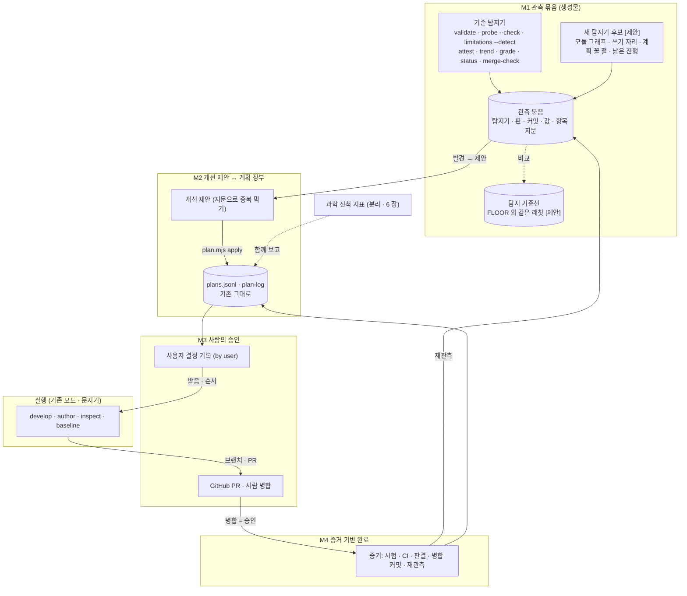

# 자기 개선 루프 — 최소판 아키텍처 · 기존 체계 대응표 · RP1 · RP2 첫 사이클 · 검증 기준 (설계, READ-ONLY)

> 2026-11-21 · develop 모드 · 설계와 조사만 — 기존 코드 · 장부 · 레지스트리 · 설정은 바꾸지 않았다. 새 프레임워크를 만들지 않는다.
> 앞선 보고서: `project-management-system-audit.md` · `project-roadmap-audit.md` · `project-plan-sources-inventory.md` · `2026-11-21-plan-process-develop-split-deadzones.md`.
> 표기 — **[사실]** 기존 구현 · 코드 · 장부에서 확인 · **[제안]** 설계 제안 · **[가설]** 검증이 필요한 가설 · **[결정]** 사용자 결정 필요.

**핵심 원칙: 자기 개선 시스템을 만드는 과정이 본래 연구 목표(현실 검증 · 학회 수준 신뢰, DEC-0010 · 0051)를 밀어내지 않는다.**

---

## 1. 설계 요구사항 (사용자 결정 2026-11-21)

| # | 요구 | 출처 |
|---|---|---|
| Q1 | 최소판 넷만: ① 관측 결과를 한 형식으로 ② 계획 장부에 개선 제안 연결 ③ 사람의 승인 ④ 증거 기반 완료 판정. 6 구성요소 · 7 단계를 한 번에 구현하지 않음 | 사용자 1 |
| Q2 | 첫 사이클 대상 = RP1(승인 위조 가능) · RP2(동시 세션 충돌) | 사용자 1 |
| Q3 | **RP1 이 고쳐지기 전에는 취약한 승인 경로(`dbtool accept` · MCP 역할 · AI 가 적는 승인 칸)로 RP1 수정을 승인하지 않는다.** 승인은 신뢰 가능한 사람의 승인 + GitHub 병합 | 사용자 1 |
| Q4 | 탐지기(Observer) 자체를 보호 대상으로. 발견 수 감소 ≠ 개선. 기준선 · 변이 시험 · 기준 변경 이력 · 감소 원인 증거를 함께 관리. 개발 에이전트가 탐지 성능 · 기준을 약화할 수 없음 | 사용자 2 |
| Q5 | 개발체계 개선 지표와 과학 진척 지표를 분리. 과학 진척이 없으면 프로젝트가 발전했다고 평가하지 않음 | 사용자 3 |
| Q6 | develop-core / develop-tools / lab(B 안) 은 장기 목표 구조로 검토만 — 모드 표 · 권한은 지금 바꾸지 않음. lab 은 설계 가설 | 사용자 4 |
| Q7 | 선행 연구: MAPE-K · 출처 확인된 Loop Engineering 만. LEAF 제외 | 사용자 5 |
| Q8 | 읽기 전용 조사 · 설계, 산출물은 이 보고서 하나 | 사용자 6 |

---

## 2. 현재 시스템 — 루프에 쓰이는 것만 [사실]

| 영역 | 있는 것 | 상태 |
|---|---|---|
| 관측 | `rebuild/status.mjs`(상태판 12 면 + `status.json`) · `probe.mjs --check`(깨진 참조) · `dbtool validate` · `limitations --detect` · `attest` · `trend` · `grade` · `probe.mjs --merge-check` · 오늘의 그래프 분석(읽기 전용 스크립트 — 저장소에 없음) | 흩어짐. 형식이 제각각 |
| 계획 | `plans.jsonl` · `plan-log.jsonl` · `plan.mjs apply/check` · 결정 57 (by · src) · open · ORDER | 작동. 제안 단계 없음 |
| 실행 | 모드 5 + 문지기(`gate.mjs`) + 명령 장부 + 영수증 | 작동 |
| 검증 | 시험 500 · 바닥값 래칫 `tests/fixtures/FLOOR.json` · 변이 시험(잡음 290 · 놓침 0) · CI(`check.yml`) · `gate finish` · 사법부 | 작동 |
| 승인 | 권한 장부 · 모드 표 · 승인 묶음(`judicial/approval.js`, AUTO_PASS = false) · 문지기 파일 보호 · **사람의 GitHub 커밋 · 병합** | 작동, 단 RP1 |
| 반영 | 서기(유일 쓰기) · 관문 봉인 · 패치 기록 · CHANGES · git | 작동, 단 RP2 |
| 조율 | PLAN-099–104 (계획만) | 없음 |

---

## 3. 6 구성요소 ↔ 기존 체계 대응표

| 구성요소 | 책임 | 기존 [사실] | 빈 곳 | 이번 최소판 [제안] |
|---|---|---|---|---|
| **Observer** | 상태 관측 · 문제 탐지 | 상태판 · 탐침 · validate · 한계 후보 · attest · trend · grade · merge-check | ① 한 형식이 없음 ② 탐지기 자체 보호 없음 ③ 데드존 · 레드패스 · 계획 꼴 절 탐지가 저장소에 없음 | **M1 관측 묶음** + **탐지기 보호(5 장)** |
| **Planner** | 개선 과제 · 우선순위 · 의존 · 완료 조건 | 계획 장부 · 결정 · open · ORDER · 정돈 제안서(미적용) | 제안 기록 · 중복 막기 · 탐지 → 제안 연결 | **M2 개선 제안 ↔ 장부** |
| **Supervisor** | 배분 · 세션 조율 · 충돌 관리 | PLAN-099–104 계획 · `merge-check` (충돌 사전 점검) | 실체 없음 | **이번엔 만들지 않음** — 첫 사이클은 사람이 세션을 띄움 |
| **Developer** | 범위 안에서 실행 | 모드 5 (develop · author · baseline · inspect · field) | develop 이 너무 넓음 (PERM-0017 ⚠) | 그대로 — B 안은 가설(Q6) |
| **Validator** | 독립 검증 · 증거 | 사법부 · 시험 · 래칫 · 변이 시험 · CI · gate finish | 계획 작업의 완료가 증거와 이어지지 않음 | **M4 증거 기반 완료** |
| **Governor** | 권한 · 승인 · 위험 통제 | 권한 장부 · 모드 표 · 문지기 보호 · 승인 묶음 · 사람 병합 | **RP1** — 승인 기록을 AI 가 쓸 수 있음 | **M3 사람의 승인 = GitHub 병합만** + RP1 이 첫 사이클 |

**세 책임의 분리** [사실 → 제안]:

| 책임 | 주체 | 지금 지켜지나 |
|---|---|---|
| 개선안 생성 | AI 세션 (어느 모드든 제안) | — |
| 개선안 승인 | **사람** — GitHub 병합 · 사용자 결정 기록(by user) | 병합은 사람만 [사실: main 커밋 중 사람 19 = GitHub 병합 · 웹 커밋, Claude 224 = 브랜치]. 단 accept 도장은 AI 가 "human" 으로 적을 수 있음 (RP1) |
| 개선 결과 검증 | 사법부 · 시험 · CI (코드) + 만든 세션과 **다른** 세션 | 코드 검증은 지켜짐. "다른 세션" 은 아직 규칙이 아님 |

---

## 4. 최소판 아키텍처

### 4.1 구조

### 4.2 네 조각

| 조각 | 무엇 [제안] | 재사용 [사실] | 새로 필요한 것 | 장부 · 형식 변경 |
|---|---|---|---|---|
| **M1 관측 묶음** | 모든 탐지기의 결과를 한 모양으로: `{ detector, detector_sha, rule_set_sha, commit, at, metric, value, baseline, items: [{ fingerprint, where, what }] }` | `status.json` 이 이미 여러 숫자를 모음 · `status.mjs` 생성기 · 각 탐지기 명령 | 묶는 생성기 하나 · 새 탐지기 넷(그래프 · 쓰기 자리 · 계획 꼴 절 · 낡은 진행) | 없음 — **생성물** (손으로 안 고침, 다른 코드가 판정에 안 씀) |
| **M2 개선 제안 ↔ 장부** | 발견 항목의 지문(탐지기 + 자리 + 종류)으로 제안 하나. 같은 지문이면 새 제안을 만들지 않고 기존 제안에 "다시 관측됨" | `plan.mjs apply` · open 기록 · 결정 기록 | 처음에는 **open 기록 + 지문을 글에** (형식 변경 없이). 제안 기록 종류는 2 단계 | 1 단계 없음 · 2 단계 형식 변경 [결정] |
| **M3 사람의 승인** | 승인 = ① 사용자 결정 기록(by user · src 원문) + ② 그 변경의 PR 을 **사람이 병합**. AI 가 쓰는 어떤 칸도 승인이 아님 | 결정 기록 · 승인 묶음 지문 · GitHub 병합 | RP1 이 고쳐질 때까지 accept 도장 · MCP 역할 · `BIODB_ROLE` 은 승인 증거에서 뺌 | 없음 (규칙 문장으로) |
| **M4 증거 기반 완료** | 작업이 끝나려면: 끝나는 조건의 시험 이름 · CI 통과 커밋 · 병합 커밋 · 재관측 결과(해당 탐지 항목이 사라짐 **+ 원인 증거**) | 결정의 `src.commit` 검사 · gate finish · CI | 1 단계: 결과 글에 증거를 적고 사람이 확인 · 2 단계: 증거 칸 + 검사 | 2 단계 형식 변경 [결정] |

### 4.3 데이터 · 작업 흐름 (한 사이클)

| 단계 (7 단계 가설과 대응) | 무엇 | 누가 | 남는 것 |
|---|---|---|---|
| 관측 | M1 생성 (커밋 기준) | 생성기 (어느 모드든 읽기) | 관측 묶음 |
| 분석 | 발견 → 원인 · 영향 · 위험 · 중복(지문) | AI 세션 | 분석 글 (보고서) |
| 계획 | 제안 → open/작업 등록 · 완료 조건 · 담당 모드 | AI 제안 → **사용자 결정** | 결정 기록 · 작업 |
| 실행 | 담당 모드 세션이 브랜치에서 | 모드 세션 | 커밋 · 영수증 |
| 검증 | gate finish --full · CI · 사법부 · **만든 세션과 다른 세션의 재검토** | 기계 + 다른 세션 | 시험 결과 · 검토 기록 |
| 반영 | PR → **사람 병합** | 사용자 | 병합 커밋 |
| 재관측 | main 의 새 커밋에서 M1 다시 · 기준선과 비교 | 생성기 | 전후 관측 묶음 |

---

## 5. Observer 보호 (Q4)

### 5.1 지금 있는 보호 [사실]

| 장치 | 보호하는 것 | 탐지기에도 걸리나 |
|---|---|---|
| 바닥값 래칫 `FLOOR.json` (시험 500 · 판정 자리 426 · 거부 말뭉치 25 — 내리면 별도 커밋) | 사법부 검사 수 | 일부 — 판정 자리 수만 |
| 변이 시험 (`enforcement.jsonl` · `tests/mutation/`) | 집행 규칙을 끄면 시험이 잡는가 | 사법부 규칙만 |
| 자기 검사 시험 8 (settings ask · PERM-0023) | 문지기 · 시험 장치 | 문지기만 |
| 문지기 보호 (권한의 뿌리 7) | 권한 표 · 판정 코드 · 승인 도구 | 상태판 · 탐침은 아님 |

→ **상태판(`status.mjs`) · 탐침(`probe.mjs`) · 한계 후보 탐지 · 새 탐지기는 develop 이 자유롭게 고칠 수 있다** [사실: develop 쓰기 `**`, 보호 목록에 없음].

### 5.2 보호 설계 [제안]

| 장치 | 무엇 | 기존 본뜸 |
|---|---|---|
| P1 **탐지기 등록부** | 탐지기마다: 이름 · 코드 파일 · 판(코드 sha) · 기준(규칙 · 문턱) · 무엇을 세나 | 번호 사전 · 명령 장부 형식 |
| P2 **탐지 기준선 (래칫)** | 탐지기별 지금 값과 항목 지문 목록. 값이 줄면 "원인 증거" 가 있어야 통과 | `FLOOR.json` |
| P3 **원인 증거** | 감소의 원인을 셋으로만 인정: ① 고친 커밋(그 항목의 자리를 바꾼 커밋 + 그 커밋 뒤 재관측에서 항목이 사라짐) ② 사람이 결정한 범위 변경(결정 번호) ③ 오탐 판정(사람이 확인한 결정 번호). **탐지기 코드가 바뀐 같은 커밋에서 감소하면 거부** | 결정 기록 by · src |
| P4 **탐지기 변이 시험** | 일부러 결함을 심은 고정 자료(데드 모듈 하나 · 서기 밖 쓰기 하나 · 장부 밖 계획 절 하나 · 낡은 진행 하나)를 탐지기가 찾는지 | `tests/mutation/` · 거부 말뭉치 |
| P5 **기준 변경 이력** | 탐지 기준(문턱 · 무시 목록 · 범위)을 바꾸면 사건 한 줄 (왜 · 누가 · 앞뒤) | 규칙 장부 `changes.jsonl` |
| P6 **보호 등급** | 탐지기 코드 · 기준선 · 변이 고정 자료를 문지기 보호(사람 커밋)로 | 권한의 뿌리 · STG-12 |

| 판단 | 근거 |
|---|---|
| P1–P5 는 develop-tools 일 (장부 · 시험 추가) | 권한 변경 없음 |
| **P6 은 L6** — 사용자 GitHub 커밋, STG-12a 보류와 관계 [결정] | 모드 표 · 권한 표 |
| 그 전까지는 "탐지기 코드가 바뀐 커밋은 사람 검토 필수" 를 승인 묶음 화면에 표시 [제안] | `approval.js` 의 분류 (코드는 바꾸지 않고 사람이 봄) |

### 5.3 지금 기준선 후보 [사실 — 2026-11-21 값]

| 탐지기 | 값 |
|---|---|
| `dbtool validate` | 오류 0 · 경고 22 |
| `limitations --detect` | 미등록 후보 0 |
| `probe.mjs --check` | 깨진 참조 0 |
| 상태판 | 미분류 문서 88 · 규칙 번호 없는 거부 자리 517 · 같은 번호 형식을 따로 적은 곳 19 · 글뿐인 규칙 206 · 이유를 찾지 못한 규칙 284 · 미등록 번호 0 · 겹침 0 |
| 변이 시험 | 잡음 290 · 놓침 0 · 안 함 0 |
| `trend` | unchecked 566 · match 90 |
| 모듈 그래프 (오늘, 저장소 밖 스크립트) | 진입점에서 못 닿는 비시험 모듈 2 · 서기 밖 직접 쓰기 11 (이관) · 시험이 못 닿는 모듈 3 |
| 계획 | 순서 밖 미완료 51 · 낡은 진행 9 · 장부 밖 할 일 34 · 장부와 안 이어진 계획 문서 42 |

---

## 6. 본래 연구 목표 보호 (Q5)

### 6.1 두 지표를 나눈다 [제안]

| 축 | 지표 | 지금 [사실] | 출처 명령 |
|---|---|---|---|
| **과학 진척** | 실측 속도 상수 | 규칙의 속도 상수 4 · 전이 규칙 57 · 시뮬레이션 상수 중 실측 약 2 % (PLAN-078 글: 데이터 4 · 가상 186) | `textbook` 부록 9.1 · PLAN-078 |
| | 실측 데이터 확보율 | 근거 수준 curated 146 · asserted 150 · abstracted 84 · computed 44 (424 중) · anchor 45 · parameter 327 | 부록 9.1 · `grade` |
| | 관찰 | 관찰 기록 28 (추정용 22 · 검증용 6) · **정량 검증 관찰 0** | `status` · RUNBOOK |
| | D000051 진행 | 관찰 0 · 질량 수지 위반(S000003) · 즉시 단계 다수 · 실험 미선정 | 해부 보고서 · gap-map |
| | 실험 ↔ 시뮬레이션 비교 | 사전 등록 5 (정성, MHC · 텔로미어) · 시나리오 44 중 가상 43 | `preregistrations.jsonl` |
| | 검증 가능성 | 규약 + 사전 등록 + 검증 관찰이 모두 있는 경로 수 [제안 지표] | `protocol.js` |
| **개발체계** | 탐지 기준선 (5.3) · 순서 밖 · 낡은 진행 · 장부 밖 · 승인 경로 신뢰 · 동시 세션 충돌 | 5.3 | M1 |

### 6.2 평가 규칙 [제안 · 일부 가설]

| 규칙 | 내용 | 종류 |
|---|---|---|
| E1 | 모든 진척 보고(로드맵 한 장 · 사이클 결과)에 **두 축을 함께**, 과학 축이 먼저 | 제안 |
| E2 | 과학 축이 그대로인 채 개발 축만 좋아지면 "프로젝트 진척 없음 — 개발체계만 개선" 으로 적음 | 제안 (사용자 요구 그대로) |
| E3 | **메타 편중 경보** — 연속 N 사이클(또는 N 일) 동안 과학 축 변화 0 이면 다음 사이클 대상은 과학 쪽에서 고름 | 가설 — N 은 [결정] (예: 2 사이클 · 14 일) |
| E4 | 데이터 : 구조 비율 — 구조 변경 하나마다 데이터 패치 하나 이상 (10-25 결함 보고서 P6 제안) | 가설 — 이미 저장소에 있는 제안 |
| E5 | 자기 개선 루프는 과학 쪽 작업(author · baseline)의 **순서를 앞지르지 못함** — 루프 작업은 ORDER 에서 과학 작업과 번갈아 | 가설 [결정] |

### 6.3 지금 상태에 이 규칙을 대면 [사실 → 추론]

2026-11-20 – 21 의 이 세션 작업은 전부 개발체계 쪽이다(계획 · 조사 · 설계 보고서 10 여 개). 같은 기간 과학 축 변화: D000051 해부(baseline 세션, 관찰 0 → 0) · 전환 기록 #8 – #11. **E2 기준으로 이 이틀은 "개발체계만 개선"** 이다. 그래서 첫 사이클(RP1 · RP2) 뒤 다음 사이클은 과학 쪽(D000051 세로 뚫기 · 첫 실험)에서 고르기를 권한다 [추론].

---

## 7. 권한 · 승인 경계

| 행위 | AI 세션 | 사람 | 금지 |
|---|---|---|---|
| 관측 · 분석 · 제안 | 함 | 봄 | — |
| 제안 받음 · 순서 · 보류 | 제안만 | **결정** | AI 가 by user 를 적음 |
| 실행 (브랜치) | 함 (모드 범위) | — | 모드 밖 쓰기 (문지기) |
| 검증 | 기계 + 다른 세션 | 이상할 때 | 만든 세션이 자기 결과를 "검증됨" 으로 |
| 반영 (main) | PR 만 (요청 시, RULE-0257) | **병합** | AI 병합 |
| Governor · 검증 기준 · 탐지기 보호 자료 바꾸기 | 제안만 (승인 묶음) | **GitHub 에서 직접 커밋** | 루프가 자기 기준을 바꿈 |
| **RP1 이 고쳐지기 전** | accept 도장 · `BIODB_ROLE=human` · AI 가 적은 승인 칸을 승인 증거로 쓰지 않음 | 결정 기록 + 병합만 | 취약 경로로 RP1 수정을 승인 (Q3) |

---

## 8. 오류 · 실패 처리

| 상황 | 처리 [제안] | 기존 [사실] |
|---|---|---|
| 검증 실패 (시험 · CI · 사법부) | 같은 브랜치에서 고침 — **최대 2 회** → 넘으면 blocked + 사람 | gate finish 가 커밋을 막음 |
| 원인 모름 (멈춤 · NaN · AUDIT_* · 무결성 FAIL) | 멈추고 물음 | RULE-0259 |
| 데이터냐 코드냐 애매 | NUMERICAL 로 가정하고 물음 | RULE-0260 |
| 관문은 통과했는데 결과가 이상 | 재현 절차와 보고 | RULE-0262 |
| 탐지 기준선이 원인 증거 없이 내려감 | 거부 → 사람 | P2 · P3 (제안) |
| 격리 | 병합하지 않은 브랜치 = 격리. lab 은 가설(Q6) | 브랜치 · AI 는 main push 불가 |
| 연쇄 전파 차단 | 신뢰 경로(main)에는 **한 번에 개선 하나** 의 PR · 다음 사이클은 앞 사이클의 재관측 뒤 | — (제안) |
| 롤백 | `git revert` 를 PR 로 → 사람 병합 · db 변경은 패치 기록으로 되짚음 | git · `data/patches/` · 사건 기록 |
| 폐기 | 제안을 rejected 로 (결정 기록) · 브랜치 보존 (기록) | 결정 기록 |

---

## 9. 검증 · 증거 체계

| 증거 | 무엇이 증명하나 | 위조 가능성 [추론] | 지금 있나 |
|---|---|---|---|
| 시험 통과 (`gate finish --full`) | 시험이 지키는 범위의 회귀 없음 | 낮음 (작업 지문 · 영수증) | 있음 |
| CI 통과 (GitHub) | 같은 것을 깨끗한 환경에서 | 낮음 | 있음 |
| 사법부 판결 · 봉인 · 도장 재검증 | 데이터 · 판정 | 낮음 (재계산) | 있음 |
| **사람 병합 커밋 (GitHub)** | 사람이 승인 | **가장 낮음** — AI 가 main 에 못 넣음 | 있음 |
| 사용자 결정 기록 (by user · src 원문) | 사람이 결정 | 중간 — 기록은 AI 가 적음, 원문 인용으로 대조 | 있음 |
| accept 도장 (by human) | — | **높음 (RP1)** | 있음 — 증거에서 뺌 |
| 재관측 전후 비교 | 개선이 실제로 일어났나 | 낮음 (두 커밋에서 같은 생성기로 다시 계산) | 없음 (M1) |
| 다른 세션의 재검토 기록 | 만든 쪽과 독립 | 중간 | 없음 (규칙 제안) |

### 9.1 변경 전후 비교 [제안]

- 기준 커밋(분기점)과 결과 커밋(병합 뒤)에서 **같은 판의 생성기** 로 M1 을 두 번 계산 → 탐지기별 값 · 항목 지문의 차이.
- 탐지기 코드 판이 두 커밋에서 다르면 비교를 "판이 다름" 으로 표시하고 개선 판정에 쓰지 않음 (P3 와 같은 이유).

### 9.2 품질이 높아졌는가 [제안]

| 조건 | 모두 만족해야 "개선" |
|---|---|
| 목표 항목 | 대상 탐지 항목이 사라짐 + 원인 증거 (P3 ①) |
| 회귀 없음 | 다른 탐지기 값이 나빠지지 않음 · 시험 · CI 통과 · 바닥값 유지 |
| 탐지기 불변 | 그 사이 탐지기 판이 같음 (또는 사람이 결정한 판 변경) |
| 두 축 보고 | 과학 축 값을 함께 적음 (E1) |

---

## 10. RP1 · RP2 첫 사이클 계획

### 10.1 대상의 사실

| | RP1 승인 위조 가능 | RP2 동시 세션 충돌 |
|---|---|---|
| 증거 [사실] | `dbtool.mjs:647` — `const by = process.env.BIODB_ROLE \|\| 'human'` · 등록부의 accept 도장 6 개 모두 `by: "human"` (2026-10-25) · 그 도장을 넣은 커밋 `853cb42` 의 작성자 = Claude · MCP 역할은 켜는 쪽이 스스로 적음(`protocol.mjs` roleOf) | ① 서기 `commitMerge` 는 봉인 db 와 쓸 db 가 같은지만 보고 **디스크의 지금 db 와는 대조하지 않음** (`base_sha256` 0 — PLAN-081 대기 · 순서 밖) ② 새 번호 `meta.next` 를 브랜치마다 발급 (`legislative.js:40`) ③ `merge-check` 는 계획 · 규칙 · 권한 장부의 번호 충돌만 봄 — **db.json 의 T · D · S · L · O · V 와 가정 · 전환 기록 seq 는 안 봄** (`ID_FILES`) |
| 기존 대응 | DEC-0064 가(병합 = 승인) · PLAN-102(승인 증거 판정, 대기) · **PLAN-090 사람/AI 행위자 구분 (대기)** | PLAN-081 · `merge-check` · 해시 사슬 검사(가정 · 사전은 깨지면 잡힘) · 패치가 임시 번호(`D+1`)로 쓰이고 병합이 진짜 번호를 줌 |
| 담당 범위 | develop (코어 — `dbtool.mjs` · `judicial/acceptance.js` · 서기) — RULE-0197 사용자 요청 | develop (코어 — 서기 · 입법) + develop-tools (`merge-check`) |

### 10.2 사이클 단계

| 단계 | RP1 | RP2 | 누가 |
|---|---|---|---|
| 관측 | 위 증거 + accept 경로 전수 (`dbtool accept` · `mcp accept` · 서기 appendAttestations) | 위 증거 + 동시 브랜치 실측 (`merge-check` 로 지금 열린 브랜치들) | 읽기 세션 |
| 분석 | 무엇이 "사람 승인" 을 주장하는 칸인가 전수 · 기존 6 도장의 처리 | 충돌의 세 종류(갱신 · 번호 · seq)별 실제 발생 가능 경로 | 〃 |
| 계획 | 작업 1 개 + 완료 조건 · 시험 이름 → **사용자 결정** | 〃 | AI 제안 → 사용자 |
| 실행 | develop 세션 (사용자 요청) | develop 세션 — RP1 과 **다른 세션 · 다른 시기** (같은 파일 `dbtool.mjs` · 서기를 만지지 않게) | 모드 세션 |
| 검증 | gate finish --full · CI · 아래 완료 조건의 거부 시험 · **다른 세션이 재검토** | 〃 | 기계 + 다른 세션 |
| 반영 | **PR → 사용자 GitHub 병합** (accept 도장 · AI 칸은 승인 증거 아님 — Q3) | 〃 | 사용자 |
| 재관측 | accept 경로 전수를 다시 · 기준선 비교 | 시험 합치기로 충돌 재현 시험 | 생성기 |

### 10.3 고치는 방향의 후보 [제안 — 고르는 것은 사용자]

| | 후보 | 장점 | 주의 |
|---|---|---|---|
| RP1-a | accept 의 승인자 기본값을 `'human'` → **기록만 `ai-session`** (사람 승인이 아님을 표시), 사람 승인은 별도 증거(병합 커밋 · 서명)로만 | 가장 작음 | 기존 6 도장은 고치지 않음 — 새 도장으로 바로잡을지 [결정] |
| RP1-b | accept 를 inspect 모드에서도 **승인 묶음(사람 커밋)** 경로로만 | 위조 경로가 사라짐 | 사용 빈도 · 손이 듦 |
| RP1-c | PLAN-090 사람/AI 행위자 구분을 앞당겨 모든 기록 줄에 행위자 | 근본 | 큼 — 형식 변경 |
| RP2-a | **PLAN-081**: 봉인에 `base_sha256`, `commitMerge` 가 디스크 db 와 다르면 거부 | 한 컨테이너 안 잃어버린 갱신 차단 | 브랜치 사이 충돌은 못 막음 |
| RP2-b | `merge-check` 를 db.json 의 번호 · 가정 · 전환 seq 까지 넓힘 | 브랜치 사이 번호 충돌을 병합 전에 봄 | 탐지만 (고치지 않음) |
| RP2-c | **병합 대신 다시 적용** — 늦게 합치는 쪽은 db.json 을 git 으로 합치지 않고, 자기 패치(임시 번호)를 main 위에서 다시 `merge` | 번호를 main 이 다시 줌 · 기존 패치 기록 재사용 | **가설** — 패치 기록만으로 다시 적용이 되는지 확인 필요 |

권장 [추론]: RP1-a → RP2-a + RP2-b → (확인 뒤) RP2-c. RP1-c 는 PLAN-090 순서대로.

### 10.4 완료 조건 (검증 기준)

| | 완료 조건 |
|---|---|
| RP1 | ① `BIODB_ROLE` 없이 `dbtool accept` 를 돌리면 도장에 `human` 이 남지 않는 **거부 시험** ② MCP · CLI 어느 경로로도 AI 세션이 "사람 승인" 칸을 만들 수 없음을 보이는 시험 ③ 승인 묶음 화면 · 문서에 "사람 승인의 증거 = 병합 커밋" 명시 ④ 재관측: accept 경로 전수에서 위조 경로 0 ⑤ 사용자 GitHub 병합 |
| RP2 | ① 봉인 뒤 디스크 db 가 바뀌면 `commitMerge` 거부 시험 ② 두 브랜치가 같은 새 번호를 다른 내용에 준 고정 자료에서 `merge-check` 가 번호 충돌로 잡는 시험 ③ 가정 · 전환 seq 겹침도 잡음 ④ 바닥값 · 변이 시험 유지 ⑤ 사용자 GitHub 병합 |
| 둘 다 | 9.2 의 네 조건 · 과학 축 값을 함께 보고 |

---

## 11. 선행 연구와의 비교

| 연구 | 1 제안 개념 | 2 실제 구현 | 3 실증 효과 | 4 한계 | 5 적용할 원리 |
|---|---|---|---|---|---|
| **MAPE-K** (IBM 자율 컴퓨팅) | Monitor · Analyze · Plan · Execute + 공유 Knowledge 의 제어 순환 | 이 보고서 안에서 원문 · 구현 사례를 확인하지 않음 (이 환경에서 원문 미열람) — 개념은 널리 알려짐 | 이번에 확인하지 않음 | 이번에 확인하지 않음 | **K = 공유 지식** — 우리 장부들(계획 · 규칙 · 등록부)이 K. 루프의 모든 단계가 같은 장부를 읽고 씀 → 새 저장소를 만들지 않음 |
| **Loop Engineering: Building Blocks, Adoption, and Impact** (arXiv 2608.21884) | 검색 결과로 제목 · 존재만 확인. 검색 요약에 "maker/checker 분리" 가 가장 강조된 요소로 나옴 | **본문 미확인** — 이 환경에서 arxiv.org 접속 불가 | 검색 요약: 효과 근거가 얇음 (수치 출처 불명) — 본문으로 확인 필요 | 본문 미확인 | **maker / checker 분리** = 만든 세션과 검증하는 세션을 나눔 (3 장 세 책임 · 9 장 다른 세션 재검토) |
| LEAF | — | — | — | — | **제외** (출처 미확인, Q7) |

비교 결과 [추론]:

| 구분 | 내용 |
|---|---|
| 저장소에 이미 있는 원리 | K(공유 지식 = 장부) · checker(사법부 · 시험) · 사람 승인(병합) · 기준 고정(래칫 · 문지기 보호) |
| 저장소에 빠진 원리 | 관측 결과의 한 형식(M1) · 탐지기 자체 보호(5 장) · 만든 쪽과 검증하는 쪽이 **세션 단위** 로 다름을 강제 · 순환의 지표가 본래 목표를 보는지(6 장) |
| 불필요한 중복을 피할 곳 | 새 지식 저장소 · 새 승인 체계 · 새 검증기 — 모두 이미 있음 |

---

## 12. 단계별 로드맵

| 단계 | 무엇 | 끝나는 조건 | 형식 · 권한 변경 | 과학 축과 번갈아 (E5 가설) |
|---|---|---|---|---|
| **L0** (지금) | 이 보고서 · 사용자 결정 | 13 장 결정 | 없음 | — |
| **L1 첫 사이클 (손으로)** | RP1 → RP2 를 4.3 의 흐름으로 사람이 세션을 띄워 돌림 | 10.4 완료 조건 · 사용자 병합 | 코어 코드 (사용자 요청) | L1 뒤 → **D000051 세로 뚫기 한 걸음** |
| **L2 M1 관측 묶음** | 기존 탐지기 결과를 묶는 생성기 + 새 탐지기 넷 + 기준선 P2 | 생성물 · 시험 · 지금 값이 5.3 과 같음 | 없음 (생성물 · 시험) | 〃 |
| **L3 탐지기 보호** | P1 · P3 · P4 · P5 (P6 은 사용자 커밋) | 탐지기 변이 시험이 심은 결함 4 종을 모두 찾음 | P6 = L6 [결정] | 〃 |
| **L4 M2 · M4 1 단계** | 제안 = open 기록 + 지문 · 완료 = 결과 글에 증거 | 한 사이클을 이 방식으로 끝냄 | 없음 | 〃 |
| **L5 M2 · M4 2 단계** | 제안 기록 종류 · 증거 칸 · 검사 | 형식 · 시험 · 이관 | 형식 변경 (RULE-0261) [결정] | 〃 |
| L6 이후 | Supervisor (PLAN-099–104) · develop B 안 · lab | 각 계획의 끝나는 조건 | L6 [결정] | 〃 |

---

## 13. 미결정 사항 · 사용자 결정

| # | 결정 | 선택지 | 권장 |
|---|---|---|---|
| U1 | RP1 고치는 방향 | a 기본값을 `ai-session` 으로 / b 승인 묶음 경로만 / c 행위자 구분 앞당김 | a (그 뒤 c 는 순서대로) |
| U2 | 기존 accept 도장 6 개 | 그대로 두고 "AI 가 기록" 이라는 한계로 / 사람이 새로 승인해 새 도장 | UNKNOWN — 당시 사용자 결정 원문 확인 뒤 |
| U3 | RP2 범위 | a 만 / a + b / a + b + c(가설 확인 뒤) | a + b |
| U4 | 첫 사이클을 계획 장부에 올릴지 | 결정 기록 + 작업 (PLAN-081 을 순서 맨 앞으로 · RP1 작업 새로) | 올림 |
| U5 | 메타 편중 경보 N | 2 사이클 / 14 일 / 다른 값 | 2 사이클 |
| U6 | 탐지기 보호 P6 (L6) | 지금 계획만 / L3 에서 사용자 커밋 | L3 에서 |
| U7 | "다른 세션 재검토" 를 규칙으로 | 예 / 코어 변경만 / 아니오 | 코어 변경만 |
| U8 | MAPE-K · Loop Engineering 원문 확인 | 네트워크 허용(arxiv.org)을 요청 / 보고서 한계로 두기 | 보고서 한계로 두고 필요할 때 |

### 검증이 필요한 가설 (요약)

| 가설 | 확인 방법 |
|---|---|
| RP2-c 패치 다시 적용으로 번호 충돌을 풀 수 있다 | 고정 자료 두 브랜치로 시험 |
| E3 · E4 · E5 가 메타 편중을 실제로 막는다 | 두 사이클 뒤 두 축 값 비교 |
| 탐지기 넷(그래프 · 쓰기 · 계획 꼴 절 · 낡은 진행)이 오탐 없이 쓸 만하다 | L2 에서 지금 값 대조 · 사람 확인 |
