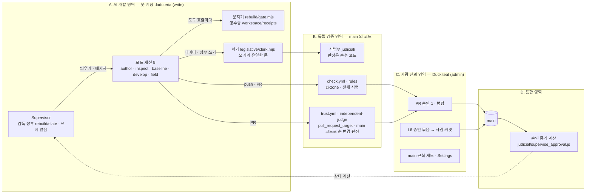

# 거버넌스 · 오케스트레이션 체계 지도 — 보고서 25 편을 한 체계로 (2026-11-24)

> develop 모드 · 사용자 요청 "관련 모든 보고서 뒤져보고, 각각 주요 요점을 잡고, 정리해서 하나의 체계로 다 연결시키자 — 지금 좀 어지러워".
> **정리만** 한다. 코드 · 장부 · 권한 · 설정 · 데이터 · 도장은 바꾸지 않았다. 새 결정도 없다. 이 문서의 "제안" 은 모두 사용자 결정 전이다.
> 입력: `docs/reports/` 의 권한 · 조율 · 감독 · 보안 보고서 25 편(§4 목록) + 다른 브랜치의 결과 보고서 1 편(`claude/attack-matrix-independent-review` 의 `2026-11-24-develop-trust-core-result.md` — main 에는 없음) · `docs/design/supervisor.md` · 결정 DEC-0048 · DEC-0064–0092 · 전환 기록 #18–#20.
> 표기: **[사실]** 저장소 · 기록에서 확인 · **[제안]** 이 문서의 정리 제안(결정 아님).

---

## 0. 한 줄로

| 범위 | 이유 | 영향 | 확인 |
|---|---|---|---|
| 흩어진 보고서들은 **한 질문에 대한 세 번의 답**이다: "AI 가 일을 많이 하되, 사람 승인과 검증을 AI 가 꾸밀 수 없게 하려면?" — ① 11-02 자리 · 권한(누가 어디를 쓰나) ② 11-20–21 조율(일을 어떻게 잇나) ③ 11-22–24 신뢰 경계(같은 기계 밖에서 무엇이 막나) | 시기마다 다른 이름으로 같은 뼈대를 키웠다 | 아래 **네 영역 × 두 겹** 한 장(§1)에 모두 들어간다 | §1 · §4 |
| 뼈대는 이미 **거의 다 섰다**: 감독 장부 · 승인 판정 · 문지기 · CI 두 겹 · 봇 신원 · main 보호 | 11-21 이후 계획 9 개 완료(099 · 100 · 101 · 102 · 113 · 114 · 081 · 111 · 116 일부) | 빈 곳은 **작고 구체적**이다: N11 문지기 fail-closed · ci-zone '선언 없음 = 사람' · CODEOWNERS · 승인 증거를 GitHub 기록으로 | §3 · §6 |
| 가장 어지러운 원인은 **같은 말이 여러 뜻**이라서다("승인" 다섯 가지 · "독립성" 세 가지 · 등급 이름 세 벌 · 전환 #20 둘) | 보고서마다 이름을 새로 붙였다 | §5 의 낱말 표 하나로 정리 | §5 |
| 순환(실제 일)은 **한 번도 끝까지 돌지 않았다** — SUP-0001 은 취소 | 보안 구멍을 찾아 막느라 순환이 멈췄다(DEC-0080 · 0089) | 다음 순서: 보안 묶음을 마치고 → PLAN-112(과학 한 걸음, 주장 층 시범)로 순환을 다시 돌린다 | §7 |

---

## 1. 한 장 그림 — 네 영역 × 두 겹

틀은 2 차 제안서(DEC-0088, "최종 정의 후보")의 **네 신뢰 영역**을 쓴다. 이 저장소에 이미 있는 부품을 그 자리에 놓으면 아래와 같다.

| 영역 | 이 저장소의 부품 [사실] | 할 수 없는 것 [사실] | 강제하는 곳 |
|---|---|---|---|
| **A. AI 개발** | 모드 5 · 문지기 · 영수증 · 서기 · 감독 장부(Supervisor) · MCP 읽기 서버 2 · 봇 계정 `daduteria`(write) | 승인 · 병합 · Settings · L6 쓰기 · 사람 승인 도장(`by: human`) 만들기 | 문지기 except · settings deny · GitHub 역할 write |
| **B. 독립 검증** | 사법부 판정 코드 · `check.yml`(rules: ci-zone + 시험) · `trust.yml`(independent-judge: `rebuild/trust-check.mjs` 를 **main 의 코드로**) · L6 보호 목록(판정 코드 8 + 의존 닫힘 15) | 개발 브랜치가 자기 판정 코드를 바꿔 통과하기(C6 닫힘) | `pull_request_target` · 필수 검사 둘 |
| **C. 사람 신뢰** | 사람 계정 `Duckiteat`(유일한 admin) · PR 승인 1 · 병합 · L6 승인 묶음 적용 · main 규칙 세트 | (제안서의 제약 — 승인 기록 지우기 · 불변 조건 임의 해제) **아직 기계로 강제하지 않음** | GitHub 규칙 세트 (우회 목록 비움) |
| **D. 통합** | main 병합 → 승인 증거 판정(지문 일치 병합 = 승인) → 감독 장부의 `awaiting_approval · applying · completed` **계산** | 승인을 사건으로 적기(금지 전이) | `supervise_approval.js` · 감독 규격 §4 |

### 두 겹 — 무엇이 "알림"이고 무엇이 "막음"인가

공격 매트릭스(11-23)의 가장 중요한 결론: **같은 기계 안의 겹은 독립 방어가 아니다.** 셸을 가진 AI 는 그 입력을 바꿀 수 있다.

| 겹 | 부품 | 성격 [사실] | 근거 |
|---|---|---|---|
| **겹 1 — 같은 기계** | 문지기(pre · post) · 영수증 · 로컬 `validate · attest · finish` · settings deny | **실수를 일찍 알리는 장치.** 협조적 흐름에서는 막지만, 적대적 AI 는 지날 수 있음(N2 finish 기록 위조 · N8 따옴표 커밋 · N11 fail-open) | attack-matrix-independent-review §1 · §5 |
| **겹 2 — 바깥** | GitHub 서버(봇 write · 규칙 세트 · 필수 검사) · main 코드로 판정(trust.yml) · 사람의 승인 · 병합 | **실제로 막는 장치.** AI 신원과 사람 신원이 GitHub 에서 갈렸으므로(DEC-0090) "병합 = 사람" 이 GitHub 사실이 됨 | bot-identity-check 종합 · PR #23 `blocked` |

→ **설계 원칙 한 줄 [제안]:** 겹 1 은 빠른 피드백, 겹 2 는 보안. 새 보안 장치는 겹 2 에 둔다. 겹 1 은 fail-closed(N11)만 맞추고 더 두껍게 하지 않는다.

---

## 2. 흐름 하나 — 상위 작업이 한 바퀴 도는 길

감독 규격(`docs/design/supervisor.md`)과 첫 순환 기록(SUP-0001)을 합친 그림.

| 단계 | 누가 · 어디서 | 남는 기록 | 상태 (적음 / 계산) |
|---|---|---|---|
| 1. 제안 | Supervisor (쓰지 않음 — 사건은 작업 세션이 적음) | 감독 장부 `propose` | `planned` (적음) |
| 2. 작성 | author 세션 (봇 브랜치) | 영수증 · 전환 기록(`sup` 칸, DEC-0081) · 장부 `start · handoff` | `running` (적음) |
| 3. 검수 | inspect 세션 — **author 와 다른 세션** · 독립성 다섯 요소 계산(G3) | 검수 영수증 · `handoff` | `running` |
| 4. 기준 시험 | baseline 세션 `finish --full` | 영수증 | `running` |
| 5. 승인 보고서 | **읽기 명령**이 만든다 — `node rebuild/supervise.mjs report SUP-…` (12 칸 · 권고 recommend/hold/deny) | 없음 (계산) | — |
| 6. 승인 | **사람**: PR 승인 1 + 병합 | GitHub `merged_by` · 리뷰 | `awaiting_approval → applying` (계산) |
| 7. 완료 | 승인 증거 판정: main 에 같은 지문이 들어갔나 | 병합 커밋 | `completed` (계산) |
| 멈춤 | 어느 단계든 | `block`(원인 태그 → deny 3 · hold 4, G2) · `cancel` | `blocked` · `cancelled` (적음) |

**금지 [사실]:** Supervisor 의 쓰기 · 승인 사건 · 검수 뒤 바뀐 대상의 승인(hold, RULE-0543) · 같은 세션의 자기 검수 · develop · field 자동 배정(PLAN-104 D4).

**SUP-0001 이 실제로 보여 준 것 [사실]:** 1–3 단계는 돎. 3 뒤에 author 가 다시 고쳐(r3) hold → 취소(DEC-0080). 장부 · 판정 · 독립성 · 보고서가 실제 순환 하나에서 돌았고, 그 순환에서 구멍 셋(검수 뒤 변경 · 권한 겹침 · 장부 줄 고침)을 찾아 닫음(G3 · G5).

---

## 3. 공격 경로 장부 — 이름 다섯 벌을 하나로

보고서마다 번호가 따로 붙었다(RP · DZ · B · N · R · C). 같은 구멍이 여러 번호를 가진다. 지금 상태로 한 장에.

| 구멍 | 다른 번호 | 지금 [사실] | 남은 것 |
|---|---|---|---|
| 승인 위조 (AI 가 사람 승인을 만듦) | RP1 · B5 · R4 · C1 | **겹 2 에서 막힘** — 새 `by: human` 도장 발급 거부 · 로컬 재검증 거부(옛 6 은 지문 고정) · 병합은 사람 계정만 | PLAN-106 끝나는 조건(다른 세션 재검토 · 사용자 병합) |
| 동시 세션 충돌 (잃어버린 갱신 · 번호 겹침) | RP2 | 닫힘 (PLAN-081 · 111) | 전환 기록 번호 겹침은 DEC-0092 로 (#20a · #20b) |
| 훅 없는 실행 · 선언 없는 커밋 | RP4 · B1 · B2 · N4 · N8 · R1 | **반쯤** — trust-check(main 코드 · 순 변경)가 L6 · 등록부 변경을 선언과 무관하게 거부. 그러나 `ci-zone` 은 여전히 "선언 없음 = 사람의 커밋" 으로 알리기만 | **ci-zone 의 옛 가정 폐기** — 봇 계정이 만든 커밋은 선언이 없어도 AI |
| 검사 코드 자체 바꾸기 | N3 · N5 · C6 | 닫힘 — 판정 코드 8 을 L6 로(D3) · main 코드로 판정(D2 · trust.yml) | — |
| 판정 코드의 의존 파일 | N10 | 대부분 닫힘 — require 의존 닫힘 15 파일을 지키는 자리로 | 파일로 읽는 의존(`commands.jsonl` 등)은 닫힘에 안 듦 |
| 병합 커밋 속 변경 | N9 | 닫힘 — 갈림점 → head 순 변경으로 판정 | — |
| 크기 · 시각 보존 위조 · 도구 밖 쓰기 | N1 · R2 | 닫힘 (알림 — 내용 지문 D4) | 겹 1 이라 알림일 뿐 |
| 로컬 finish 기록 위조 | N2 | 열림 (겹 1) | 겹 2 가 대신 막음 — 더 막지 않기를 권함 [제안] |
| **문지기 fail-open** | N11 · (RP4 일부) | **열림** — `rebuild/gate.mjs:317` 예외 시 `code = 0` | fail-closed — 쓰는 도구를 막음 (L6 묶음) |
| main 직접 push · 병합 · 자동 병합 | N6 · N12 · B6 · N7 | 닫힘 — 규칙 세트(승인 1 · 필수 검사 둘 · 우회 비움) · 봇 write · deny(merge · auto-merge · push -f · main push) · Allow auto-merge 꺼짐 | "Dismiss stale approvals" 켜짐 여부 미확인(사람) |
| 세션 중 브랜치 바꾸기 | B3 | 절차로만 (G6 — 감독 규격 · 모드 문서에 적는 것으로 정했으나 이번에 문서에서 찾지 못함) | G6 문서 확인 · 다시 생기면 코드(L6) |
| 하위 에이전트 · fork | B7 | 확인 끝 — 같은 세션 번호로 영수증에 남음 → **다른 세션의 재검토로 칠 수 없음** | — |
| 독립 검수의 정보 오염 | B8 | 계산으로 보임 — G3 독립성 다섯 요소 | 권한 요소 ✗(author · inspect 가 attestations 공유) → DEC-0078 도장 종류 분리로 해소 |
| 조건 미달 `integrator` 도장 | R3 · C2 | 범위 밖 — 구조 대안만 | 열린 질문 |
| 사람 쪽 남용 (승인 기록 지우기 · 불변 조건 해제) | 제안서 Phase 7 | **기계 강제 없음** — 사람은 admin | 제안서 Phase 3–4 의 일 (뒤에 가볍게, DEC-0088 Q2) |

---

## 4. 보고서 25 편 (+ 다른 브랜치 1) — 한 줄 요점과 자리

| 보고서 | 요점 [사실] | 영역 · 층 | 지금도 유효한가 |
|---|---|---|---|
| 11-01 `work-automation` | 반복 기록 일을 자동화 · 파일 탐침 설계 | 도구 | 유효 (STG-11 완료) |
| 11-02 `write-ownership` | "쓰기는 한 곳에" 재검토 — 자리마다 담당 · 등급 L0–L6 · 인식키 | A (자리 권한) | 유효 — 지금 권한 표의 출발점 |
| 11-02 `identity-keys` | 자리 189 · 구역 39 · 열쇠 ~50 · 작업 23 의 요청 / 판정 / 기록 열쇠 | A | 유효 — 열쇠 이름은 권한 표에 |
| 11-02 `approval-bundle` | L6 변경 = 승인 묶음(지문 · 화면 · 눌러도 거부) → 사람 커밋 | C | 유효 — 지금도 L6 는 이 방식 |
| 11-02 `l6-test-split` | 자기 검사 시험을 L2 로 빼면 생기는 일 측정 | B | 참고 |
| 11-02 `authority-overview` | STG-12 전체: L6 는 AI 가 못 씀 · 사람 승인 증거는 불완전(같은 계정) | A · C | **증거 칸은 낡음** — 봇 계정 분리로 해소(DEC-0090) |
| 11-02 `run-record-design` | 계산 기록부 설계 — 실행마다 재현 · 감사 | D (나중) | 대기 (PLAN-089) |
| 11-20 `orchestration-explained` | 조율을 쉽게 — MCP 넷 · 네 층(데이터 · 세션 · GitHub · git 증거) | 흐름 | 유효 · `.mcp.json` 없음은 낡음(PLAN-105) |
| 11-20 `orchestration-modules-flow` | 요청 하나가 지나는 모듈 · MCP 수명 | 흐름 | 유효 |
| 11-20 `orchestration-tabletop` | cAMP 탁상 실행 — 문지기 변경 없이 돎 · 막힘 셋(PR 누가 여나 등) | 흐름 | 유효 — 결정 F1 · F6 로 닫힘 |
| 11-21 `plan-process-develop-split-deadzones` | 데드존 9 · 레드패스 10 — 가장 무거운 것 RP1 · RP2 | 전체 | RP1 · RP2 는 처리, 나머지 일부 열림(RP3 · RP5 · RP7) |
| 11-21 `self-improvement-loop-minimal` | 최소판 넷 · RP1 이 고쳐지기 전엔 취약한 길로 승인하지 않음 · 탐지기 보호 · 과학 지표 분리 | 원칙 | 유효 — **메타 편중 경보의 근거** |
| 11-21 `platform-independent-orchestrator-review` | Claude Code = 교체 가능한 실행 모듈 · 묶인 것은 문지기뿐 → Governor 를 CI 로 한 겹 | B | 유효 — trust.yml 로 실현 |
| 11-22 `governance-architecture-proposal` | 사용자 1 차 제안서 원문 (Deny/Hold · 독립성 · 승인 보고서 · Auditor) | 입력 | 원문 보존 |
| 11-23 `plan-116-phase1-governance-mapping` | 1 차 제안서 대응: A 7 · B 5 · C 1 · 틀은 앞선 결정, 빈칸은 제안서 · G1–G8 | 전체 | 유효 — G2–G5 완료 · G1 · G6–G8 남음 |
| 11-23 `plan-116-g5-bypass-scenarios` | 우회 시나리오 A–E 대조 · 탐지 안 되던 셋 고침 | B | 유효 |
| 11-23 `plan-106-independent-review` | RP1 길 넷 재검토 — 셸 직접 쓰기(④)만 남음 | B | 닫힘(DEC-0083) |
| 11-23 `rule-0546-independent-review` | 셸 위조 수정 재검토 — 남은 틈 R1–R5 | B | R2 · R4 · R5 닫힘 · R1 반쯤 · R3 범위 밖 |
| 11-23 `attack-path-matrix` | 자기 점검: 같은 기계 겹은 독립 방어 아님 · D1–D4 | B · C | D1–D4 적용 끝 |
| 11-23 `attack-matrix-independent-review` | 독립 재검토: **부분 충족** · 새 경로 N8–N12 | B · C | N9 · N10 · N12 닫힘 · **N8 반쯤 · N11 열림** |
| 11-23 `mutual-authority-trust-architecture-proposal` | 사용자 2 차 제안서 — 네 신뢰 영역 · 상호 거부권 · 스파링 · 중재 · Phase 1–7 | 입력 (최종 정의 후보) | 원문 보존 · 13 장 여덟 항목 검토 미착수 |
| 11-23 `…-review-notes` | 통합가 의견 — Q1 봇 신원 · Q2 보안 핵심 먼저 · Q4 Hard Veto = 서명된 절차 | 결정 | DEC-0088 |
| 11-23 `ai-bot-identity-setup` | 봇 계정 1 개 절차(사람이 GitHub 에서) · 7 장 = 뒤에 develop 할 일 | C | 유효 — **7 장이 지금 할 일 목록** |
| 11-23 `derived-artifact-freshness-review` | 생성물 원칙 P1–P4 | 도구 | 원칙만 · 장부화 보류 |
| 11-24 `bot-identity-check` | push · PR actor = 봇 · default branch 원인 찾아 사람이 고침 · 필수 검사 둘이 돎 | C | 유효 — 6 장 넷 충족(6-3 은 PR #23 으로) |
| (다른 브랜치) 11-24 `develop-trust-core-result` | 세 고리: 신원 분리 · main 보호 · main 코드로 판정 | A · B · C | 유효 — main 에는 PR #19 로 코드만 들어옴, 보고서는 그 브랜치에만 |

---

## 5. 낱말 정리 — 같은 말이 여러 뜻

| 낱말 | 지금 쓰이는 뜻들 [사실] | 혼동이 생기는 곳 | 정리 제안 [제안] |
|---|---|---|---|
| **승인** | ① 승인 묶음(L6 패치를 사람이 적용) ② 승인 도장(`attestations` 의 `accept`, 데이터 인정) ③ PR 승인(GitHub 리뷰 1) ④ 승인 증거(main 에 지문 일치 병합 = 감독 장부의 승인) ⑤ 확인 창 `ask`(DEC-0089 로 push 는 없앰) | "승인자 = human" 이 도장 칸인지 GitHub 계정인지 | ①=**L6 적용** · ②=**인정 도장** · ③④=**사람 승인**(GitHub 사실 하나로 합침 — PLAN-102 를 GitHub 기록으로 바꾸면 ③과 ④가 같아짐) |
| **human** | ① 도장의 `by: human`(옛 6 개, 실제는 AI 가 적음) ② MCP 이름표 `BIODB_ROLE=human`(서버가 안 뜸) ③ GitHub 사람 계정 ④ ci-zone 의 "선언 없음 = 사람" | ④ 는 봇 분리 뒤 **틀린 가정** | 사람 = **GitHub 사람 계정의 행위만**. ①②④ 는 사람의 증거로 쓰지 않음 |
| **독립성** | ① 다른 세션(DEC-0066 U7) ② 다섯 요소 계산(G3) ③ 다른 신뢰 영역(2 차 제안서) | 하위 에이전트는 ① 도 아님(B7) | ① ⊂ ② ⊂ ③ 의 **세 등급**으로 이름 붙임 — 재검토 보고서에 등급을 적음 |
| **등급 이름** | L0–L6(자리 위험 등급, 강제됨) · 1 차 제안서 L0–L3(행위 위험) · G1 권고 R0–R3 | L 두 벌이 겹침 | G1 그대로: 행위 등급은 **R0–R3**, 자리 등급 L 에서 계산 (사용자 결정 U2 대기) |
| **Supervisor · 오케스트레이터 · Governor** | Supervisor = 세션을 띄우고 잇는 상위 세션(쓰지 않음) · 오케스트레이터 = 같은 것의 옛 이름 · Governor = 권한 강제(문지기 + CI) | 11-21 보고서는 셋을 섞어 씀 | **Supervisor = A 영역의 조율 · Governor = 겹 1(문지기) + 겹 2(CI) 의 강제** |
| **전환 기록 #20** | main 의 #20(inspect → develop, 봇 확인 끝) · 다른 브랜치의 #20(develop → inspect, 세 고리) | 번호 겹침 | DEC-0092 대로 #20a · #20b — 다음 전환 기록부터 적용 |

---

## 6. 계획 작업 — 영역별로 다시 묶기

| 영역 | 완료 [사실] | 진행 · 대기 [사실] | 남은 끝나는 조건 |
|---|---|---|---|
| A 조율 | PLAN-099 규격 · 100 장부 · 101 F6 · 081 · 111 (RP2) | ◐ 105 MCP (쓰기 서버 잠금 F1) · ◐ 077 예약 작업 (저장소 · 커넥터 미연결 — 사람) · ☐ 103 첫 순환(SUP-0001 취소) · ☐ 104 자동 배정 | 순환 하나 `completed` · 자동 배정 D4 시험 |
| B 독립 검증 | 102 승인 증거 · 114 CI 겹 · trust.yml(DEC-0089 묶음 2) | ◐ 116 (G1 · G6–G8 · 2 차 제안서 검토) · ☐ 108 탐지기 보호 | ci-zone 옛 가정 폐기 · N11 · 의존 파일 |
| C 사람 신뢰 | 113 AI 병합 막기 · 봇 신원(DEC-0090) · main 규칙 세트 | ◐ 106 RP1 (재검토 · 사용자 병합) | CODEOWNERS · Dismiss stale approvals 확인 · 사람 서명(DEC-0069 나, 나중) |
| D 통합 | 102 (지문 판정) | ☐ 089 계산 기록부 · 090 행위자 구분 · 091 주장 장부 | 승인 증거를 GitHub `merged_by` · 리뷰로 |
| 과학 축 (밀려난 것) | — | ☐ 112 D000051 주장 층 시범 · ◐ 115 주장 층 · ASY-08 | DEC-0066 메타 편중 경보 — 11-20 이후 과학 축 진척 작음 |

---

## 7. 다음 순서 — 한 줄로 [제안, 결정 아님]

이미 정해진 것(전환 기록 #20 · 봇 절차서 7 장 · DEC-0088 Q2 · DEC-0089)을 순서로만 놓았다.

| 차례 | 일 | 영역 · 겹 | 방식 |
|---|---|---|---|
| 1 | **보안 묶음 하나**: N11 문지기 fail-closed · ci-zone "선언 없음 = 사람" → push 신원 판정 · `.github/CODEOWNERS`(사람 계정) | B · C / 겹 1 · 2 | L6 → 승인 묶음 하나(스크립트 하나 — trust-core-result §5 교훈) |
| 2 | 승인 증거를 GitHub 기록으로 (PLAN-102 고침) — `merged_by` · 승인 리뷰어가 사람 계정 | D | develop (L6 아님 — `supervise_approval.js`) |
| 3 | 사람 확인 둘: Dismiss stale approvals · PLAN-077 예약 작업에 저장소 붙이기 | C | 사람 (GitHub · claude.ai 화면) |
| 4 | **순환 다시 돌리기** — PLAN-112 (D000051 주장 층 시범) 를 SUP-0002 로 | A → D | 과학 축 — 메타 편중 경보 해소 |
| 5 | 그 순환에서 깨진 곳 → PLAN-104 자동 배정 | A | develop |
| 뒤 | 2 차 제안서 13 장 여덟 항목 · 거부권 · 스파링 · 중재 정의 · G1 이름 · G6 문서 | 전체 | 순환이 한 번 돈 뒤 가볍게 (DEC-0088 Q2) |

---

## 8. 사용자 결정이 필요한 것 — 한곳에

| # | 질문 | 출처 | 권고 [제안] |
|---|---|---|---|
| 1 | 이 지도(네 영역 × 두 겹)를 PLAN-116 의 **최종 정의 뼈대**로 쓸지 | 이 문서 | 예 — 새 층을 짓지 않고 있는 부품의 자리만 정함 |
| 2 | §7 차례 1 의 보안 묶음 셋을 한 승인 묶음으로 만들지 | 전환 #20 open | 예 |
| 3 | §5 낱말 정리(승인 · human · 독립성 등급 · R0–R3)를 감독 규격 · 교과서에 반영할지 | 이 문서 · G1(U2) | 예 — 문서 고침만 |
| 4 | N2(로컬 finish 위조)처럼 겹 1 에서만 열린 길은 **더 막지 않음**을 원칙으로 둘지 | §1 두 겹 | 예 — 겹 2 가 막음 |
| 5 | 사람 쪽 남용(승인 기록 지우기 등)을 언제 다룰지 | 2 차 제안서 Phase 3–4 · 7 | 순환이 돈 뒤 |
| 6 | 옛 `by: human` 도장 6 의 처리 (U2) | PLAN-106 재검토 | 지금처럼 지문 고정 · 한계로 기록 |
