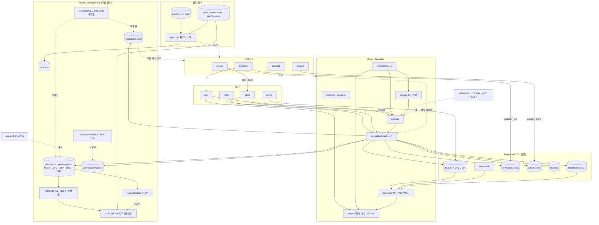

# 프로젝트 전체 구조 · 관리체계 전수조사 (READ-ONLY)

> 2026-11-21 · develop 모드 세션(브랜치 `ccr-ec2eb1b1-gk35p2`, 출발 커밋 `3c8064c` = main) · 조사와 문서화만 했다. 기존 소스 · 장부 · 스키마 · 설정 · 계획 파일은 바꾸지 않았다.
> 표기: **[사실]** = 코드 · 파일 · 명령 출력으로 확인 · **[추론]** = 분석자의 판단 · **UNKNOWN** = 자료로 판단할 수 없음.
> 숫자는 2026-11-21 의 저장소 값이다(`node dbtool.mjs status` · `rebuild/status/00-summary.md` · 직접 센 값).

---

## 1. 조사 개요 및 범위

| 항목 | 내용 |
|---|---|
| 목적 | 시뮬레이터 · Core · Database · Registry · MCP · PLAN · TASK · ORCHESTRATION 의 역할과 연결을 파악해, 기존 체계를 보존하는 상위 프로젝트 관리체계의 설계 근거를 만든다 |
| 범위 | 저장소 전체(추적 파일 약 1200 개), `.claude/` 설정 · 훅 · 스킬, GitHub CI, 클라우드 예약 작업 1 개, 원격 브랜치 7 개 |
| 방법 | 파일 머리 주석 · 장부 첫 줄 · 필드 집계 · 명령 장부 · 문지기 코드 · MCP 서버 코드 읽기, `dbtool status` · `status.json` 읽기. 실행 로직은 돌리지 않았다(시험 묶음은 끝내기 검사로만) |
| 하지 않은 것 | 수정 · 통합 · 분리 · 재해석. 시험 전체를 새로 돌려 동작을 확인하는 일(시험 500 개는 `finish --full` 에서 통과 — 그 범위만 "작동" 으로 본다) |
| 바뀐 파일 | 이 보고서 하나 + 끝내기 검사가 요구하는 생성물 `rebuild/status/*` 갱신(문지기 `finish_first` — 손으로 고치지 않음) |

---

## 2. 저장소 전체 구조

### 2.1 최상위 [사실]

| 경로 | 추적 파일 | 역할 (머리 주석 · README 기준) |
|---|---|---|
| `core.js` (772 줄) | 1 | **행정부** — 읽기 · 질의 · 시뮬레이션(`simulate` 사건 기반 · `simulateRate` 속도 기반, 명시 오일러). 쓰기 · 판정 없음 |
| `model.js` (1042 줄) | 1 | **공유 헌법 층** — 형식 · 정규화 · 색인 · 참조 · 속도 법칙 정의 (세 권력이 모두 읽음) |
| `vocab.js` (660 줄) | 1 | **통제 어휘** — 위치 · 특징 · 종 · 외부 ID 형식 · 관계 제약. "사람이 검토하고 바꾼다" |
| `dictionary.js` | 1 | 사전 — 기계 키 ↔ 사람말 |
| `inbox.js` · `scenarios.js` | 2 | 수신함 읽기 · 시나리오 읽기 (읽기 전용) |
| `orchestrator.js` (323 줄) | 1 | **조정자** — 행정 실행 → 사법 판정 배선 (생물 시뮬레이션용) |
| `dbtool.mjs` | 1 | **명령줄 진입점** — `status · validate · merge · simulate · fate · attest · transition …` |
| `index.html` · `viewer.html` | 2 | 화면 (두 파일 바이트 동일 — 9 장) |
| `CLAUDE.md` | 1 | **중심 문서 (입구)** — 생성물 (`rebuild/status.mjs --write`) |
| `README.md` · `SCHEMA.md` · `DESIGN-v4.md` · `FEATURES.md` · `CHANGES.md` · `limitations.md` | 6 | 소개 · 형식 명세 · v4 설계 · 특징/가설 층 초안 · 코드/형식 변경 기록 · 한계 등록부(생성물) |
| `judicial/` | 35 | **사법부** — 관문 · 감사 · 질량 검증 · 운명 판정 · 신원 · 도장 · 승인 묶음 · 전환 기록 검사 · 관찰 비교 · 규약 … |
| `legislative/` | 3 | **입법부** — `legislative.js`(순수 merge) · `augment_draft.js` · `clerk.mjs`(유일한 파일 쓰기) |
| `compiler/` | 8 | **공유 컴파일러** — db + 시나리오 → 불변 IR · 속도 IR · 수식 테이프 · 가정 풀기 · 교란 · 관찰 연산자 |
| `engine/` | 18 | **행정부 엔진** — 운명 엔진 JS + Rust/WASM · 수치 결합점 등록부 · 난수 · 탐침 병렬 |
| `mcp/` | 6 | **MCP 서버** query · run · clerk · fetch + 공통 틀 + 검색 질의 |
| `data/` | 483 | **신뢰 데이터** — db · 패치 · 사건 기록 · 원장 · 수신함 |
| `attestations/` | 1 | 도장 등록부 |
| `rebuild/` | 47 | **재건(관리) 도구와 장부** — 문지기 · 규칙 장부 · 계획 장부 · 읽기 · 상태 생성 |
| `docs/` | 378 | 설계(21) · 모드 문서 · 계획(생성물) · 보고서 · 교과서 · 실행 설명서 · 템플릿 |
| `workspace/` | 61 | AI 작업 공간 — 과제 · 핸드오프 · 전환 기록 · 영수증 · NEXT · WORKORDER · STG-12 묶음 |
| `tests/` | 104 (최상위 64) | 시험 500 개 · 거부 말뭉치 25 · 바닥값 `tests/fixtures/FLOOR.json` |
| `examples/` | 47 | 시나리오 44 (가상 — "지식이 아님") · 관찰 예 · 패치 예 |
| `migrations/` | 13 | 형식 변환 001–012 (v1 → v12) · 옛 ID 대응표 |
| `schemas/` | 2 | 관찰(obs) · FFI 형식 |
| `.claude/` | — | `settings.json`(훅 4 종 · allow 57 · ask 29 · deny 21) · 스킬 5 (모드마다) |
| `.github/workflows/check.yml` | 1 | CI — push · PR 때 Rust 빌드/시험 · 규칙 시험 전체 · validate · 한계 · attest · trend · grade · Fate-Test(JS · Rust) · 상태/교과서 최신 |

### 2.2 실행 진입점 [사실]

| 진입점 | 누가 | 무엇 |
|---|---|---|
| `node dbtool.mjs <명령>` | 사람 · AI(Bash) · MCP clerk | 명령 36 개(명령 장부 `kind: cli`) |
| `node mcp/{query,run,clerk,fetch}.mjs` | MCP 클라이언트 (BIODB_ROLE 로 역할) | 도구 32 개 |
| `node rebuild/gate.mjs open/finish/hook` | 세션 · 훅 | 모드 열기 · 끝내기 검사 · 도구 전후 검사 |
| `node rebuild/plan.mjs apply/check` · `rules.mjs apply` · `read.mjs` · `status.mjs --write/--check` · `probe.mjs` | 세션 | 계획 · 규칙 장부 고치기, 읽기(L0–L2), 생성물 |
| `index.html` / `viewer.html` | 사람(브라우저) | 화면 |
| CI `check.yml` | GitHub | 검증 |
| 클라우드 예약 작업 `trig_01F8u8Uv6zMLRRdiignASP1P` "추세 재확인 (매달)" | claude.ai | 매달 3 일 08:41 KST, author 모드 추세 점검 |

### 2.3 시험 · 검증 체계 [사실]

| 층 | 무엇 | 어디 |
|---|---|---|
| 규칙 시험 | 500 개 (`node --test tests/*.test.mjs`), 바닥값 래칫(시험 500 · 판정 자리 426 · 거부 말뭉치 25 — 내리면 별도 커밋) | `tests/` · `FLOOR.json` |
| 바뀐 것에 닿는 시험 | `tests/affected.mjs` — 커밋은 이것, push 는 `--full` | 문지기 finish |
| 모드별 끝내기 묶음 | `modes.json` gate.modes.*.finish + common.finish | `rebuild/gate.mjs` |
| 변이 시험 | 집행 규칙을 일부러 끄고 시험이 잡는지 — 잡음 290 · 놓침 0 | `rebuild/rules/enforcement.jsonl` · `tests/mutation/` |
| CI | 위 전부 + Rust | `.github/workflows/check.yml` |

---

## 3. 기존 Registry 현황

### 3.1 분류 기준

- **K = 생물학 지식 관리 데이터** (무엇이 사실인가)
- **E = 시뮬레이터 실행 데이터** (무엇을 넣고 돌렸나)
- **G = 개발 · 운영 관리 데이터** (누가 무엇을 왜 바꿨나, 무엇을 할 것인가)

### 3.2 전체 목록 [사실]

번호 체계는 이미 **번호 사전**(`rebuild/index/namespaces.jsonl`, 56 이름공간 — active 35 · planned 3 · legacy 2 · external 16)에 등록돼 있다. 아래 "번호" 칸은 그 사전의 값이다.

| Registry | 위치 | 분류 | 담는 것 · 필드 (요약) | 번호 | 생성 · 수정 주체 | 검증 | 실행에서 쓰는 곳 |
|---|---|---|---|---|---|---|---|
| **db — 개념** | `data/db.json#terms` (210) | K | names · aliases | `T000001` (meta.next.T) | 입법 merge (패치 → 관문 → 서기) | `validate` · 관문 봉인 | 색인 · 매핑 |
| **db — 정의항** | `#senses` (212) | K | term · kind · tier · xrefs · components · desc · site · rule · obs | `D000001` · 하위 `D…/site|rule|desc|obs/<키>` | 〃 | 〃 + 신원 도장 | 컴파일러 · core 가 규칙을 읽음 |
| **db — 기전 단계** | `#steps` (57) | K | rule · agents · inputs · outputs · regulators · part_of | `S000001` | 〃 | 〃 + 질량 검증 | 경로 시뮬레이션 |
| **db — 한계** | `#limitations` (127) | K | target · type(Gap 8 종) · requirement · found_in · by · at | `L000001` | 〃 | `limitations --check/--detect` | 감사 · 보고서 |
| **db — 관찰 기록** | `#observations` (28: 추정용 22 · 검증용 6) | K | observable · value · unit · uncertainty · precision · replicates · condition · method · use · evidence | `O000001` | 〃 | 관문 · 규약(보정/검증 분리) | 상수 근거 · 관찰 비교 |
| **db — 값** | `#values` (68) | K | subject · property · value · unit · context · evidence · derivation | `V000001` (foldValues) | 입법 foldValues | 〃 | 시작량 · 부피 |
| 패치 기록 | `data/patches/` (71) | G(지식 변경 이력) | 병합된 패치 + report | patch_record | 서기 commitMerge | 봉인 | `dbtool report` |
| 사건 기록 | `data/log/events.jsonl` · genesis | G | 이관 · 병합 사건, 해시 사슬(prev) | event (seq) | 서기 | 사슬 검사 | 기원 증명 |
| 가정 원장 | `data/assumptions.jsonl` (360) | **E** | slot · value · unit · origin · basis, 해시 사슬 | `A000001` | 서기 appendAssumptions (`assume add` — author · baseline) | 사법부 검사 → 봉인 | 시나리오가 `{assume: A…}` 로 가리킴 (컴파일러가 풂) |
| 사전 등록 | `data/preregistrations.jsonl` (5) | **E** | 시나리오 sha256 · 질문 · 규약 | preregistration (seq) | `dbtool register` (baseline) | 규약 구조 판정 | 검증 결론의 전제 |
| 사전(번역) | `data/dictionary.jsonl` (116) | G(표현) | register · key · label_en · meaning_en, 사슬 | dictionary_entry | `dictionary add` (develop) | 사법부 검사 | 렌더러 |
| 수신함 | `data/fetched/` (405 — europepmc · chebi · uniprot · rhea · brenda · consensus) + FETCH_LOG | K(증거 원본) | 원본 그대로 | inbox_file · fetch_log | 서기 fetchToInbox (MCP fetch · augment fetch · trend --fetch) | 받기 기록 사슬 | 인용 대조 · 도장 증거 |
| **도장 등록부** | `attestations/registry.json` (363: verified · trend · accept) | K(신뢰 판정) | subject · claim · evidence(sha256) · checks · issuer | attestation (digest) | 서기 (사법부 재확인 통과 시) — `augment apply` · `trend --write`(author · inspect) · `accept`(inspect) | `dbtool attest` (CI) | 등급 · 관문 문턱 |
| 시나리오 | `examples/scenarios/` (44) | **E** | 시작량 · 상수(가정 번호) · 신호 · 부피 | 파일 이름 | baseline · develop · field | 컴파일러 · 감사 | 엔진 입력 |
| 수치 결합점 | `engine/coupling.js` | **E** | 생물 사실이 아닌 수치 선택(허용 오차 · 격자) | key | develop | 시험 | 엔진이 `resolve()` 로만 읽음 |
| 통제 어휘 | `vocab.js` | K(형식) | 위치 · 특징 · 종 · 세션 모드 … | vocab_token | 사람 (사용자 요청) | 시험 | 전부 |
| **규칙 장부** | `rebuild/rules/rules.jsonl` (536 · 살아 있음 521: 글 197 · 기계 324) | G | id · text · modes · enforce · unit | `RULE-0001` | `rules.mjs apply` (변경 기록 `changes.jsonl` 332) | 장부 검사 · 변이 시험 | 검사 오류 꼬리표 |
| 집행 · 수식 · 연결 · 검토 | `enforcement.jsonl` 324 · `formulas.jsonl` 13 (`EQ-…`) · `links.jsonl` 558 · `review.jsonl` 88 | G | 규칙 ↔ 시험 · 수식 · 이유 연결 · 검토 결정 | — · `EQ-0001` | `rules.mjs apply` | 〃 | 읽기 모드 |
| **명령 장부** | `rebuild/rules/commands.jsonl` (68: cli 36 · mcp 32) | G(권한) | cmd · kind · modes · writes · writes_on · collector | cmd 이름 | `rules.mjs apply` | RULE-0515 · 0287 | **문지기가 쓰는 명령을 모드별로 막음** |
| **상시 권한 장부** | `rebuild/rules/permissions.jsonl` (23) | G(권한) | id · layer · list · what · why · by · at · revoke | `PERM-0001` | `rules.mjs apply` | RULE-0521 (설정 · 모드 표와 대조) | 설정 · 문지기 |
| **모드 표 · 문지기 정책** | `rebuild/rules/modes.json` | G(권한) | modes(5) · gate(common · modes · roles.collector) | 모드 키 | 사람만 (문지기 파일 — develop 도 못 씀) | RULE-0521 | `gate.mjs` |
| 번호 사전 · 파일 → 모드 · 예외 | `rebuild/index/namespaces.jsonl` 56 · `file-modes.jsonl` 45 · `exceptions.jsonl` 3 | G | 이름공간 · 발급자 · 저장 위치 | ns | 재건 도구 | 번호 검사(미등록 0 · 겹침 0) | 상태 생성 |
| 분류 장부 | `rebuild/ledger/units.jsonl` (7281) | G | 문서 문장 단위 분류 | `U0001` | 재건 분류 | 형식 오류 0 | 규칙 맥락 |
| **계획 장부** | `rebuild/state/plans.jsonl` (plan 3 · decision 57 · part 11 · item 168 · synthesis 15 · direction 9 · open 10 · note 3 · order 1) + `plan-log.jsonl` (510 사건) | G | 3 장 참조 | `PLAN-` · `STG-` · `ASY-` · `DEC-` · `DIR-` | `plan.mjs apply` (모든 모드 — 공통 구역) | `plan.mjs check` (장부 = 잔액) | 생성물 `docs/plan/` |
| 과제 | `workspace/tasks/TASK-001…005` + TASK-TYPES | G | 사람용 마크다운 | `TASK-003` (integrator) | 통합가 | **없음** [사실: 검사 코드를 찾지 못함] | 수집가 세션 |
| 핸드오프 | `workspace/handoff/` (HANDOFF-*.md 5 · *.jsonl 3) | G → K 후보 | 후보 줄 · 상태(collected → verified/rejected → applied) | — | 수집가(put_handoff) · 통합가 | `verify-collection` · 인용 대조 | author 패치의 입력 |
| **전환 기록** | `workspace/transitions.jsonl` (main 10 줄 · 다른 브랜치에 #11) | G | from · to · at · why · target · files · open (+ seq) | seq | `dbtool transition` (모든 모드 · 수집가 포함) | `judicial/transition_audit.js` (칸 7 외 거부) | 다음 세션의 입력 |
| **영수증** | `workspace/receipts/` (24 파일 = 12 세션) | G | 도구 호출마다 한 줄, 사슬(prev) | `<날짜>-<세션>` | 문지기 훅만 (protect) | 사슬 | 감사 |
| 코드 · 형식 변경 기록 | `CHANGES.md` (327 행) | G | Scope · Why · Impact · Verification | `CHG-…` (계산) | 서기 derived · 세션 | RULE-0191 (코드가 알림) | — |
| 작업 메모 | `workspace/NEXT-*.md` 3 · `WORKORDER-2026-11-02-engine.md` · `docs/reports/` | G | 산문 | 없음 | 세션 | 없음 | 사람 · 다음 세션 |
| 저장 지도 · 권한 표 | `docs/textbook/storage-map.json` · `authority.json` | G(형식) | 저장 구역 · 등급 정책 · 권한 | — | 사람(권한 표는 문지기 보호) | 시험 | 부록 · 권한 판정 |
| 예약 작업 | claude.ai (`trig_…`) | G(외부) | 지시문 · 일정 | scheduled_task (external) | 사용자 | UNKNOWN (저장소 밖) | 매달 추세 점검 |

### 3.3 참조 관계 [사실]

| 보내는 쪽 | 받는 쪽 | 어떻게 |
|---|---|---|
| 정의항 rule / step | 정의항 · 단계 | 번호(D… · S…) |
| 한계 L | 정의항 · 단계 | target 번호 |
| 관찰 O | 규칙 상수의 근거(from) | evidence |
| 시나리오 | 가정 A · 정의항 D | `{assume}` · 번호 |
| 도장 | 정의항 하위 번호 · 수신함 파일 sha256 | subject · evidence |
| 전환 기록 | T·D·S·O·L·V · A · RULE (target) · 파일(files) | `TARGET_RE` — **PLAN · TASK · ORCH 는 못 가리킴** |
| 계획 결정 DEC | 작업 · 커밋 | affects · src.commit (검사됨) |
| 규칙 RULE | 분류 단위 U · 시험 · 수식 EQ | links · enforcement |
| 명령 장부 | 모드 · 쓰기 구역(서기 ZONES) | modes · writes |
| 과제 TASK | 핸드오프 | 글로만 (기계 연결 없음) |

---

## 4. 기존 개발 관리체계 현황

### 4.1 구성요소 [사실]

| 구성요소 | 정의된 역할 | 상태 관리 | 생성 · 변경 절차 | 다른 것과의 관계 | 실제 사용 |
|---|---|---|---|---|---|
| **MASTER (최상위 계획)** | 별도 MASTER 파일 **없음**. 가장 가까운 것: `CLAUDE.md`(입구 · 규칙) · `docs/design/direction.md`(북극성 "현실 검증", 2026-10-22) · `docs/plan/ORDER.md`(세 계획을 한 줄로) | ORDER 는 장부의 order 기록 | `plan.mjs apply` (order op) | ORDER → 작업 번호 | 사용 중 (11/20 갱신) |
| **계획 3 개** | build(구현 — 9 부 · 109 작업 · 완료 42 · 진행 11 · 대기 55 · 보류 1) · rebuild(재건 — 완료 39 · 진행 2 · 보류 1) · assay(측정법 — 완료 1 · 진행 3 · 대기 12 · 보류 1) | 작업마다 state(open · partial · done · hold) + 기호 + 날짜 + result | `plan.mjs apply` — 묶음마다 at · why, 사건으로 덧붙임. 손글 시절 사건은 git 역사에서 가져옴 | 결정 · 방향 · 종합 · 열린 질문이 같은 장부 | 사용 중 |
| **PLAN / STG / ASY 작업** | 작업 하나 = 작업 · 자리 · 끝나는 조건 칸 | 위 state | 위 | 순서(ORDER)에 자리마다 왜 | 사용 중 |
| **DEC 결정 로그** | 57 건 — type · by(user/ai/unstated) · by_src · 원문 · affects · updates | 덧붙이기 (updates) | `plan.mjs apply` decide · decision-update | 작업 · 커밋 참조를 검사 | 사용 중 |
| **DIR 방향 · 종합 · 열린 질문** | 9 · 15 · 10 | direction state · open resolved | 〃 | 계획 문서 생성 | 사용 중 |
| **TASK** | 통합가 → 수집가 **묶음 과제** (한 번에 하나) | **상태 칸 없음** | 사람/통합가가 md 작성 | 결과는 handoff/ 로 (글로만 연결) | TASK-001–005 (최근 쓰임 UNKNOWN) |
| **핸드오프** | 수집 결과 + 검증 · 적용 상태 | md 표의 상태 글 + 일부 jsonl | 수집가 put_handoff · 통합가 손 | TASK · 패치 | 사용 중 (5 주제) |
| **전환 기록** | 모드 사이 인계 (한 세션 = 한 모드) | **열림/처리됨 상태 없음** — 덧붙이기만 | `dbtool transition` | 다음 세션 프롬프트 | 사용 중 (#1–#11) |
| **ORCHESTRATION** | **계획만 있음**: PLAN-099–104 (DEC-0064 · 0065, 2026-11-20) — 상위 작업 ORCH-nnnn | — | — | — | **미구현** |
| NEXT · WORKORDER | 세션 사이 산문 메모 (STG-11f 가 전환 기록으로 대신하려는 것) | 없음 | 손 | — | 11/19 이후 새 것 없음 |
| 보고서 | `docs/reports/` — 측정 · 해부 · 설계 입력 | 없음 | 세션 | 계획 결과 칸에서 인용 | 사용 중 |
| CHANGES.md | 코드 · 형식 변경 한 행 (RULE-0191) | 덧붙이기 | 세션 | 커밋 | 사용 중 |
| 재건 상태판 | `rebuild/status/00–11` + `status.json` | 생성물 (응답 끝 훅이 갱신) | `status.mjs --write` | 장부 전부를 셈 | 사용 중 |

### 4.2 상태 흐름이 정의된 곳 [사실]

| 대상 | 상태 | 기계 검사 |
|---|---|---|
| 계획 작업 | open → partial → done (hold) | 장부 = 잔액 · 날짜 필수. **done 에 증거(시험 · 커밋)를 요구하지 않음** (`rebuild/state.mjs` apply 의 state op) |
| 핸드오프 후보 | collected → verified / rejected → applied | 일부(verify-collection 은 판정, 상태 글 갱신은 손) |
| 세션 모드 | 열림 → finish 통과 → 커밋 · push | 문지기 (작업 지문 · RULE-0516) |
| 데이터 변경 | 패치 → 관문 → 봉인 → 서기 → (PR · 병합) | 관문 · 서기 · CI |
| 전환 기록 · TASK · ORCH | 없음 | 없음 |

---

## 5. MCP 및 AI 실행체계 현황

### 5.1 서버 [사실 — `mcp/*.mjs`]

| 서버 | 도구 | 입력 · 출력 | 접근 데이터 | 쓰기 | 역할 |
|---|---|---|---|---|---|
| `query` | summary · map · context · mechanism · pattern · limitations · origin · assume_uses · qualgraph · retraction · inbox · verify_collection (12) | JSON 인자 → 글 + structuredContent | db · 색인 · 원장 (메모리, 크기 · 시각으로 무효화) | 없음 | 모든 역할 |
| `run` | run_fate · run_ensemble · run_rate (3) | 시나리오 → 예측 + 출처 꼬리표(db · 시나리오 · IR · 코드 지문, protocol/exploration) | db · 시나리오 · 엔진 | 없음 | 모든 역할 |
| `fetch` | resolve_access · fetch_abstract · fetch_fulltext · resolve_doi · search_literature · uniprot_kinetics · brenda_kinetics (7) | 식별자 → 수신함 파일 + 받기 기록 | 바깥 원천 (공개 전문 · 초록만) | 증거 구역만 (서기) | 수집가 포함 |
| `clerk` | put_handoff (모든 역할) · validate_patch · merge · augment_apply · register · assume_add · dictionary_add · accept · attest · write_derived (integrator · human) (10) | 저장소 **밖** 패치 경로 → dbtool 결과 | 저장소 전체 (dbtool 경유) | **있음 — 유일한 문** · 단일 작성자 잠금 | 역할별 |
| 공통 틀 `protocol.mjs` | initialize · ping · tools/list · tools/call | 표준 입출력 JSON-RPC 2.0, 한 번에 하나 | — | — | `BIODB_ROLE` (기본 collector), 목록에 없는 도구는 부르는 자리에서도 거부 |

시험: `tests/mcp.test.mjs` ①–⑦ (프로토콜 · 무효화 · 역할 · 단일 작성자 · 핸드오프 · 받기 기록 · 삼권) · `tests/mcp_run.test.mjs` — **IMPLEMENTED**.

### 5.2 권한이 걸리는 자리 [사실]

| 겹 | 무엇을 보나 | 근거 |
|---|---|---|
| 1 문지기 훅 (pre/post, `Bash · Edit · Write · MultiEdit · NotebookEdit · mcp__.*`) | 모드의 쓰기 경로 · **쓰는 명령(cli · mcp)을 명령 장부의 modes 로 막음**(RULE-0515) · 수집가 역할이면 collector 표시 없는 쓰기 명령 막음(RULE-0287) · 사후 파일 대조 · 영수증 | `rebuild/gate.mjs` commandBlock · `MCP_RE` |
| 2 MCP 서버 | 역할로 도구 목록을 거름 | `protocol.mjs` |
| 3 사법부 | 내용 (관문 · 봉인 · 도장 재확인) | `judicial/` |
| 4 입법 서기 | 쓰기 구역(ZONES 11) · 봉인 지문 | `legislative/clerk.mjs` |
| 5 사람 | settings ask 29 · 문지기 파일 · main 병합 | `.claude/settings.json` · GitHub |

예: `mcp accept` 는 명령 장부상 inspect 만 — author 세션에서 부르면 겹 1 이 막는다. 읽기 명령(`writes: null`)은 장부의 modes 와 다르더라도 막지 않는다(코드 주석 "읽기 명령은 막지 않는다").

### 5.3 서버 간 호출 [사실]

`clerk` → `dbtool.mjs`(자식 프로세스) → 사법부 → 서기. `query` · `run` · `fetch` 는 서로 부르지 않는다. 서버를 세션에 꽂는 설정(`.mcp.json` · settings `mcpServers` · `~/.claude.json` mcpServers)은 **이 컨테이너에서 찾지 못함** → 지금 세션들은 MCP 대신 `dbtool` 명령을 쓴다 [사실: 이 세션 도구 목록에 저장소 MCP 없음].

### 5.4 AI 가 할 수 있는 범위 [사실]

| 할 수 있음 | 사람이 해야 함 |
|---|---|
| 모드 하나 열고 그 모드의 쓰기 · 명령 · 시험 · 커밋 · 자기 브랜치 push | 문지기 · 설정 · 모드 표 · 권한 표 · 판정 코드 변경 (승인 묶음, 사람이 GitHub 에서 커밋 — STG-12) |
| 전환 기록 남기기 · 계획 장부 고치기(모든 모드) | main 병합 · PR 생성 요청(RULE-0257) |
| 클라우드 세션 띄우기 · 메시지 · 예약 작업(세션 도구 — 저장소 밖) | develop 모드 요청(사용자 요청 시만) · vocab · 규칙 변경 요청(RULE-0197) |

### 5.5 Supervisor · 조율 기능 [사실]

코드에 `supervisor` 문자열 **없음**. 상위 조율은 **사람 + 전환 기록 + 세션 도구(수동)** 로만 이뤄짐. 계획(PLAN-099–104)만 있음 → **MISSING**. 유사 기능: `orchestrator.js` 는 시뮬레이션 배선이라 해당 없음.

---

## 6. Core 및 Simulator 구조

### 6.1 책임과 경계 [사실]

| 구성 | 책임 | 경계 (하지 않는 것) |
|---|---|---|
| model.js (헌법) | 형식 · 정규화 · 색인 · 속도 법칙 정의 | 시뮬레이션 · 판정 · 쓰기 |
| core.js (행정) | 질의 · `simulate`(사건) · `simulateRate`(속도, 명시 오일러 + 안정성 감사) | 쓰기 · 판정 · "verified" 선언 |
| compiler/ (공유) | db + 시나리오 → 불변 IR(운명 · 속도) · 수식 테이프 · 가정 풀기 · 교란 · 관찰 연산자 | 쓰기 · 판정 · 엔진 호출 |
| engine/ (행정) | 운명 엔진 — JS 와 Rust/WASM(테이프 해석기 + 결합 Rodas3, 비트 일치), 결합점 등록부, 카운터 난수, 탐침 병렬 | 분자 이름을 모름(RULE-0009) · db 상수를 바꾸지 않음 |
| judicial/ (사법) | 관문 · 감사 · 독립 질량 검증 · 운명 판정 · 관찰 비교 · 규약 · 신뢰 지표 · 도장 · 승인 묶음 | 실행 · 쓰기 |
| legislative/ (입법) | 패치 적용 계산(순수) · 초안 · 서기 쓰기 | 판단 |
| orchestrator.js (조정자) | 행정 실행 → 사법 판정 배선 · engineGap 등 | 쓰기 · 판정 |

**두 엔진** [사실]: 속도 엔진(core.simulateRate, 명시 오일러)과 운명 엔진(IR + Rodas3)이 따로 있고, 하나로 합치는 일이 PLAN-080(진행) · PLAN-055(완료, 차이 측정 — 입력 해석이 주 원인).

### 6.2 지식 데이터 ↔ 실행 데이터 [사실]

```text
지식(K): db.json (규칙 · 단계 · 관찰 · 값) ─┐
실행(E): 시나리오 + 가정 원장 A… + 결합점 ──┼→ 컴파일러 → IR → 엔진 → 원자료 → 사법부(감사 · 질량 · 비교) → 판결 · 보고서
관찰(K): O… (use = validation) ────────────┘                                  ↑ 관찰 연산자(측정 장치 보정)
```
시나리오는 "지식이 아님"(README) — 가상 숫자는 가정 원장 번호로만(구조 재편 §3).

### 6.3 author · assay · baseline · validation 의 정체 [사실]

| 이름 | 무엇인가 | 혼동 주의 |
|---|---|---|
| author | **세션 모드** (데이터 쓰기) + 수집가 역할 | 모듈 아님 |
| baseline | **세션 모드** (검증된 코어로 실행 · 관찰과 대조, 사전 등록) | 모듈 아님 |
| inspect | **세션 모드** (판정 · 도장 · 읽기) | — |
| assay | **계획 이름**(측정법 계획 ASY-00…16) | 모드도 모듈도 아님 |
| validation | **관찰 기록의 use 값**(추정 estimation / 검증 validation) + 규약의 검증 세트(`judicial/protocol.js`, 추정 · 검증 분리) | 모드 아님 |

### 6.4 모델 정의 → 계산 → 검증 흐름 [사실]

1. author: 문헌(fetch) → 핸드오프 → 패치 → 관문 → 서기 → db (+ 도장)
2. baseline: 시나리오(가정 번호) → 사전 등록 → 실행(run · dbtool fate/simulate) → 감사
3. 관찰 비교: 관찰 연산자 → 예측 측정량 → `obs_compare` (오차 막대) → 판결
4. 결과: FINDING 은 고치지 않음 · DATA_GAP 은 한계 · ENGINE_DEFECT 는 develop (결함 태그 RULE-0039–0043)

---

## 7. 구성요소 간 관계도

실선 = 코드에서 호출 · 쓰기를 확인 · 점선 = 문서 · 글로만 연결 또는 미구현 · `?` = 미확인.



---

## 8. 구현 현황 분류표

| 기능 | 분류 | 근거 |
|---|---|---|
| 삼권 분립 (행정 순수 · 사법 비실행 · 서기 유일 쓰기) | IMPLEMENTED | 머리 주석 · 서기 ZONES · `mcp.test.mjs` ⑦ |
| 한 세션 = 한 모드 · 모드별 쓰기 경로 · 쓰는 명령 막기 | IMPLEMENTED | `gate.mjs` · 훅 · RULE-0515 |
| 끝내기 검사 → 커밋/push 열기 | IMPLEMENTED | `gate finish` (이 세션에서 여러 번 작동) |
| 영수증 (도구 호출 사슬) | IMPLEMENTED | 훅 · `receipts/` |
| 계획 장부 (사건 · 잔액 · 생성물 · 읽기 L0–L2) | IMPLEMENTED | `plan.mjs check` · `read.mjs` |
| 규칙 · 명령 · 권한 장부 + 설정 대조 | IMPLEMENTED | RULE-0521 시험 |
| 번호 사전 (56 이름공간, 미등록 0) | IMPLEMENTED | `namespaces.jsonl` · 상태판 |
| 패치 관문 · 봉인 · 도장 · 추세 · 등급 | IMPLEMENTED | CI 단계 |
| MCP 서버 4 + 역할 거름 + 단일 작성자 | IMPLEMENTED | 코드 · 시험 |
| MCP 를 세션에 연결하는 설정 | MISSING | `.mcp.json` 등 없음 |
| 운명 엔진 JS = Rust 비트 일치 · Rodas3 | IMPLEMENTED | `rust_engine.test.mjs` · CI |
| 속도 엔진과 운명 엔진 하나로 | PARTIAL | PLAN-080 ◐ |
| 관찰 연산자 · 관찰 비교 · 규약(보정/검증 분리) | IMPLEMENTED | `obs_operator.js` · `obs_compare.js` · `protocol.js` |
| 실측 상수 | PARTIAL | 전이 규칙 57 중 속도 상수 4 |
| 가설 층 | DOCUMENTED | FEATURES.md "아직 구현 전" |
| 승인 묶음 (L6 변경 분류 · 지문 · 화면) | IMPLEMENTED | `judicial/approval.js` · STG-12 (AUTO_PASS = false) |
| TASK 상태 관리 | MISSING | 상태 칸 · 검사 없음 |
| 전환 기록의 처리 상태 (열림 · 처리됨) | MISSING | 칸 7 만, 덧붙이기만 |
| 상위 작업 조율 (ORCH · Supervisor · Dispatcher) | MISSING (계획 PLAN-099–104 만) | 코드 없음 |
| 작업 완료의 증거 연결 (done ↔ 시험 · 커밋 · PR) | PARTIAL | result 글에 적음, 기계 검사 없음 |
| 계획 간 의존성 | PARTIAL | order 의 why 글 · DEC affects · "끝나는 조건" 글 — 의존 칸 없음 |
| 여러 세션 동시 작업의 장부 순번 충돌 | MISSING (방지책 없음) | 덧붙이기 장부 seq · 가상 실행 F8 |
| 클라우드 예약 작업 (추세 매달) | IMPLEMENTED (외부) · 결과 보존 PARTIAL | 11/3 push 403 유실 → 지시문에 확인 단계(DEC-0062) |
| 사람 승인의 증거 (병합 = 승인) | DOCUMENTED (DEC-0064 가) | 판정 코드 없음 (PLAN-102) |
| SBML · SED-ML 내보내기 | DOCUMENTED | PLAN-038 대기 |
| 시뮬레이터가 실제 실험을 재현 (D000051) | MISSING | 관찰 0 · 2026-11-21 해부 |

---

## 9. 중복 · 충돌 · 관리 공백

### 9.1 중복 [사실]

| 무엇 | 어디 | 비고 |
|---|---|---|
| 같은 화면 두 파일 | `index.html` = `viewer.html` (바이트 동일) | 의도 UNKNOWN (GitHub Pages 입구일 수 있음) |
| 세션 사이 인계 셋 | 전환 기록 · NEXT-*.md · WORKORDER | STG-11f 가 NEXT 를 전환 기록으로 대신하는 중 — 과도기 |
| 시뮬레이션 엔진 둘 | core.simulateRate · 운명 엔진 | PLAN-080 으로 해소 중 (의도된 과도기) |
| 같은 번호 형식을 코드에 따로 적은 곳 | 19 곳 (상태판) | — |
| "조정자 orchestrator" 와 "작업 조율 orch" 이름 | `orchestrator.js` · PLAN-099– | 뜻이 다름 — 문서에서 구분해 둠 |

### 9.2 충돌 · 불일치

| 무엇 | 사실 | 분류 |
|---|---|---|
| 문서 숫자가 지금과 다름 | README "형식 v10 · kinetics 2 건 · observations 15 건" / SCHEMA.md 제목 "형식 버전 9" / 실제 v12 · 속도 상수 4 · 관찰 28 | CONFLICT (낡은 문서) |
| **accept 도장의 승인자** | `dbtool.mjs:647` — `BIODB_ROLE` 가 없으면 승인자를 `'human'` 으로 기록. inspect 모드의 AI 세션이 `dbtool accept` 를 돌리면 "human" 으로 남는다 [사실: 코드] · 사람이 실제 눌렀는지는 기록이 가르지 못함 [추론] | CONFLICT (RULE-0461 의 취지와) — 조사 단계라 고치지 않음 |
| 예약 작업 지시문의 PR | 지시문 6 단계 "main 으로 PR 을 연다" vs RULE-0257 "PR 은 사용자 명시 요청 시만" | UNKNOWN — 사용자가 만든 지시문을 상시 요청으로 볼지는 사용자 판단 |
| 도장을 쓰는 모드 | 모드 문서: 승인 도장은 inspect / 명령 장부: `trend --write` 는 author · inspect, gate: author 도 `attestations/**` 쓰기 허용 | 문서 표현과 장부 범위가 다름 — 의도 여부 UNKNOWN |
| 제 11/20 설명서의 오류 | `docs/reports/2026-11-20-orchestration-modules-flow.md` §6.2 "모드와 역할이 따로 논다 → author 세션이 도장 도구를 쓸 수 있다" — **틀림**: 명령 장부 + 문지기가 쓰는 MCP 도구를 모드로 막는다(5.2). 남는 빈 곳은 "역할 이름표를 스스로 적는다" 와 "MCP 연결 설정 없음" 뿐 | CONFLICT (이 세션 문서) — 원칙대로 이번엔 고치지 않음 |
| 계획 장부를 모든 모드가 씀 | 공통 구역에 `rebuild/state/**` — 계획 결정은 사용자 몫인데 기계로는 어느 모드도 고칠 수 있음 | 설계 의도(장부 검사 + why 필수) [사실] · 결정 출처(by)는 글로만 [사실] |

### 9.3 관리 공백 (질문 1–8 에 대한 답)

| 질문 | 답 | 근거 |
|---|---|---|
| 1 전체 진행을 한눈에? | **부분** — 계획 순서(ORDER) · 재건 상태판(구조 숫자)은 있음. **지금 돌고 있는 세션 · 브랜치 · PR · 막힌 전환 기록을 함께 보는 곳은 없음** | ORDER.md · 00-summary.md |
| 2 모든 계획과 작업이 추적 가능? | 계획 작업은 **예**(장부 · 사건). TASK · 전환 기록 · 핸드오프 · 세션 · 브랜치는 서로 기계로 이어지지 않음 | 3.3 표 |
| 3 계획 간 의존성? | **부분** — 글(why · 끝나는 조건 · affects)로만. 의존 칸 · 순환 검사 없음 | plans.jsonl 필드 |
| 4 완료와 검증 구분? | 데이터는 **예**(관문 · 도장 · 관찰 비교). 계획 작업은 **아니오** — done 이 증거 없이 기록됨. 세션은 finish 로 시험 통과를 구분 | state.mjs apply · gate |
| 5 AI 권한 / 사람 승인 구분? | **예, 대부분** — 권한 장부 · 문지기 · ask · 문지기 파일 보호 · main 병합. 빈 곳: accept 승인자 기본값 'human', MCP 역할 이름표 자기 선언 | 5.2 · 9.2 |
| 6 DB 변경 통제? | **예** — 서기 유일 쓰기 · 관문 봉인 · 모드 제한 · CI · 병합. 다만 "사람이 승인했다" 는 증거는 병합 기록뿐(판정 코드 없음) | — |
| 7 Registry 와 개발 관리의 책임 경계? | 지식 · 실행 Registry 는 **명확**(서기 구역 · 번호 사전). 개발 관리(TASK · 전환 · 핸드오프 · 계획 · NEXT)는 **겹침** — 같은 "다음에 할 일" 이 셋 이상에 흩어짐 | 4.1 |
| 8 다른 기준으로 관리되는 같은 정보? | 예 — 형식 버전(README · SCHEMA · db), 인계(전환 · NEXT · WORKORDER), 승인 도장의 모드, 상태 흐름(계획 · 핸드오프 · 세션이 각자) | 9.1 · 9.2 |

---

## 10. 상위 프로젝트 관리체계 도입 필요성 [추론]

| 지금 비어 있는 일 | 왜 필요한가 | 기존 무엇이 반쯤 하고 있나 |
|---|---|---|
| **진행 중인 일의 지도** — 어떤 세션 · 모드 · 브랜치 · PR 이 어느 계획 작업을 하고 있나 | 이번 조사 중에도 "다른 develop 세션" 이 무엇을 하는지 기록으로 알 수 없었음 | 영수증(세션별) · 세션 도구(저장소 밖) |
| **인계의 처리 상태** — 전환 기록 #8–#11 중 무엇이 처리됐나 | 지금은 사람이 기억함 | 전환 기록(덧붙이기만) |
| **계획 작업 ↔ 실행 증거** — done 의 근거(시험 · 커밋 · PR · 관찰 판결) | 완료와 검증을 구분하려면 | result 글 · CHANGES · 계획 결정 src.commit 검사 |
| **의존성** | 순서를 바꿀 때 무엇이 깨지는지 | order why · affects |
| **사람 승인의 증거 계산** | AI 가 쓸 수 있는 칸에 "human" 을 적는 방식은 증거가 안 됨 | 승인 묶음 지문 · GitHub 병합 |
| **여러 세션 동시 작업** | 덧붙이기 장부 순번 겹침 · 생성물 충돌 | 없음 |
| **여러 모드를 거치는 일 하나**(예: cAMP · D000051) | 한 세션 = 한 모드라 일 하나가 세션 여럿에 흩어짐 | 전환 기록 사슬 |

새 체계가 **하지 말아야 할 일**: 지식 판정(사법부) · 데이터 쓰기(서기) · 권한 부여(권한 장부) · 계획 내용(계획 장부) · 모드 통제(문지기). 이것들은 이미 있고 작동한다.

---

## 11. 설계 시 반드시 보존해야 할 기존 구조

| 보존할 것 | 이유 | 연결할 때 주의 |
|---|---|---|
| 삼권 분립 + 서기 유일 쓰기 (ZONES) | 모든 신뢰의 바닥 | 새 장부도 서기 구역 하나로 — 다른 쓰기 길 금지 |
| 한 세션 = 한 모드 · 문지기 · 영수증 | 쓰기 통제와 감사 | 감독이 모드를 대신 열거나 우회 실행 경로를 만들지 않기 |
| 명령 장부 · 권한 장부 · 모드 표 (RULE-0521 대조) | 권한은 장부에만 | 새 명령은 명령 장부에 줄로, 권한은 PERM 줄로 — 문지기 파일 변경은 사람 |
| 계획 장부 (사건 = 잔액, why 필수, 생성물) | 맥락 보존 (DEC-0027) | 상위 체계는 계획 작업 **번호를 가리키기만**, 상태를 이중으로 적지 않기 |
| 번호 사전 (56) · 번호 재사용 금지 | 참조 보존 | 새 번호(예: ORCH-)는 사전에 먼저 등록 |
| 전환 기록 형식 (칸 7, 검사됨) | 세션 인계 | 칸을 늘리지 말고 새 장부가 전환 순번을 가리키기 |
| 핸드오프 상태 흐름 · TASK md 형식 | 수집가 체계 | 덮어쓰지 않고 참조 |
| 관문 · 봉인 · 도장 · 관찰 비교 · 규약 | 데이터 신뢰 | 승인 = 데이터 판정이 아님 — 둘을 섞지 않기 |
| 바닥값 래칫 · 변이 시험 · CI | 회귀 방지 | 새 검사를 더하면 바닥값을 올림 |
| 결함 태그 (FINDING · DATA_GAP · NUMERICAL · ENGINE/COMPILER_DEFECT) | 고칠 자리를 정함 | 상위 체계의 "막힘" 분류가 이것과 같은 말을 쓰게 |

---

## 12. 추가 확인이 필요한 사항 (UNKNOWN)

| 무엇 | 왜 모름 | 확인 방법 |
|---|---|---|
| 지금 다른 develop 세션이 하는 일 | 세션 목록 첫 쪽에 돌고 있는 develop 세션 없음 · 사용자 컴퓨터 세션은 볼 수 없음 | 사용자에게 |
| `index.html` / `viewer.html` 를 둘 다 두는 이유 | 기록 없음 | git 역사 · 사용자 |
| TASK-001–005 가 아직 쓰이는지 | 상태 칸 없음 | 핸드오프 상태와 대조 · 사용자 |
| 분류하지 않은 문서 88 개의 역할 | 상태판 수치만 | `rebuild/status/02-docs.md` 상세 |
| 예약 작업 지시문의 PR 이 RULE-0257 의 "명시 요청" 인지 | 해석 문제 | 사용자 결정 |
| author 의 도장 쓰기 범위가 의도인지 | 모드 문서와 장부 표현 차이 | 사용자 · DEC 검색 |
| 클라우드 예약 작업에 저장소가 지금 붙어 있는지 | API 결과에 저장소 정보 없음 | 다음 실행(12/3) 결과 |
| MCP 서버를 실제로 쓴 세션이 있었는지 | 영수증에서 `mcp__` 호출을 세지 않음 | 영수증 검색 |
| 시험 500 개 중 무엇이 무엇을 지키는지 전체 표 | 이번 범위 밖 | `rebuild/status/03-commands-checks.md` · `10-enforcement.md` |

---

## 13. 다음 설계 단계 제안 [추론]

| 단계 | 무엇 | 기존과의 연결 | 결정 필요 |
|---|---|---|---|
| 1 | **이 보고서의 9.2 충돌 처리 방침** — 고칠지 · 둘지 · 한계로 둘지 (accept 승인자 기본값 · 낡은 문서 숫자 · 예약 작업 PR · 제 11/20 문서 오류) | 각 모드로 (develop · author) | 사용자 |
| 2 | 상위 체계의 **범위를 이 보고서 10 장 일곱 줄로 한정** — 기존이 하는 일은 맡지 않음 | DEC-0064 · 0065 와 대조, PLAN-099 규격의 입력 | 사용자 확인 |
| 3 | 새 번호 이름공간 등록 설계(ORCH-, 실행 run) — 번호 사전 먼저 | `namespaces.jsonl` | — |
| 4 | "참조만 하는 상위 장부" 의 칸 설계 — 계획 작업 번호 · 전환 순번 · 영수증 · 브랜치 · PR · 판결을 **가리키기만** | 3.3 참조 표 | F1(장부 자리) |
| 5 | 상태판에 "진행 중인 일" 면 하나 추가 설계 — 생성물로 | `rebuild/status` | — |
| 6 | 첫 순환(PLAN-103) 또는 D000051 세로 뚫기로 실제 시험 | 2026-11-21 지도 문서 | 사용자 (실험 고르기) |
