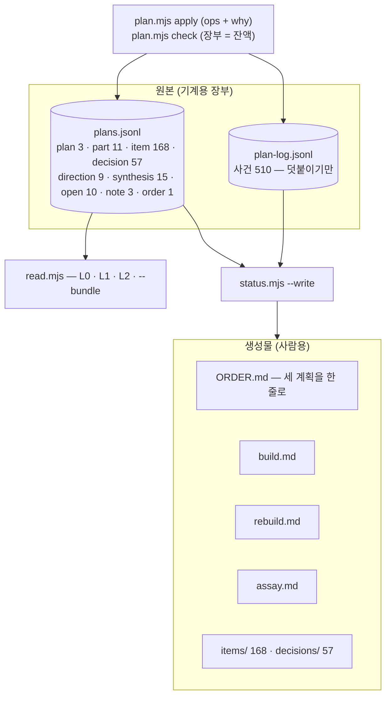
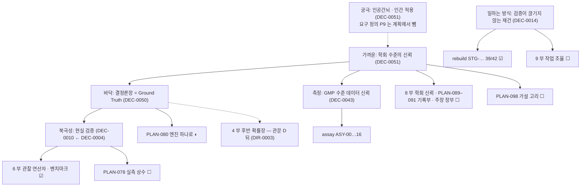
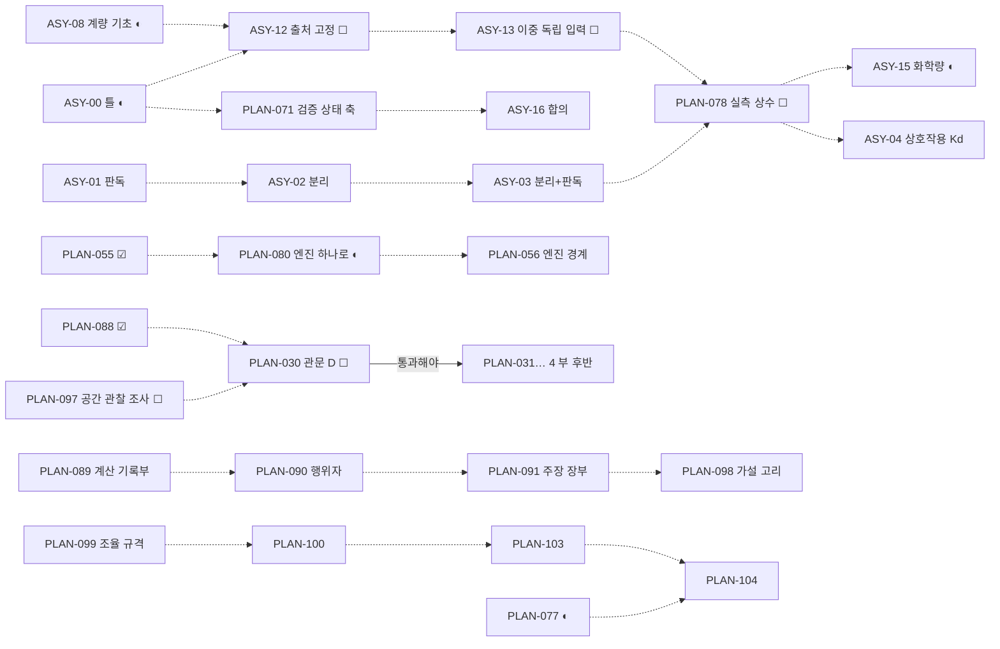

# 전체 로드맵 조사 — 계획 3 개 · 작업 168 · 결정 57 (READ-ONLY)

> 2026-11-21 · develop 모드 · 조사와 문서화만 — 계획 장부 · ORDER · 계획 문서는 바꾸지 않았다.
> 원본: `rebuild/state/plans.jsonl`(지금) · `rebuild/state/plan-log.jsonl`(걸어온 길 510 사건). 생성물: `docs/plan/ORDER.md` · `build.md` · `rebuild.md` · `assay.md` · `items/` 168 · `decisions/` 57. 저장소에 `PLAN.md` 라는 파일은 없다 — 재건 계획의 옛 출력 자리 `rebuild/PLAN.md` 는 장부의 `out` 칸에만 남아 있다.
> 표기: **[사실]** 장부 · 코드에서 확인 · **[추론]** 분석자 판단 · **UNKNOWN** 자료로 판단 불가. 앞선 조사: `docs/reports/project-management-system-audit.md`.
> 부록 A–C(작업 전부 · 순서 전부 · 순서 밖 작업)는 장부에서 기계로 뽑은 표다(읽기 전용 스크립트, 장부는 바꾸지 않음).

---

## 0. 한눈에

| 무엇 | 값 [사실] | 한 줄 뜻 [추론] |
|---|---|---|
| 계획 | 3 — build(구현) · rebuild(재건) · assay(측정법) | 무엇을 만들까 · 어떻게 일할까 · 어떻게 잴까 |
| 작업 | 168 — 완료 82 · 진행 16 · 대기 67 · 보류 3 | 절반이 끝남. 남은 것의 무게는 build 7 부와 assay |
| 결정 | 57 — 목적 6 · 설계 26 · 순서 9 · 방법 7 · 범위 7 · 진단 2 / 사용자 39 · 합의 4 · 위임 3 · 적히지 않음 11 | 목표가 여러 번 좁혀지고 높아졌다 |
| 방향 · 종합 · 열린 질문 | 9 (열림 6) · 15 · 10 (열림 8) | |
| 순서(ORDER) | 49 자리 — 그중 완료 16 | **미완료 작업 84 중 51 은 순서에 자리가 없다** |
| 의존 | 장부에 의존 칸 **없음**. 작업 글 속 번호 33 개 · 순서의 "왜" 글 · 결정의 affects | 선후는 글로만 적혀 있다 |
| 완료 조건 | 168 모두 "끝나는 조건" 이 있다 (빈 것 0) | 조건은 있으나 **완료 기록은 그 조건이 충족됐는지를 기계가 확인하지 않는다** |

---

## 1. 현재 전체 로드맵의 구조

### 1.1 층 [사실]

| 장치 | 무엇 | 근거 |
|---|---|---|
| 순서와 내용을 뗌 | 순서는 ORDER 하나, 내용은 작업 · 결정마다 파일. 순서를 바꿔도 내용 파일은 그대로 | DEC-0042 (2026-11-01) |
| 계획은 생성물 | 손으로 고치지 않고 `plan.mjs apply` 로만, 바꿀 때마다 why | DEC-0027 — "길어도 되지만 정확하게, 맥락을 모두" |
| 장부 = 잔액 | 사건을 차례로 접은 결과가 지금 기록과 같아야 함 | `rebuild/state.mjs` check |
| 손글 시절의 역사 | build 80 커밋 · rebuild 22 커밋에서 사건을 가져옴(`source: git`) | plan.import |

### 1.2 계획 셋 [사실]

| 계획 | 제목 | 부 | 작업 | 완료 · 진행 · 대기 · 보류 | 처음 목적 |
|---|---|---|---|---|---|
| **build** | 구현 계획 — 검증 · 저장 · 적분 엔진 | 9 | 109 | 42 · 11 · 55 · 1 | DEC-0001 위에서 아래로 차례로 실행하는 작업 목록 (2026-10-15) |
| **rebuild** | 재건 계획 — 글이 아니라 구조가 말하게 | 1 ("7. 단계") | 42 | 39 · 2 · 0 · 1 | DEC-0014 모든 파일을 갈아엎되 검증은 끊기지 않게 (2026-10-25) |
| **assay** | 측정법 계획 — 기초 판독에서 조합 · 심화로 | 1 ("측정법 사다리") | 17 | 1 · 3 · 12 · 1 | DEC-0041 기초 판독부터, 만든 방법을 남기며 (2026-11-01) |

### 1.3 build 의 아홉 부 [사실]

| 부 | 완료 · 진행 · 대기 · 보류 | 무엇 (부 제목) |
|---|---|---|
| 1 부 | 10 · 0 · 0 · 0 | 검증 기반과 저장의 출발점 — 동등성 검정 · 기원 기록 · 규약 · 교란 · v12 · 관문 A′ |
| 2 부 | 2 · 4 · 5 · 0 | 보고서 · 저장 확장 |
| 3 부 | 2 · 2 · 3 · 0 | 판정 강화 |
| 4 부 | 2 · 0 · 9 · 0 | 적분 엔진 — **관문 D 를 통과해야 4 부 후반** |
| 5 부 | 1 · 0 · 3 · 0 | 신뢰 외부화 |
| 6 부 | 9 · 1 · 0 · 0 | 현실 위의 검증 — 관찰 연산자 · 벤치마크 · 축약 (DEC-0010 "완성됨") |
| 7 부 | 13 · 4 · 27 · 1 | 구조 재편 — 가정 · 판정 · 측정법을 1 급으로 (가장 큼) |
| 8 부 | 3 · 0 · 2 · 0 | 학회 수준의 신뢰 — 바닥 · 실행 · 확률 층 · 가설 고리 |
| 9 부 | 0 · 0 · 6 · 0 | 작업 조율 (2026-11-20 추가) |

---

## 2. 프로젝트 최종 목표와 하위 목표

### 2.1 목표가 적힌 결정 [사실 — 원문 요약]

| 결정 | 날짜 · 누가 | 목표 |
|---|---|---|
| DEC-0004 | 10-15 · 사용자 | **북극성**: 살아 있는 생명체의 기전 연구. 등급 붙은 실측 데이터와 반증 가능한 판정을 **자원**으로 먼저, 그 위에 적분 장 엔진 — "자원 먼저 장 나중" |
| DEC-0010 | 10-22 · 적히지 않음 | 북극성을 **현실 검증**으로 좁힘 — "시뮬레이션이 현실 위에서 기능한다". 그 기계(6 부)는 "완성됨" |
| DEC-0014 | 10-25 · 적히지 않음 | 재건 미션 — 모든 파일을 갈아엎되 **검증은 끊기지 않게** |
| DEC-0043 | 11-01 · 사용자 | 측정법 최종 목표 — **GMP 에 쓸 수 있는 수준의 데이터 신뢰도**: GMP 자료를 담고 판정하는 그릇 + 문헌값은 정직한 등급 (규제 인증 자체는 범위 밖) |
| DEC-0050 | 11-02 · 사용자 | 시스템의 틀 — **결정론장을 현실에 닿는 바닥(Ground Truth)** 으로, 확률장을 거기에 붙잡아, 인공간뇌의 기초 데이터를 쌓는 통합 시스템. 판정: 골격은 충분하나 바닥이 가정 값 위(실측 속도 상수 4/160) · 확률장 본체가 설계뿐 · 실행 인터페이스 없음 · 규모가 이름뿐 |
| DEC-0051 | 11-02 · 사용자 | **목표의 층** — 가까운 목표 = 학회에서 신뢰 가능한 수준(재현 · 근거 추적 · 외부 정답 · 공인 신뢰성 틀 · 가설 사전 등록과 검증, 논문 · 보고서). 궁극 목표 = 인공간뇌(항상성 · 자극과 반응 · 의식 스위치)와 인간 적용. AI 메모: 인간 적용은 학회 수준보다 높은 별도 근거가 필요 |
| DEC-0044 | 11-01 · 사용자 | 범위 밖: 양자역학 (양자 계산값은 계산 갈래로만) |
| DEC-0008 | 10-16 · 사용자 | 범위 분리: 포스트-빌드 방향은 이 계획에 섞지 않음 |

### 2.2 목표 나무 [추론 — 결정의 "닿는 작업" 과 부 제목으로 엮음]

| 층 | 하위 목표 | 지금 [사실] |
|---|---|---|
| 궁극 | 인공간뇌 · 인간 적용 | 저장소에 정의 없음 (DEC-0050 원문: "요구 규모 · 데이터 종류는 아직 모름") |
| 가까운 | 재현 · 근거 추적 · 외부 정답 · 신뢰성 틀 · 가설 검증 | PLAN-088 · 094 · 095 · 096 ☑ / 089 · 090 · 091 · 098 · 040 · 038 ☐ |
| 바닥 | 실측에 매인 결정론 코어 | 실측 속도 상수 4 (전이 규칙 57 중) · PLAN-078 ☐ · 080 ◐ |
| 북극성 | 현실 관찰로 판정 | 기계 ☑ (6 부) · 관찰 데이터 적음(28 기록 · D000051 0) |
| 측정 | 측정법 그릇 · 불확도 · 무결성 | ASY 17 중 ☑ 1 (ASY-14) |
| 일하는 방식 | 구조가 말하는 저장소 · 한 세션 = 한 모드 | rebuild 39/42 ☑ · 9 부 ☐ |

---

## 3. 단계별 선후관계와 의존성

### 3.1 선후가 적힌 자리 [사실]

| 자리 | 모양 | 예 |
|---|---|---|
| ORDER 의 자리와 "왜" | 49 자리, 자리마다 글 | "ASY-12 출처 고정 — 옛 관찰 22 의 원문 숫자 채우기가 이 위에서 해야 한 번에 끝남 (DEC-0046)" |
| 관문 (gate) 작업 | 통과해야 뒤가 열림 | PLAN-010 관문 A′ ☑ · **PLAN-030 관문 D ☐ — "통과하지 못하면 31 이후 보류"** |
| 부 제목 | "관문 D 를 통과해야 4 부 후반" | 4 부 |
| 방향 DIR | DIR-0003 공간 엔진은 공간 관찰이 생긴 뒤 · DIR-0001 77 → 78 → 52 → 71 → 79 | |
| 결정 (order 9 건) | DEC-0003 · 0005 · 0013 · 0028 · 0029 · 0030 · 0048 · 0049 · 0062 | DEC-0028 "검증이 능력을 앞서지 않게 — 4 부를 stage 1 에서 멈춤" |
| 작업 글 속 번호 | 33 개 (부록 A "글 속 번호") | PLAN-098 → PLAN-089 · PLAN-091 / ASY-13 → PLAN-078 |
| 옛 순번 글 | "78 이 모을 …", "12A" | 번호 모양이 아니라 기계로 못 셈 |

### 3.2 주요 사슬 [추론 — 위 자리의 글을 엮음 · 실선 = 끝나는 조건에 적힌 관문 · 점선 = 순서의 "왜" · 작업 글에만 있음]

### 3.3 글 속 번호의 성질 [사실 → 추론]

- 서로를 가리키는 쌍이 셋: PLAN-092 ↔ 093 · PLAN-103 ↔ 104 · STG-12 ↔ 12a. 의존 순환이 아니라 "앞 · 뒤를 함께 적은 글" 이다 → **글 속 번호는 의존이 아니다**. 의존 방향은 사람이 읽어야 안다 [추론].
- 미완료 84 중 순서에 자리가 있는 것 33 · 없는 것 **51** (부록 C). 순서 밖 작업의 선후는 부 안의 차례와 부 제목뿐 [사실].

---

## 4. 각 단계의 완료 조건과 검증 기준

### 4.1 완료 조건 [사실]

| 무엇 | 사실 |
|---|---|
| 작업마다 "끝나는 조건" | 168 / 168 (빈 것 0) |
| build 공통 조건 (note) | `node --test` 전부 · validate 오류 0 · textbook --check · CHANGES 한 행 · 사법부 규칙이 바뀌면 거부 말뭉치 + FLOOR 상향 · 형식이 바뀌면 migrations + SCHEMA + 교과서 · 엔진이 바뀌면 JS · Rust 같은 커밋 … |
| 완료인데 결과 기록이 없음 | 2 — PLAN-041 · STG-00 |
| 조건의 모양 [추론, 부록 A 를 읽고] | ① 시험 (예: "변조 시 거부 시험") — 대부분 ② 측정 · 비교 ("비율 전후 · 궤적 전후") ③ 문서 · 형식 ("규격 문서 + 사용자 확인") ④ 사람 결정 ("사용자 커밋") ⑤ 조건부 분기 ("통과하지 못하면 31 이후 보류") |

### 4.2 검증 기준 — 누가 "끝났다" 를 확인하나 [사실]

| 단계 | 확인하는 것 | 기계 검사 |
|---|---|---|
| 작업을 완료로 적기 | `plan.mjs apply` state op — at · why 만 필요 | **조건 충족 여부를 보지 않음** |
| 그 작업의 코드 커밋 | `gate finish <모드>` — 바뀐 것에 닿는 시험 · push 는 전체 | 있음 (세션 단위) |
| main 에 들어감 | CI 전부 + 사람 병합 | 있음 |
| 결과 칸 | 글 (커밋 · 시험 · 보고서를 적음) | 결정의 `src.commit` 만 검사됨, 작업 결과의 커밋은 검사 안 됨 |
| 데이터 쪽 완료 | 관문 · 봉인 · 도장 · 관찰 비교 | 있음 |

→ **완료(사람 · AI 가 적음)와 검증(기계가 확인)이 작업 단위에서는 이어져 있지 않다.** DEC-0009 "AI 자기 보고를 실행 증거로 인정하지 않음" 이 코드 · 데이터에는 구현돼 있으나 계획 작업의 완료 표시에는 적용되지 않는다 [추론].

---

## 5. 현재 진행 상태와 미정 사항

### 5.1 진행 중 (16) [사실]

| 번호 | 진행 표시 날짜 | 비고 [추론] |
|---|---|---|
| PLAN-012 · 012a · 013 · 016a · 025 | 2026-10-16 / 10-15 | **한 달 넘게 진행 표시 그대로** — 실제로 진행 중인지 UNKNOWN |
| PLAN-047 | 10-22 | 〃 |
| PLAN-070 · 079 · STG-06 | 10-29 | 〃 |
| PLAN-077 · ASY-00 · ASY-08 | 11-01 | 077 은 저장소 연결이 사용자 일 (보류 중) |
| PLAN-020 · STG-11f · ASY-15 | 11-02 | ASY-15 판정 함수까지 끝, 자료(화학식)를 기다림 |
| PLAN-080 | 11-19 | 가장 최근 — 엔진 하나로 |

### 5.2 보류 (3) [사실]

| 번호 | 무엇 | 까닭 |
|---|---|---|
| PLAN-H01 | 종 계보 계산 · 가정 `derived_from` | 원래 "(보류)" 항목 |
| STG-12a | L6 보강 묶음 | 사용자 결정 2026-11-02 — 사용자 손이 드는 L6 보강은 하지 않음 |
| ASY-06 | 구조 (X선 · cryo-EM · NMR) | 모델이 구조를 입력으로 쓰지 않아, 쓰게 될 때 다시 연다 |

### 5.3 열린 질문 (8) · 열린 방향 (6) [사실]

| 종류 | 계획 | 내용 |
|---|---|---|
| 질문 | rebuild | main 병합 시점 — 사용자가 정한다 |
| 질문 | rebuild | 기록을 계획 항목 단위로 묶을 것인가 (DEC-0002 같은 커밋 규약을 바꾸는 일) |
| 질문 | rebuild | 대화 밖으로 옮기기 — skill · hook · subagent (조건: STG-11a–d 뒤) |
| 질문 | rebuild | 권한 등급 일곱(L0–L6) · 구역 이름 · L5 두 열쇠 (DEC-0048) |
| 질문 | assay | 온도 · pH 파생층 — 실제 사례가 생기면 |
| 질문 | assay | **사람 승인의 증명 — 사용자 기기 키의 git 서명 커밋 · 태그로 할 것인가** (DEC-0046) |
| 질문 | build | PLAN-101 문지기 연결 — STG-12a 보류를 풀 것인가 — **낡음**: DEC-0065 가 PLAN-101 범위를 "승인 PR 권한" 으로 바꿨는데 질문은 닫히지 않았다 |
| 질문 | build | F1 — 조율 장부 자리 (공통 구역 / 새 구역) |
| 방향 | build | DIR-0001 77 → 78 → 52 → 71 → 79 · DIR-0002 첫 정량 검증 한 건 · DIR-0003 공간 엔진은 공간 관찰 뒤 |
| 방향 | rebuild | DIR-0007 시범 · DIR-0008 절차 문장 326 의 새 자리 · DIR-0009 10a 만 끝내고 main 에 |

### 5.4 그 밖의 미정 [사실]

| 무엇 | 사실 |
|---|---|
| 순서 밖 미완료 | 51 (부록 C) — 2 · 3 · 4 · 5 부 대부분, 7 부 일부, STG-06 · ASY-06 · ASY-07 |
| 결정 번호 빈자리 | DEC-0052 – DEC-0059 가 없음 (0051 다음 0060). 장부 · git 역사에서 흔적을 찾지 못함 → 까닭 UNKNOWN |
| ASY-00 결과의 측정법 장부 | 결과 글은 `data/assays.jsonl` 장부를 만들었다고 적음. 코드(서기 구역 · `judicial/assay_audit.js` · dbtool) 는 있으나 **파일은 아직 없음** — 첫 쓰기 전 장부(항목 0) [사실]. 앞선 전수조사의 Registry 표에 빠졌다 |
| 지금 대화에서 정할 것 | F1 · F6 · PLAN-105 · 세로 뚫기 · 첫 실험 · E1 담당 (2026-11-20/21 문서) — **장부에는 아직 없음** |

---

## 6. 기존 계획 체계의 한계

| # | 한계 [사실 → 추론] | 영향 |
|---|---|---|
| 1 | **의존 칸이 없다** — 선후가 순서의 "왜" · 부 제목 · 글로만 | 순서를 바꿀 때 무엇이 깨지는지 기계가 못 알려 줌. 글 속 번호는 의존이 아님(3.3) |
| 2 | **순서가 일부만 덮는다** — 미완료 84 중 51 이 순서 밖 | "전체 로드맵" 과 "지금 할 일 목록" 이 다름. 순서 밖 작업은 잊힐 수 있음 |
| 3 | **완료 ≠ 검증** — 완료 표시에 증거를 요구하지 않음 | "끝났다" 가 조건 충족인지 기록만으로는 모름 (DEC-0009 의 취지가 계획 층에는 없음) |
| 4 | **진행 표시가 낡음** — 10-16 부터 ◐ 인 작업 5 개 이상 | 진행 상태판을 믿기 어려움. "진행" 의 유효 기간이 없음 |
| 5 | **목표 층이 작업에 기계로 묶이지 않음** — 결정의 affects 로만 | 목표별 진척(예: 학회 수준까지 몇 %)을 셀 수 없음 |
| 6 | **실행과 끊김** — 작업 ↔ 세션 · 브랜치 · PR · 전환 기록 · TASK 연결이 없음 | 누가 지금 어느 작업을 하는지 모름 (다른 develop 세션 문제) |
| 7 | **세 계획의 축이 다름** — build 는 부 9, rebuild 는 단계 하나, assay 는 사다리 하나 | 계획끼리 크기 · 진척을 비교하기 어려움 |
| 8 | **열린 질문 · 방향이 닫히지 않고 쌓임** — 질문 8 · 방향 6 이 열림, 하나는 이미 낡음 | 결정 대기 목록이 따로 없음 |
| 9 | **모든 모드가 계획 장부를 고칠 수 있음** — 공통 구역 | 설계 의도(why 필수 · 장부 검사)이나, 사용자 결정인지 AI 판단인지는 결정의 by 칸에만 — 작업 상태 변경에는 by 가 없음 |
| 10 | **덧붙이기 장부의 순번** — 여러 세션이 동시에 apply 하면 병합 때 겹침 | 동시 작업에서 장부 검사 실패 (가상 실행 F8) |
| 11 | **대화 속 결정이 장부 밖에 머묾** — 정할 것이 문서(보고서)에만 있고 open 기록이 아님 | 다음 세션이 못 봄 |

---

## 7. 전체 로드맵을 관리하기 위해 추가로 필요한 기능 [추론]

기존 장부(plans.jsonl · plan-log)를 **바꾸지 않고 위에 얹는** 것만 적는다. 각 기능의 "기존 연결" 은 이미 있는 것을 다시 만들지 않기 위한 표시다.

| # | 기능 | 메우는 한계 | 기존 연결 | 무게 |
|---|---|---|---|---|
| R1 | **의존 그래프** — 작업 사이 `needs`(먼저 끝나야 함) · `gate`(통과해야 열림) 를 칸으로. 순환 검사 · "이걸 미루면 막히는 것" 계산 | 1 · 2 | 작업 번호 · 관문 작업(PLAN-010 · 030) · ORDER | 장부 형식 변경 → 사용자 결정 · RULE-0261 |
| R2 | **완료 증거 연결** — done 에 증거 칸(시험 이름 · 커밋 · PR · 판결 · 보고서) 과 검사 (`src.commit` 처럼) | 3 | 결정의 커밋 검사 · gate finish 영수증 · CI | 〃 |
| R3 | **진행의 유효 기간** — ◐ 이 N 일 넘으면 상태판에 "낡음" 표시 (판정만, 상태는 안 바꿈) | 4 | status.mjs 생성물 | 작음 |
| R4 | **목표 나무** — 목적 결정(DEC purpose)을 뿌리로, 부 · 작업을 가지로 묶고 목표별 진척을 셈 | 5 · 7 | DEC affects · 부 | 중간 |
| R5 | **로드맵 한 장** — 세 계획 · 순서 안/밖 · 막힌 것 · 결정 대기 · 낡은 진행을 함께 보는 생성물 | 2 · 4 · 8 | ORDER.md · 상태판 | 작음 (생성물) |
| R6 | **결정 대기 목록** — 열린 질문 · 방향 · 대화 속 "정할 것" 을 open 기록으로 모으고 낡은 것을 표시 | 8 · 11 | open · direction 기록 | 작음 |
| R7 | **실행 연결** — 작업 ↔ 세션 · 브랜치 · PR · 전환 순번 · TASK (참조만) | 6 | 9 부 작업 조율 (PLAN-099–104) | 9 부와 같은 일 |
| R8 | **상태 변경의 행위자** — 작업 state 사건에 by(user · ai · delegated) | 9 | 결정의 by · PLAN-090 사람/AI 행위자 구분 | PLAN-090 과 묶음 |
| R9 | **동시 작업 안전** — 덧붙이기 장부 병합 규칙(사건 번호를 세션 · 차례로, 또는 병합 시 다시 매기기) | 10 | plan-log seq · 가상 실행 F8 | PLAN-100 과 묶음 |

### 7.1 먼저 할 것 [추론]

| 차례 | 무엇 | 까닭 |
|---|---|---|
| 1 | R5 로드맵 한 장 + R3 + R6 | 생성물 · 판정만이라 기존 장부를 안 바꿈 — 가장 안전하고, 바로 "한눈에" 를 줌 |
| 2 | R1 의존 + R2 완료 증거 | 형식 변경이라 사용자 결정 — 한 번의 형식 변경으로 묶기 |
| 3 | R4 목표 나무 | R1 위에서 |
| 4 | R7 · R8 · R9 | 9 부(작업 조율) · PLAN-090 과 함께 |

---

## 8. 추가 확인이 필요한 사항 (UNKNOWN)

| 무엇 | 확인 방법 |
|---|---|
| 10 월 중순부터 ◐ 인 작업들이 실제로 진행 중인지 | 작업마다 `read.mjs --depth 2` 의 마지막 사건 · 사용자 |
| DEC-0052 – 0059 가 없는 까닭 | 사용자 · 옛 세션 기록 |
| 순서 밖 51 작업을 계속 계획에 둘지 | 사용자 결정 |
| 궁극 목표(인공간뇌)의 요구 정의(P9)를 언제 다룰지 | DEC-0051 에서 뺌 — 사용자 |

---

## 부록 A. 모든 작업 (168) — 계획 · 부별

> 장부 `rebuild/state/plans.jsonl` 에서 뽑은 그대로(2026-11-21). 제목은 읽기 모드 L0, "끝나는 조건" 은 앞 180 자 — 전문은 `node rebuild/read.mjs <번호> --depth 2`. "순서" = ORDER.md 의 자리(없으면 —). "글 속 번호" = 작업 글에 적힌 다른 작업 번호(의존의 단서일 뿐, 장부에 의존 칸은 없다).

### A.1 구현 계획 (build)

#### 1부 — 검증 기반과 저장의 출발점 — 완료 10 · 진행 0 · 대기 0 · 보류 0

| 번호 | 제목 | 상태 · 날짜 | 순서 | 글 속 번호 | 끝나는 조건 |
|---|---|---|---|---|---|
| PLAN-001 | M1 동등성 검정 | ☑ 완료 2026-10-15 | — | — | 단일 가설 일치가 δ 없이 나오지 않음 · 등급별 분기 시험 · 필요 정밀도 수식 시험 |
| PLAN-002 | S1 기원 체크포인트 + 델타 기록 | ☑ 완료 2026-10-15 | — | — | 병합 1 건 뒤 재생 일치 · 기록 변조 시 거부 시험 |
| PLAN-003 | 모의 실험 규약 (시나리오 형식) | ☑ 완료 2026-10-15 | — | — | 선언 누락·사후 변경 거부 시험 |
| PLAN-004 | 교란 연산자 | ☑ 완료 2026-10-15 | — | — | 각 교란의 IR 변환 시험 · 엔진 코드 변경 없음 |
| PLAN-005 | 교란 차이 검사 | ☑ 완료 2026-10-15 | — | — | 선언 밖 차이를 넣은 IR 거부 시험 |
| PLAN-006 | 형식 v12 | ☑ 완료 2026-10-15 | — | — | 이전 스크립트 왕복 · 정성 관찰 거부 말뭉치 |
| PLAN-007 | 정성 그래프 0 층 판정 | ☑ 완료 2026-10-15 | — | — | 합성 그래프 시험(일치·없음·반대) |
| PLAN-008 | 정성 모의 판정 | ☑ 완료 2026-10-15 | — | — | 해석적으로 아는 경우 시험 · 우연 수준 보고 |
| PLAN-009 | null 시나리오 전환 | ☑ 완료 2026-10-15 | — | — | 전환 전후 궤적 해시 같음(합성 규칙 없는 경우) 또는 차이를 설명 |
| PLAN-010 | 관문 A′ | ☑ 완료 2026-10-15 | — | — | 판정 수준이 붙은 보고서 1 건. 원문을 받지 못하면 `RETRIEVAL_TASKS.md` 로 사용자에게 |

#### 2부 — 보고서 · 저장 확장 — 완료 2 · 진행 4 · 대기 5 · 보류 0

| 번호 | 제목 | 상태 · 날짜 | 순서 | 글 속 번호 | 끝나는 조건 |
|---|---|---|---|---|---|
| PLAN-011 | 엔진 단계 0 상수 접기 | ☑ 완료 2026-10-15 | — | — | JS = Rust · 도함수 ≤1e-14 · bench 전후 |
| PLAN-012 | 보고서 1차 | ◐ 진행 2026-10-16 | — | — | 기존 시나리오 전부에 판정 수준 |
| PLAN-012a | 정성 관찰 수집 (사용자와 함께) | ◐ 진행 2026-10-15 | — | — | 우연 기준선 P(K ≥ k) < α 를 말할 수 있는 건수 · 규약을 세울 수 있는 관찰은 사전 등록 |
| PLAN-013 | 파생 그래프 + 철회 전파 | ◐ 진행 2026-10-16 | — | — | 철회 시험 |
| PLAN-014 | 번호 병합·분리 | ☑ 완료 2026-10-15 | — | — | 병합 후 참조 해석 시험 |
| PLAN-015 | 조각 + 머클 매니페스트 봉인 | ☐ 대기 | — | — | 조각 db 로 시험 전부 · 봉인 변조 거부 |
| PLAN-016 | SQLite 색인 | ☐ 대기 | — | — | 색인 삭제 후 재생성 동일 |
| PLAN-016a | 사전·번역기 (표현 층 1급화) | ◐ 진행 2026-10-16 | — | — | R1 왕복(기계→사람→기계 동일) · R2 통과(바이트 동일, 생성 아님) · 미등록 토큰 거부 픽스처 · 이관은 점진(일괄 금지) |
| PLAN-017 | 증분 관문 | ☐ 대기 | — | — | 2 만 건 합성 db 에서 패치 1 건 < 1 s |
| PLAN-018 | 대량 입력 + 동시 쓰기 | ☐ 대기 | — | — | 충돌 거부 시험 |
| PLAN-019 | 뷰어 조각 읽기 · 실행 저장소(이진 열) · 계산 보관소(`cache` 구역) | ☐ 대기 | — | — | 20 만 합성 db 로 명령·뷰어 동작 |

#### 3부 — 판정 강화 — 완료 2 · 진행 2 · 대기 3 · 보류 0

| 번호 | 제목 | 상태 · 날짜 | 순서 | 글 속 번호 | 끝나는 조건 |
|---|---|---|---|---|---|
| PLAN-020 | 카운터 기반 난수 | ◐ 진행 2026-11-02 | — | PLAN-021 | 네이티브 = WASM 비트 · 짝 판정 검정력 시험 |
| PLAN-021 | 정수 초월 함수 | ☑ 완료 2026-11-02 | — | PLAN-080 ASY-08 | 확률 실행 JS = Rust 비트 |
| PLAN-022 | L4·M3 | ☑ 완료 2026-10-15 | — | — | 비독립 일치 표시 시험 |
| PLAN-023 | M2 | ☐ 대기 | — | — | 보정 시험 |
| PLAN-024 | L1 | ☐ 대기 | — | — | 분류 전 "원인 미정" 시험 |
| PLAN-025 | V7 식별 가능성 | ◐ 진행 2026-10-16 | — | — | 식별 불가 상수 표시 시험 |
| PLAN-026 | M4 | ☐ 대기 | — | — | compare 출력에 매개변수 수·정보 기준 |

#### 4부 — 적분 엔진 (관문 D 를 통과해야 4부 후반) — 완료 2 · 진행 0 · 대기 9 · 보류 0

| 번호 | 제목 | 상태 · 날짜 | 순서 | 글 속 번호 | 끝나는 조건 |
|---|---|---|---|---|---|
| PLAN-027 | T3 정수 장 | ☑ 완료 2026-10-22 | — | — | 원장 오차 정확히 0 · 실수 FV 대비 L2 |
| PLAN-028 | 배제 축 e | ☐ 대기 | — | — | 위치 접촉 판정이 기하로 같음 |
| PLAN-029 | T5 정확 핵 표 | ☐ 대기 | — | — | 핵 = FV 기계 정밀도 · 오염 캐시 거부 |
| PLAN-030 | 관문 D | ☐ 대기 | — | — | 통과하지 못하면 31 이후 보류 |
| PLAN-031 | T4 = 표현 전환 | ☐ 대기 | — | — | P5 대체 시험 |
| PLAN-032 | 막 2D 스파크 | ☐ 대기 | — | — | 2D 수용체 결합 시험 |
| PLAN-033 | 세포 이동 | ☐ 대기 | — | — | 이동 원장 시험 |
| PLAN-034 | 맥락 경계 층 + 분기 축 b | ☐ 대기 | — | — | 분기 공유 비율 보고 |
| PLAN-035 | 목표 J | ☐ 대기 | — | — | J 와 판정 수준 보고 |
| PLAN-036 | Rust 장 이식 + simd128 | ☐ 대기 | — | — | 네이티브 = WASM = 직렬 비트 · bench |
| PLAN-037 | P3–P5 정리 | ☑ 완료 2026-10-29 | — | — | 시험 전부 |

#### 5부 — 신뢰 외부화 — 완료 1 · 진행 0 · 대기 3 · 보류 0

| 번호 | 제목 | 상태 · 날짜 | 순서 | 글 속 번호 | 끝나는 조건 |
|---|---|---|---|---|---|
| PLAN-038 | SBML core(반응망) · SED-ML(규약·교란·측정) · OMEX(묶음) 내보내기 | ☐ 대기 | 39 | — | 외부 도구 재현 1 건 |
| PLAN-039 | Sobol 영향도 + 지식 공백 보고서 C·D·E 단계 | ☐ 대기 | — | — | 처방 표 · 시간축 차이 |
| PLAN-040 | 공인 신뢰성 틀 대응표 | ☐ 대기 | 38 | — | 보고서 보충 |
| PLAN-041 | ~~교과서 부록 한 번에 다시 쓰기~~ | ☑ 완료 2026-10-15 | — | — | `textbook --check` 부록 최신 |

#### 6부 — 현실 위의 검증 (관찰 연산자 · 벤치마크 · 축약) — 완료 9 · 진행 1 · 대기 0 · 보류 0

| 번호 | 제목 | 상태 · 날짜 | 순서 | 글 속 번호 | 끝나는 조건 |
|---|---|---|---|---|---|
| PLAN-042 | 관찰 연산자 — 장치 눈먼 곳 | ☑ 완료 2026-10-22 | — | — | 분해능 아래 차이를 INDISTINGUISHABLE 로 접는 거부·통과 픽스처 |
| PLAN-043 | 관찰 연산자 카탈로그 — 측정 유형 확장 | ☑ 완료 2026-10-22 | — | — | 유형별 왕복 + 사각 선언 · 미등록 측정 유형 거부 |
| PLAN-044 | 해석해 벤치마크를 생물 경로에 배선 | ☑ 완료 2026-10-22 | — | — | 해석해 대비 수렴, P3-5 밖 생물 경로에서 |
| PLAN-045 | 수렴 스윕 | ☑ 완료 2026-10-22 | — | — | 차수 추정 보고 · 비수렴 시 NUMERICAL 등록 |
| PLAN-046 | 강성 프로파일 진단 | ☑ 완료 2026-10-22 | — | — | L000113 재현에 프로파일 분류가 붙음 |
| PLAN-047 | 모델 축약 연산자 (QSSA·부분평형) — 강성 실마리 | ◐ 진행 2026-10-22 | — | — | 전체=축약 TOST 통과 + 선언 밖 변화 거부 · 강성 제거를 프로파일(46)로 확인 |
| PLAN-048 | 사각 지도 유지 | ☑ 완료 2026-10-22 | — | — | `limitations --detect` 관측 공백 후보 0 |
| PLAN-088 | 엔진 정답 시험 + 변형 관계 시험 | ☑ 완료 2026-11-18 | 20 | PLAN-044 PLAN-030 | 정답 모음 대조 통과 또는 한계 기록 · 척도 변환 불변 시험 |
| PLAN-092 | 시계 안전망 시험 | ☑ 완료 2026-11-02 | 1 | PLAN-093 | 시험 5 개 통과 · 고친 뒤(PLAN-093) 결함 줄만 의도적으로 갱신 |
| PLAN-093 | 시계 정리 (관찰 격자 한정) | ☑ 완료 2026-11-02 | 2 | PLAN-092 | 출하 시나리오의 시각열·궤적이 비트까지 불변(PLAN-092 ①②) · K1·K3·K4 줄을 새 올바른 값으로 의도적으로 갱신 · JS = Rust 시각열 · 전체 시험 |

#### 7부 — 구조 재편 (가정·판정·측정법을 1급으로) — 완료 13 · 진행 4 · 대기 27 · 보류 1

| 번호 | 제목 | 상태 · 날짜 | 순서 | 글 속 번호 | 끝나는 조건 |
|---|---|---|---|---|---|
| PLAN-089 | 계산 기록부 | ☐ 대기 | 27 | — | R0: 실행 결과가 코드·WASM·환경 정체를 가리킴 · R1·R2: 사슬 재생과 필수 칸 검사 시험 · R3: 같은 백엔드끼리 출력 해시 대조 통과 |
| PLAN-090 | 사람/AI 행위자 구분 | ☐ 대기 | 28 | — | 모든 새 기록 줄에 행위자 칸 · AI 가 스스로 '승인'할 수 없음 시험 · 공개용 표 생성 · 학술지 정책 확인(미정) |
| PLAN-091 | 주장 장부 | ☐ 대기 | 29 | — | 승인된 주장마다 근거 사슬을 거꾸로 따라가 입력·코드까지 닿음 · 근거 없는 주장 거부 시험 · 철회 전파 시험 · 가정 의존 표지 시험 |
| PLAN-049 | 가정 원장 | ☑ 완료 2026-10-23 | — | — | 미등록 시나리오 변환 전후 풀린 시나리오 동일 · 등록 5건 불변 · 감사 거부 시험 |
| PLAN-050 | 판정 원장 | ☐ 대기 | — | — | 재실행 일치 · 변조 거부 시험 · 자동결정률 출력 |
| PLAN-051 | 입력 귀속 | ☐ 대기 | — | — | 해석적으로 아는 계에서 강건·민감 둘 다 · 등록 검증 5건에 귀속 보고 |
| PLAN-052 | 측정법 어휘 | ☐ 대기 | — | ASY-00 | 미등록 측정법 거부 · 공유 깃발 시험 |
| PLAN-053 | 불일치 원인 분류 | ☐ 대기 | — | — | 분류 전 '원인 미정' 시험 · 원인별 합성 시험 |
| PLAN-054 | 재검토 감지 정밀화 | ☐ 대기 | — | — | 거짓 경보 사례(D000210 → L000116) 시험 |
| PLAN-055 | 두 갈래 차이 측정 → 하나로 | ☑ 완료 2026-11-19 | 24 | PLAN-080 | 차이 보고 · 하나로 옮기면 기존 보고 결과 대조 |
| PLAN-056 | 엔진 경계 | ☐ 대기 | 26 | — | 궤적 비트 · `rust_engine.test` |
| PLAN-058 | 전문 수신함 + 인용–전문 자동 대조 | ☑ 완료 2026-10-23 | — | — | 인용이 전문에 없으면 REJECTED · 전문 없으면 REVIEW · 거부 시험 |
| PLAN-059 | 정량 판정 맥락 이전 | ☑ 완료 2026-10-23 | — | — | 정량 판정에 context_transfer · 시험 |
| PLAN-060 | 받기 기록 | ☑ 완료 2026-10-23 | — | — | 추가 전용 사슬 · 대조 시험 |
| PLAN-061 | MCP 서버 | ☑ 완료 2026-10-23 | — | — | 프로토콜·역할 거부·단일 작성자·쓰기 없음 시험 |
| PLAN-062 | 종이 비면 통과하던 구멍 | ☐ 대기 | — | — | 종 없는 상수·관찰 거부 픽스처 |
| PLAN-063 | 수집 후보에 종 필수 | ☐ 대기 | — | — | 거부 시험 |
| PLAN-064 | 다른 종 판정은 '가설 생성' 까지만 | ☐ 대기 | — | — | 생쥐 측정 판정 상한 시험 · 지금 검증 5건(전부 9606) 불변 |
| PLAN-H01 | PLAN-H01 (build (보류)) 종 계보 계산 · 가정 `derived_from` | 보류 | — | — | — |
| PLAN-065 | 보고서 자동 생성 — 실험 계획서 · 가설 · 결과 · 진행 경과 · 환경 | ☐ 대기 | — | — | 손 보고서 4건을 생성으로 재현 · 등록 5건 보고서에 다섯 묶음 |
| PLAN-050p | 판정 원장 줄인 판 | ☐ 대기 | — | — | 재실행 일치 · 변조 거부 |
| PLAN-066 | 환경(조건 묶음) | ☐ 대기 | — | — | 전후 궤적 비트 동일 · 등록 5건 불변 · 환경 차이 보기 |
| PLAN-067 | 생화학 기준 B0 확장 | ☐ 대기 | — | — | kon 1e30 거부 사례 · 선언하면 통과 |
| PLAN-068 | 생화학 기준 B1·B2 | ☐ 대기 | — | — | 경고·기준 없음 시험 |
| PLAN-069 | 글에만 있는 규칙 정리 | ☑ 완료 2026-10-29 | — | STG-05c STG-05d STG-06b | 규칙마다 처리 기록 |
| PLAN-070 | 시험 세 층 + 검사 결과 네 칸 | ◐ 진행 2026-10-29 | — | STG-05d STG-05c STG-10d | 공통 적합성 시험(모든 종류가 핵심 통과) · 바뀐 것만 시험(17 의 바탕) |
| PLAN-070p | 시험 두 원칙 | ☐ 대기 | — | — | 패킷이 불변식을 건너뛰면 실패 · 라우팅 없음 거부 · 속성 위조 거부 · 다중 패킷 실행 시험 |
| PLAN-071 | 검증 상태 = 기록의 축 묶음 (S, D, T, I) | ☐ 대기 | 34 | — | 축마다 오르내림 시험(철회·반대 관찰·기한·독립 관찰) |
| PLAN-072 | 인정 = (기록, 용도) | ☑ 완료 2026-10-25 | — | — | 용도별 인정·거부 시험 · 가장 약한 근거 · 승인이 축 조건을 넘으면 거부 |
| PLAN-073 | 등급 비교의 한 줄 세우기 | ☑ 완료 2026-10-25 | — | — | 비교 불가 쌍 시험 · 기존 문턱 판정 불변 확인 |
| PLAN-074 | 관문 = 인정 '추정' (체계 하나) | ☑ 완료 2026-10-25 | — | — | 다른 종 상수 → 관문 거부 시험 · 지금 판정 불변 |
| PLAN-075 | observe·fate 판정에 인정 | ☑ 완료 2026-10-25 | — | — | 같은 검증이 명령마다 같은 판정 수준 시험 |
| PLAN-076 | 승인 이력 + validate 가 승인 도장 검사 | ☑ 완료 2026-10-25 | — | — | 철회 이력 보존 · 변조 승인 도장 → validate 실패 |
| PLAN-077 | 추세 재확인 자동화가 실제로 돌게 | ◐ 진행 2026-11-01 | 8 | — | 11/3 첫 실행 결과(받음·match·도장·PR) |
| PLAN-078 | 실측 상수 늘리기 | ☐ 대기 | 31 | — | 비율 전후 · 궤적 전후 비교 |
| PLAN-079 | 규칙 문서 한 곳 | ◐ 진행 2026-10-29 | 37 | STG-08 | 변경당 파일 수 · 규칙 중복 검사 |
| PLAN-080 | 속도 엔진 하나로 | ◐ 진행 2026-11-19 | 25 | — | 두 경로 궤적 대조 · Δt 무관성 · L000081 닫기 |
| PLAN-081 | 쓰기의 비교 후 교체 | ☐ 대기 | — | — | 동시 병합 거부 시험 |
| PLAN-082 | 판정 날짜를 입력으로 기록 | ☐ 대기 | — | — | 같은 입력 + 같은 날짜 = 같은 보고서 |
| PLAN-083 | 미카엘리스–멘텐 기질 수 | ☐ 대기 | — | — | 컴파일러 시험 · 도함수 ≤ 1e-14 |
| PLAN-084 | 우연 기준선 최소 표본 | ☐ 대기 | — | — | 시험 |
| PLAN-085 | 공간 층(P3–P5)의 지위 | ☑ 완료 2026-10-29 | — | — | 선택 뒤 시험 범위 |
| PLAN-086 | 효율 둘 | ☐ 대기 | — | — | 판정 불변 · 궤적 해시 불변 · 시간 |
| PLAN-087 | 막 유효 부피를 데이터로 · 사건 기반 경쟁 표시 | ☐ 대기 | — | — | 순서 바꿔 같은 결과 · Concentration_Gap |
| PLAN-057 | LPS 기준해 → 운명 엔진 QSSA | ☐ 대기 | — | — | 기준해 1회 또는 한계 기록 · 축약 TOST |

#### 8부 — 학회 수준의 신뢰 (바닥 · 실행 · 확률 층 · 가설 고리) — 완료 3 · 진행 0 · 대기 2 · 보류 0

| 번호 | 제목 | 상태 · 날짜 | 순서 | 글 속 번호 | 끝나는 조건 |
|---|---|---|---|---|---|
| PLAN-094 | 실행 인터페이스 (읽기 전용 MCP) | ☑ 완료 2026-11-18 | 21 | — | 도구 목록 시험(쓰기 · 파일 생성 없음) · 같은 입력 같은 출력 해시 · 출력에 등급 · 가정 의존 표시 · 규약 없는 실행은 '탐색' 표시 |
| PLAN-095 | 사법부 시간 · 짝 판정 | ☑ 완료 2026-11-18 | 22 | PLAN-020 | 같은 두 변형의 판정이 기계 부하에 안 흔들림 시험 · 시각 독립 검사가 엔진의 시계 결함을 잡음(거부 사례) · 짝 판정 검정력 시험 · 마지막 짧은 구간 신호 변경 실행에서 증명서 오탐 없음 |
| PLAN-096 | 확률 층 정확도 확인 | ☑ 완료 2026-11-19 | 23 | — | 2A → B 의 소수 분자 해석해(분포)와 앙상블 일치 시험 또는 한계 등록 · 고치면 JS = Rust 지문 유지 |
| PLAN-097 | 확률장 재가동의 전제 — 반박할 공간 관찰 조사 | ☐ 대기 | 40 | PLAN-030 | 공간 관찰 후보 목록(출처 · 측정량 · 해상도) + 관문 D 기준안 · 후보가 없으면 '없음' 으로 닫고 확률장 구현은 보류 |
| PLAN-098 | 가설 세우기 · 검증 고리 | ☐ 대기 | 30 | PLAN-089 PLAN-091 | 가설 하나를 등록 → 실행 → 판정 → 주장까지 번호로 되짚음 · 등록 안 한 가설은 '확증' 표시 불가 시험 |

#### 9부 — 작업 조율 (여러 모드 세션을 잇는 상위 작업) — 완료 0 · 진행 0 · 대기 6 · 보류 0

| 번호 | 제목 | 상태 · 날짜 | 순서 | 글 속 번호 | 끝나는 조건 |
|---|---|---|---|---|---|
| PLAN-099 | 조율 규격 | ☐ 대기 | 5 | — | 규격 문서 + 금지 전이 표 + 사용자 확인 — 기존 tasks/ · handoff/ · transitions.jsonl · receipts/ · gate.mjs 의 역할이 바뀌지 않음을 표로 |
| PLAN-100 | 조율 장부 + 명령 | ☐ 대기 | 6 | — | fold 결정성 · 금지 전이 거부 · 중복 start 거부 · approve 사건 거부 · 두 브랜치에서 붙인 장부를 합쳐도 검사 통과(F8) 시험 |
| PLAN-101 | 승인 PR 권한(F6) | ☐ 대기 | 9 | STG-12a | 사용자 결정 기록 · (나)면 PERM 줄과 철회 방법 · RULE-0521 시험 통과 |
| PLAN-102 | 승인 증거 판정 | ☐ 대기 | 7 | — | 브랜치 커밋만 → 승인 아님 · 병합 뒤 파일 바뀜 → 승인 아님 · 지문 일치 병합 → 승인 시험 · 판정 모듈이 실행·쓰기를 하지 않음(RULE-0475 류 검사) |
| PLAN-103 | 첫 순환 — cAMP (손으로, 순차) | ☐ 대기 | 10 | PLAN-104 | ORCH-0001 completed — 모든 사건이 영수증 · 전환 기록 · 병합 커밋을 가리키고 되짚힘 · 순환에서 깨진 곳 목록(이것이 PLAN-104 의 입력) |
| PLAN-104 | 배정 자동화 (Hybrid) | ☐ 대기 | 11 | PLAN-103 PLAN-077 PLAN-100 | 두 번째 순환을 Supervisor 가 사람 손 없이 awaiting_approval 까지 끌고 감 · 재시도 한도 넘김 → blocked 시험 · 승인은 여전히 사용자 병합뿐 |

### A.2 재건 계획 (rebuild)

#### 7. 단계 — 완료 39 · 진행 2 · 대기 0 · 보류 1

| 번호 | 제목 | 상태 · 날짜 | 순서 | 글 속 번호 | 끝나는 조건 |
|---|---|---|---|---|---|
| STG-00 | 터 닦기 | ☑ 완료 2026-10-25 | — | — | `rebuild.test` 통과 · 전체 시험 통과 |
| STG-00p | 번호 사전 | ☑ 완료 2026-10-25 | — | — | 저장소의 번호 모양 토큰이 모두 이름공간 하나에 맞음 · 겹침 0 |
| STG-01 | 분류 1차 | ☑ 완료 2026-10-25 | — | — | 모든 문장이 단위 하나 이상 · 모드별 개수와 빈 모드가 관리 파일에 |
| STG-02 | 분류 2차 | ☑ 완료 2026-10-25 | — | — | 같음 |
| STG-03 | 분류 3차 | ☑ 완료 2026-10-25 | — | — | 같음 |
| STG-04 | 분류 4차 | ☑ 완료 2026-10-25 | — | — | 같음 + 파일마다 모드(누가 건드리나) |
| STG-05 | 규칙 번호 | ☑ 완료 2026-10-29 | — | — | 규칙마다 집행 지점·시험, 집행 없는 규칙 목록 |
| STG-05a | 규칙 장부 | ☑ 완료 2026-10-25 | — | — | 판단 규칙 단위 전부 장부에 · 관리 파일 07 |
| STG-05b | 휴리스틱 규칙 묶기 | ☑ 완료 2026-10-25 | — | — | 휴리스틱 규칙 단위 0 |
| STG-05bp | 맥락 살리기 | ☑ 완료 2026-10-25 | — | — | 판정 행 없는 규칙 0 · 표 줄 규칙의 머리 0 누락 · 관리 파일 08 · 시험 ⑩ |
| STG-05bpp | 규칙 검토 | ☑ 완료 2026-10-25 | — | — | 형식 오류 0 (시험 ⑨) |
| STG-05bppp | 사용자 결정 반영 · 보고서에서 이유 찾기 | ☑ 완료 2026-10-25 | — | — | 은퇴 규칙은 보관 파일에 · 예약에 이유 · 08·09 형식 오류 0 |
| STG-05c | 집행 자리 확인 | ☑ 완료 2026-10-25 | — | — | unchecked 0 |
| STG-05d | 코드가 번호를 냄 | ☑ 완료 2026-10-29 | — | — | 거부 자리마다 RULE · 말뭉치 같은 결과 |
| STG-06 | 새 구조 | ◐ 진행 2026-10-29 | — | — | 새 세션이 처음 읽는 양 전후 · 규칙 하나가 적힌 곳 = 1 · 읽기 모드 출력이 원본에서 바이트 동일하게 재생성 · 수식 기록 없는 계산은 '없음' 으로 드러남 · **옛 규칙 대조 시험**: 장부의 모든 규칙 단위(사본은 원래 단위로 묶어)가 새 구조의 어느 모드 문서·공통·규칙 장부에 빠짐없이 있다 — 단, 낡은 … |
| STG-06a | 중심·모드 문서 생성 | ☑ 완료 2026-10-29 | — | — | 원본에서 바이트 동일 재생성(시험 ①) · 옛 규칙 대조(시험 ⑬) |
| STG-06b | 옛 규칙 대조 · 확인 목록 | ☑ 완료 2026-10-29 | — | — | 확인 목록의 결정 0 남음 |
| STG-06c | 전환 기록 · 명령 장부 · 상태 기록 | ☑ 완료 2026-10-29 | — | — | 형식 시험 |
| STG-06d | 수식 기록 · 읽기 모드 렌더러 | ☑ 완료 2026-10-29 | — | — | 렌더 결정론 · 없음 드러남 |
| STG-06e | 관리 파일 JSON 원본 · 삼권 분립 점검 | ☑ 완료 2026-10-29 | — | — | governance 통과 |
| STG-07 | 문지기·영수증 | ☑ 완료 2026-10-29 | — | — | 훅이 실제로 막는 시험 · 영수증 = git 변경 |
| STG-08 | 비우기·교체 | ☑ 완료 2026-10-29 | — | — | 옛 입구 0 · 전체 시험 통과 · **옛 문서는 맥락 시험(⑩ + 6 단계 옛 규칙 대조)이 통과한 뒤에만 지운다** — 맥락이 새 구조에 옮겨지기 전에 원문이 사라지지 않게 |
| STG-09 | 코드 재배치 | ☑ 완료 2026-10-29 | — | — | 판정 불변(말뭉치·시험 같은 결과) |
| STG-10 | 작업 비용 줄이기 | ☑ 완료 2026-11-01 | — | — | 10a–10f 가 모두 ☑ · 같은 종류의 변경(규칙 하나를 기계 규칙으로)을 다시 할 때 커밋 1 · 영향 시험만으로 커밋 |
| STG-10a | 로컬 = CI | ☑ 완료 2026-10-29 | — | — | GitHub CI 초록 · 설정을 빼면 시험이 빨개짐(변이 시험) |
| STG-10b | 변이 시험 무커밋 | ☑ 완료 2026-10-30 | — | — | 커밋하지 않은 변경으로 변이 시험 결과를 냄 · 브랜치·작업 트리 그대로 |
| STG-10c | 장부 고치기 도구 | ☑ 완료 2026-10-30 | — | — | 장부를 도구 밖에서 고치면 시험이 거부 · 모양이 다르면 거부 |
| STG-10d | 바뀐 것만 시험 | ☑ 완료 2026-10-30 | — | — | 지도 · 커밋 검사 시간이 변경 크기에 비례 · push 는 늘 전체 통과 · 지도에서 빠진 연결을 넣으면 시험이 잡음 |
| STG-10e | 시험의 합성 기록 | ☑ 완료 2026-10-31 | — | — | 실제 기록 번호에 기대는 단언 0 (남는 것은 이유와 함께 목록) |
| STG-10f | 계획 읽기 깊이 | ☑ 완료 2026-10-31 | — | — | PLAN 0 단계 ≤ 300 B · 2 단계 = 지금 출력과 같은 바이트 |
| STG-10g | 상시 권한 장부 | ☑ 완료 2026-10-31 | — | — | 장부 · 생성 · 거부 시험 · 문지기 권한·자기 검사 장치(gate · settings)는 장부로도 열 수 없음 |
| STG-10h | 글 규칙 → 기계 규칙 | ☑ 완료 2026-11-01 | — | — | 모드마다 글 규칙 중 판정 가능한 것 0 (남는 것은 이유와 함께 목록) · 올린 규칙마다 거부 시험 + 변이 시험 caught · 세션 시작 읽는 양 전후 측정 · read.mjs 출력에서 이유·결정이 빠진 규칙 0 |
| STG-10i | 받은 원본 중복 없애기 | ☑ 완료 2026-11-01 | — | — | 옛 경로로 읽던 모든 곳이 같은 바이트를 받음(도장 재확인 · 추세 점검 · 시험 전부 같은 결과) · 중복 0 · 색인과 받기 기록이 어긋나면 시험이 거부 |
| STG-10j | 단위 장부 정리 | ☑ 완료 2026-11-01 | — | — | 읽기 모드 · 관리 파일 출력이 정리 전과 바이트 동일 · 장부 크기 전후 |
| STG-11a | 규칙 한 번에 | ☑ 완료 2026-11-01 | 47 | — | 같은 명세를 옛 방식과 새 방식으로 넣어 장부 바이트 동일 · 어긋난 find 거부 · 장부 사건(봉인·이유)은 지금과 같음 |
| STG-11b | 재생성 한 번에 | ☑ 완료 2026-11-01 | 46 | — | 재생성 뒤 textbook --check · status --check · plan check 통과 |
| STG-11c | 빠른 사전 검사 | ☑ 완료 2026-11-01 | 45 | — | 이번 세션의 구조 실패 사례 재현을 precheck 가 잡음 · push 전 전체 시험은 그대로 |
| STG-11d | 파일 탐침 | ☑ 완료 2026-11-01 | 48 | — | 이번 세션 작업 셋(RULE-0525 · 0526 · 무결성 보고서)에 탐침이 내놓는 자리 ⊇ 실제로 고친 파일 · 읽기만 · 파일을 옮기면 첫 등급 참조가 고쳐지고 깨진 참조 0 · 과거 기록을 고치려 하면 거부 |
| STG-11e | CHANGES 초안 | ☑ 완료 2026-11-02 | 49 | — | 초안의 범위 칸 ⊇ git diff 의 파일 |
| STG-11f | 세션 끊기 | ◐ 진행 2026-11-02 | 14 | — | 넘김 기록 형식 · 다음 세션이 넘김 기록 + 탐침만으로 첫 작업 자리에 닿음(영수증 확인) |
| STG-12 | 자리별 담당과 권한 재검토 | ☑ 완료 2026-11-02 | 44 | STG-12a | 자리 빠짐 없는 표(등급 · 구역 · 담당 · 인식키) 사용자 결정 · 표를 장부로 · 정적 시험(구역 함수를 부르는 코드 = 표의 모듈) · develop 손 쓰기를 L1 · L2 로(권한 장부) |
| STG-12a | L6 보강 묶음 | 보류 2026-11-02 | 42 | STG-12 ASY-11 | ①–⑦ 중 하는 것은 한 묶음으로 모아 사용자에게 한 번에 묻는다. 사용자 부담이 큰 일(웹 편집 · 로컬 설치 · 서명 키)은 사용자가 원할 때만. 이 항목은 열지 않아도 평소 작업에 영향이 없다 — 영수증 감사(RULE-0529)와 git 기록이 사후 감시 |

### A.3 측정법 계획 (assay)

#### 측정법 사다리 — 완료 1 · 진행 3 · 대기 12 · 보류 1

| 번호 | 제목 | 상태 · 날짜 | 순서 | 글 속 번호 | 끝나는 조건 |
|---|---|---|---|---|---|
| ASY-00 | 틀 | ◐ 진행 2026-11-01 | 12 | PLAN-052 | 형식 · 거부 시험(미등록 · 빠진 만든 방법) · 같은 측정 깃발 시험 · 기존 관찰 28 모두 측정법 또는 공백 등록(정보 작성 모드) · PLAN-052 ☑ |
| ASY-01 | 기초 판독 | ☐ 대기 | 16 | — | 방식마다 만든 방법·근거 출처가 장부에 · 그 방식으로 잰 실제 관찰 하나 이상이 그 측정법을 가리킴 |
| ASY-02 | 기초 분리 | ☐ 대기 | 17 | — | 분리 속성을 단 실제 관찰 하나 이상 · 분리만으로 값을 적으면 거부 |
| ASY-03 | 분리 + 판독 | ☐ 대기 | 18 | PLAN-078 | 조합 측정법이 구성(앞 단계 측정법)을 번호로 가리킴 · 실제 관찰 하나 이상 |
| ASY-04 | 상호작용 | ☐ 대기 | 33 | — | 결합 상수 관찰 하나 이상이 측정법을 가리킴 |
| ASY-05 | 세포 수준 | ☐ 대기 | 36 | — | 정성 관찰의 판독이 측정법을 가리킴(원문으로 확인한 것만) |
| ASY-06 | 구조 | 보류 | — | — | 모델이 구조를 입력으로 쓰게 될 때 다시 연다 |
| ASY-07 | 갈래 계산 | ☐ 대기 | — | — | 계산 값 관찰(지금 ΔG°′ 8)이 계산 방법을 가리킴 · 계산을 측정법으로 적으면 거부 |
| ASY-08 | 계량 기초 | ◐ 진행 2026-11-01 | 3 | PLAN-011 | 단위 표가 차원 벡터 + 정확한 유리수 배율로(옛 실수 배율과 1 ulp 안 — 전후 시험, f64 한 번 반올림) · SI 정의 상수 표 · 속도 법칙마다 차원 검사(어긋나면 거부 시험 — 희소 소거는 속도 법칙이 수천에 이를 때) · 자리수 규칙(원문 유효 숫자 보존 · 보고 반올림) 시험 · 추적성 칸과 불확도 예산… |
| ASY-09 | 검증 축 | ☐ 대기 | 19 | — | 검증 칸 형식 · 근거가 없으면 없다고 드러남(등급이 내려감) · 오르내림 시험 |
| ASY-10 | GMP 자료 받기 | ☐ 대기 | 43 | — | 실제 GMP 자료 출처가 생길 때 연다 — 칸 형식 · 빈 칸이면 GMP 급이 아님을 시험 |
| ASY-11 | 사슬 꼬리 | ☐ 대기 | 41 | STG-12a | 줄을 지우면 거부 · head 와 사슬이 다르면 오류 · 모든 추가 전용 장부에 닿음 |
| ASY-12 | 출처 고정 | ☐ 대기 | 13 | — | 인용문에 없는 숫자 거부 · 원문에 없는 인용문 거부 · 철회 DOI 표시 · 옛 관찰 22 의 원문 숫자는 이 위에서 채움 |
| ASY-13 | 이중 독립 입력 | ☐ 대기 | 15 | PLAN-078 | 불일치 거부 · 같은 세션의 두 입력은 독립으로 치지 않음 · 실측 상수 모으기(PLAN-078) 전에 절차 |
| ASY-14 | 내부 일관성 | ☑ 완료 2026-11-18 | 4 | — | 알려진 불가능 조합을 잡음 · 바꿔 적힌 SD/SEM 표시 시험 |
| ASY-15 | 화학량 보존 | ◐ 진행 2026-11-02 | 32 | — | 불균형 반응 거부 · 검사 불가 반응 수가 보임 |
| ASY-16 | 여러 출처 합의 | ☐ 대기 | 35 | — | 합의값·척도 인자 재계산 시험 · 같은 출처 둘을 독립으로 세지 않음 |

## 부록 B. 지금 순서 (ORDER.md, 49 자리) — 자리마다 왜

| 자리 | 번호 | 상태 | 왜 (장부 원문, 앞 220 자) |
|---|---|---|---|
| 1 | PLAN-092 | ☑ 완료 | 엔진 먼저(DEC-0049) — 결과를 바꾸지 않고 시계의 지금 동작을 못 박는 안전망 (완료) |
| 2 | PLAN-093 | ☑ 완료 | 안전망 위에서 시계 정리 — 출하 시나리오는 비트 불변이어야 함 (DEC-0049) |
| 3 | ASY-08 | ◐ 진행 | 2026-11-18 앞으로(DEC-0062): 불확도 예산 칸 + 추적성 — ASY-14 와 같은 자리(정량 관찰의 불확도·원문 숫자)라 한 번의 형식 변경으로 묶음. 원래: 가장 기초 — 단위 · 상수 · 자리수 · 추적성 · 불확도 예산. 모든 판독이 이 단을 가리킴 (DEC-0043) |
| 4 | ASY-14 | ☑ 완료 | 2026-11-18 앞으로(DEC-0062): ASY-08 과 한 묶음 — 원문 숫자에 sem · n · 정수 자료 칸, 검증기에 consistency 잇기. 원래: 판정 함수까지 끝(judicial/consistency.js) — 관찰 형식에 sem · n · 평균 칸이 생기면 검증기에 잇는다(형식 변경은 사용자 요청). 들이는 값마다 걸러야 하니 모으기 전에 (DEC-0046) |
| 5 | PLAN-099 | ☐ 대기 | DEC-0064 — 규격 먼저: 나중에 고치면 장부·명령·시험을 다 옮김 |
| 6 | PLAN-100 | ☐ 대기 | DEC-0064 — 규격 위의 장부와 명령, develop 안에서 끝남 |
| 7 | PLAN-102 | ☐ 대기 | DEC-0064 가 — 승인 증거 판정은 장부와 함께 있어야 순환이 승인을 계산할 수 있음 |
| 8 | PLAN-077 | ◐ 진행 | 구조 평가 뒤 순서의 첫째(DEC-0030) — 추세 재확인이 실제로 돌게 (저장소 연결은 사용자 일 — 보류 중) — 2026-11-18: 11/3 실행이 저장소 미연결로 push 403, 결과 유실. 재발 방지는 예약 작업 지시문에 시작 전 push 확인(DEC-0062). 저장소 연결은 여전히 사용자 일 |
| 9 | PLAN-101 | ☐ 대기 | DEC-0065 — 승인 PR 권한(F6): 첫 순환 직전에 정함 |
| 10 | PLAN-103 | ☐ 대기 | DEC-0065 ④ — 첫 순환은 PLAN-077(push 유실) 해결 뒤 |
| 11 | PLAN-104 | ☐ 대기 | DEC-0065 ④ — 자동 배정은 PLAN-077 · PLAN-103 뒤 |
| 12 | ASY-00 | ◐ 진행 | 데이터를 모으기 전에 측정법 틀 — 나중이면 모은 기록을 모두 옮겨야 함 (DEC-0041) — 2026-11-02: 옛 정량 관찰 22건은 정보 작성 모드로 넘김 기록을 남김(다음 세션이 author 로 열어 시작) |
| 13 | ASY-12 | ☐ 대기 | 옛 관찰 22 의 원문 숫자 채우기가 이 위에서 해야 한 번에 끝남 (DEC-0046) — 2026-11-02: ASY-00 과 같은 22건이라 같은 정보 작성 세션에서 |
| 14 | STG-11f | ◐ 진행 | 도구와 형식은 끝(probe --next · NEXT-*.md) — 남은 것은 다음 세션이 그것만으로 첫 작업 자리에 닿는지 영수증으로 확인 (DEC-0047) |
| 15 | ASY-13 | ☐ 대기 | 실측 상수 모으기(78) 전에 절차로 서야 함 (DEC-0046) |
| 16 | ASY-01 | ☐ 대기 | 조합 측정법이 가리킬 기초 판독 먼저 |
| 17 | ASY-02 | ☐ 대기 | 분리는 판독의 앞 단계 속성 — 조합(3) 전에 |
| 18 | ASY-03 | ☐ 대기 | 78 이 모을 속도 상수의 측정법(효소 활성 분광 등) |
| 19 | ASY-09 | ☐ 대기 | 정량 측정이 들어오는 3 과 함께 — 값마다 검증 근거 수준 (DEC-0043) |
| 20 | PLAN-088 | ☑ 완료 | 실측 상수로 비교를 시작하기 전에 엔진 쪽 근거 — 관문 D 의 바탕 (DEC-0046) — 2026-11-02: 엔진 시스템 일은 다른 세션이 하고 있어 이 계열은 건드리지 않음 |
| 21 | PLAN-094 | ☑ 완료 | 인공간뇌가 돌려서 예측을 받는 길 — 운명 엔진은 JS = Rust 비트 일치라 인터페이스를 지금 열어도 안정적 (DEC-0051 · 충분도 판정 C2) |
| 22 | PLAN-095 | ☑ 완료 | 시간 · 짝 판정 · 벽시계 — 학회 수준의 재현과 독립 검증의 전제 (DEC-0051 · 충분도 판정 A4 · B4) |
| 23 | PLAN-096 | ☑ 완료 | 확률 층 정확도 확인 — 소수 분자 영역의 신뢰, 코드 확인이 먼저 (충분도 판정 B6) |
| 24 | PLAN-055 | ☑ 완료 | 엔진 하나로 가는 첫걸음 — 두 엔진 차이를 먼저 잼 (충분도 판정 A5) |
| 25 | PLAN-080 | ◐ 진행 | 속도 엔진을 운명 엔진과 하나로 — 바닥이 둘인 모순 제거 (충분도 판정 A5, 속도 엔진 궤적이 바뀜) |
| 26 | PLAN-056 | ☐ 대기 | 엔진 경계 정리 — 80 과 묶임 (충분도 판정 A5) |
| 27 | PLAN-089 | ☐ 대기 | GMP·논문 목표의 빈 곳(계산 과정 기록). R0(코드 정체)은 엔진과 무관해 먼저 가능하나 R3(재현 검사)는 안전망 시험·시계 정리·난수 정리 뒤에 의미가 있음 (DEC-0060) |
| 28 | PLAN-090 | ☐ 대기 | 행위자 구분은 새 기록 줄마다 필요해서 계산 기록부·주장 장부와 함께 설계 — 학술 규범(저자는 사람, AI 사용 공개) (DEC-0060) |
| 29 | PLAN-091 | ☐ 대기 | 계산 기록부(89)와 행위자 구분(90) 위에서 — 주장 → 실행 → 입력·코드 사슬 (DEC-0060) |
| 30 | PLAN-098 | ☐ 대기 | 가설 → 사전 등록 → 실행 → 판정 → 주장의 사슬 — 089 · 091 위에서 (DEC-0051 가설 검증 목표) |
| 31 | PLAN-078 | ☐ 대기 | 북극성 ①의 병목 — 측정법·검증 칸이 선 뒤 실측 상수를 모음 |
| 32 | ASY-15 | ◐ 진행 | 판정 함수와 보고까지 끝(judicial/stoichiometry.js) — 지금 단계 57 모두 검사 불가, 화학식과 계수가 자료에 들어오면 검증기에 잇는다. 78 이 저분자 반응 상수를 들이며 화학식이 생김 (DEC-0046) |
| 33 | ASY-04 | ☐ 대기 | 경쟁 판정의 바탕인 Kd — 78 다음으로 필요해질 상수 |
| 34 | PLAN-071 | ☐ 대기 | 검증 상태 축 — I 축(독립성)은 같은 측정 깃발(ASY-00) 위에 |
| 35 | ASY-16 | ☐ 대기 | 독립성 축(71) 위에, 독립 출처가 쌓인 뒤 (DEC-0046) |
| 36 | ASY-05 | ☐ 대기 | 정성 검증 판독의 측정법 |
| 37 | PLAN-079 | ◐ 진행 | 규칙 문서 한 곳 — 구조 평가 뒤 순서의 끝(DEC-0030) |
| 38 | PLAN-040 | ☐ 대기 | 공인 신뢰성 틀 대응표(V&V 40 · FDA · 실무 10 규칙, 원문 확인) — 학회 수준의 신뢰 기준 (DEC-0051 · 지침 조사 보고서) |
| 39 | PLAN-038 | ☐ 대기 | SBML · SED-ML · OMEX 내보내기 — 밖으로 가져가 재현 가능하게 (충분도 판정 C9) |
| 40 | PLAN-097 | ☐ 대기 | 확률장 재가동 전제 — 반박할 공간 관찰이 있는지부터 (field 모드 멈춤 규칙, 충분도 판정 B7–B10) |
| 41 | ASY-11 | ☐ 대기 | 권한 표(L6)에 head 기록 구역을 더해야 하는 일이라 사용자 손이 든다 — 보류(STG-12a ⑧). 원래 이유: 가장 싸고 모든 장부에 닿음, 자료가 쌓이기 전에 (DEC-0046) |
| 42 | STG-12a | 보류 | 사용자 손이 드는 L6 보강 — 사용자가 원할 때만 연다(2026-11-02 원칙). 열지 않아도 평소 작업에 영향이 없고 영수증 감사(RULE-0529)가 사후 감시 |
| 43 | ASY-10 | ☐ 대기 | 실제 GMP 자료 출처가 생길 때 — 그때까지는 순서 끝 (DEC-0043) |
| 44 | STG-12 | ☑ 완료 | 엔진 일보다 먼저 — 오늘 만든 도구 바로 밑의 구조라 미루면 도구가 지금 방식에 굳음 (DEC-0048) — 끝남 |
| 45 | STG-11c | ☑ 완료 | 가장 싸고 바로 실패를 줄임 — 다음 작업들이 규칙을 더하는 일이라 먼저 (DEC-0047) — 끝남 |
| 46 | STG-11b | ☑ 완료 | 11a 가 부름 (DEC-0047) — 끝남 |
| 47 | STG-11a | ☑ 완료 | ASY-08 · 11 · 12 가 규칙을 더함 — 그대로 효과 (DEC-0047) — 끝남 |
| 48 | STG-11d | ☑ 완료 | 효과는 가장 크지만 설계가 큼 — 앞의 셋이 만든 자리 정보를 씀 (DEC-0047) — 끝남 |
| 49 | STG-11e | ☑ 완료 | 탐침의 바뀐 자리 정보를 씀 (DEC-0047) — 끝남 |

## 부록 C. 순서에 없는 미완료 작업 (51)

| 번호 | 계획 · 부 | 상태 | 제목 |
|---|---|---|---|
| PLAN-012 | build · 2부 — 보고서 · 저장 확장 | ◐ 진행 2026-10-16 | 보고서 1차 |
| PLAN-012a | build · 2부 — 보고서 · 저장 확장 | ◐ 진행 2026-10-15 | 정성 관찰 수집 (사용자와 함께) |
| PLAN-013 | build · 2부 — 보고서 · 저장 확장 | ◐ 진행 2026-10-16 | 파생 그래프 + 철회 전파 |
| PLAN-015 | build · 2부 — 보고서 · 저장 확장 | ☐ 대기 | 조각 + 머클 매니페스트 봉인 |
| PLAN-016 | build · 2부 — 보고서 · 저장 확장 | ☐ 대기 | SQLite 색인 |
| PLAN-016a | build · 2부 — 보고서 · 저장 확장 | ◐ 진행 2026-10-16 | 사전·번역기 (표현 층 1급화) |
| PLAN-017 | build · 2부 — 보고서 · 저장 확장 | ☐ 대기 | 증분 관문 |
| PLAN-018 | build · 2부 — 보고서 · 저장 확장 | ☐ 대기 | 대량 입력 + 동시 쓰기 |
| PLAN-019 | build · 2부 — 보고서 · 저장 확장 | ☐ 대기 | 뷰어 조각 읽기 · 실행 저장소(이진 열) · 계산 보관소(`cache` 구역) |
| PLAN-020 | build · 3부 — 판정 강화 | ◐ 진행 2026-11-02 | 카운터 기반 난수 |
| PLAN-023 | build · 3부 — 판정 강화 | ☐ 대기 | M2 |
| PLAN-024 | build · 3부 — 판정 강화 | ☐ 대기 | L1 |
| PLAN-025 | build · 3부 — 판정 강화 | ◐ 진행 2026-10-16 | V7 식별 가능성 |
| PLAN-026 | build · 3부 — 판정 강화 | ☐ 대기 | M4 |
| PLAN-028 | build · 4부 — 적분 엔진 (관문 D 를 통과해야 4부 후반) | ☐ 대기 | 배제 축 e |
| PLAN-029 | build · 4부 — 적분 엔진 (관문 D 를 통과해야 4부 후반) | ☐ 대기 | T5 정확 핵 표 |
| PLAN-030 | build · 4부 — 적분 엔진 (관문 D 를 통과해야 4부 후반) | ☐ 대기 | 관문 D |
| PLAN-031 | build · 4부 — 적분 엔진 (관문 D 를 통과해야 4부 후반) | ☐ 대기 | T4 = 표현 전환 |
| PLAN-032 | build · 4부 — 적분 엔진 (관문 D 를 통과해야 4부 후반) | ☐ 대기 | 막 2D 스파크 |
| PLAN-033 | build · 4부 — 적분 엔진 (관문 D 를 통과해야 4부 후반) | ☐ 대기 | 세포 이동 |
| PLAN-034 | build · 4부 — 적분 엔진 (관문 D 를 통과해야 4부 후반) | ☐ 대기 | 맥락 경계 층 + 분기 축 b |
| PLAN-035 | build · 4부 — 적분 엔진 (관문 D 를 통과해야 4부 후반) | ☐ 대기 | 목표 J |
| PLAN-036 | build · 4부 — 적분 엔진 (관문 D 를 통과해야 4부 후반) | ☐ 대기 | Rust 장 이식 + simd128 |
| PLAN-039 | build · 5부 — 신뢰 외부화 | ☐ 대기 | Sobol 영향도 + 지식 공백 보고서 C·D·E 단계 |
| PLAN-047 | build · 6부 — 현실 위의 검증 (관찰 연산자 · 벤치마크 ·… | ◐ 진행 2026-10-22 | 모델 축약 연산자 (QSSA·부분평형) — 강성 실마리 |
| PLAN-050 | build · 7부 — 구조 재편 (가정·판정·측정법을 1급으로) | ☐ 대기 | 판정 원장 |
| PLAN-051 | build · 7부 — 구조 재편 (가정·판정·측정법을 1급으로) | ☐ 대기 | 입력 귀속 |
| PLAN-052 | build · 7부 — 구조 재편 (가정·판정·측정법을 1급으로) | ☐ 대기 | 측정법 어휘 |
| PLAN-053 | build · 7부 — 구조 재편 (가정·판정·측정법을 1급으로) | ☐ 대기 | 불일치 원인 분류 |
| PLAN-054 | build · 7부 — 구조 재편 (가정·판정·측정법을 1급으로) | ☐ 대기 | 재검토 감지 정밀화 |
| PLAN-062 | build · 7부 — 구조 재편 (가정·판정·측정법을 1급으로) | ☐ 대기 | 종이 비면 통과하던 구멍 |
| PLAN-063 | build · 7부 — 구조 재편 (가정·판정·측정법을 1급으로) | ☐ 대기 | 수집 후보에 종 필수 |
| PLAN-064 | build · 7부 — 구조 재편 (가정·판정·측정법을 1급으로) | ☐ 대기 | 다른 종 판정은 '가설 생성' 까지만 |
| PLAN-H01 | build · 7부 — 구조 재편 (가정·판정·측정법을 1급으로) | 보류 | PLAN-H01 (build (보류)) 종 계보 계산 · 가정 `derived_from` |
| PLAN-065 | build · 7부 — 구조 재편 (가정·판정·측정법을 1급으로) | ☐ 대기 | 보고서 자동 생성 — 실험 계획서 · 가설 · 결과 · 진행 경과 · 환경 |
| PLAN-050p | build · 7부 — 구조 재편 (가정·판정·측정법을 1급으로) | ☐ 대기 | 판정 원장 줄인 판 |
| PLAN-066 | build · 7부 — 구조 재편 (가정·판정·측정법을 1급으로) | ☐ 대기 | 환경(조건 묶음) |
| PLAN-067 | build · 7부 — 구조 재편 (가정·판정·측정법을 1급으로) | ☐ 대기 | 생화학 기준 B0 확장 |
| PLAN-068 | build · 7부 — 구조 재편 (가정·판정·측정법을 1급으로) | ☐ 대기 | 생화학 기준 B1·B2 |
| PLAN-070 | build · 7부 — 구조 재편 (가정·판정·측정법을 1급으로) | ◐ 진행 2026-10-29 | 시험 세 층 + 검사 결과 네 칸 |
| PLAN-070p | build · 7부 — 구조 재편 (가정·판정·측정법을 1급으로) | ☐ 대기 | 시험 두 원칙 |
| PLAN-081 | build · 7부 — 구조 재편 (가정·판정·측정법을 1급으로) | ☐ 대기 | 쓰기의 비교 후 교체 |
| PLAN-082 | build · 7부 — 구조 재편 (가정·판정·측정법을 1급으로) | ☐ 대기 | 판정 날짜를 입력으로 기록 |
| PLAN-083 | build · 7부 — 구조 재편 (가정·판정·측정법을 1급으로) | ☐ 대기 | 미카엘리스–멘텐 기질 수 |
| PLAN-084 | build · 7부 — 구조 재편 (가정·판정·측정법을 1급으로) | ☐ 대기 | 우연 기준선 최소 표본 |
| PLAN-086 | build · 7부 — 구조 재편 (가정·판정·측정법을 1급으로) | ☐ 대기 | 효율 둘 |
| PLAN-087 | build · 7부 — 구조 재편 (가정·판정·측정법을 1급으로) | ☐ 대기 | 막 유효 부피를 데이터로 · 사건 기반 경쟁 표시 |
| PLAN-057 | build · 7부 — 구조 재편 (가정·판정·측정법을 1급으로) | ☐ 대기 | LPS 기준해 → 운명 엔진 QSSA |
| STG-06 | rebuild · 7. 단계 | ◐ 진행 2026-10-29 | 새 구조 |
| ASY-06 | assay · 측정법 사다리 | 보류 | 구조 |
| ASY-07 | assay · 측정법 사다리 | ☐ 대기 | 갈래 계산 |
